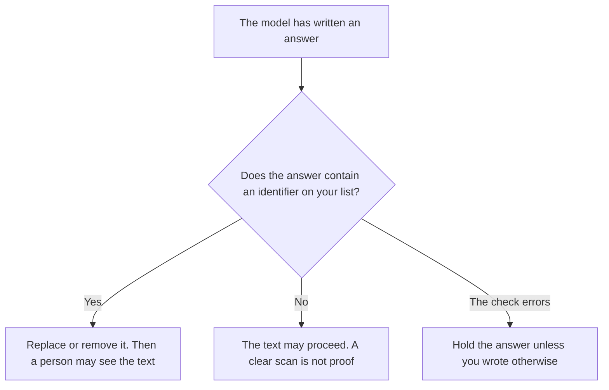

**AI output PII redaction is the step that removes or masks personal identifiers in text the model already wrote, before that text is shown, sent, logged, or pasted into a ticket.** The identifier list is yours: a name with an account, an email, a phone number, a government id, a precise address. The model does not decide the list. An answer that still contains a listed identifier has not left the step.

Checking the answer for those identifiers, without removing them, is [what an AI output PII scan is](/blog/what-is-ai-output-pii-scan-2026/). Removing identifiers before the prompt leaves your side is [what AI PII redaction is](/blog/what-is-ai-pii-redaction-2026/). A mask for any item on a list you wrote, including secrets that are not personal data, is [what an AI output redaction pass is](/blog/what-is-ai-output-redaction-pass-2026/). This page is personal identifiers, on the way out.

Claude's prices are the October 24, 2026 read of claude.com/pricing recorded in [Claude pricing explained](/blog/claude-pricing-explained-2026/). ChatGPT's Plus price is the October 24 plan-page figure recorded in [ChatGPT pricing explained](/blog/chatgpt-pricing-explained-2026/). Notion and Grammarly prices are from directory pages checked October 16, 2026. A live fetch of Grammarly's plans URL returned HTTP 401 on October 24, as the Grammarly pricing article records. Published October 24, 2026. We did not measure detection. The directory does not list an output-redaction fee.

## What the step is allowed to change

| Field | Who writes it | The step may |
|---|---|---|
| The identifier types | You | Mask or remove only those types |
| The replacement | You: a token such as [email], or delete | Use that replacement. It may not invent a fake address |
| Where the original is kept, if anywhere | You, or Original not stored | Keep it only where you said |
| What happens if the check errors | You, and the default is hold | Show the raw answer only if you wrote that |
| Who may see the original | You | Copy the name. It may not widen the audience |

The inbound redaction keeps an email out of the prompt. The output step catches an email the model produced anyway, from memory or from a tool result. You want both when the answer can leave the building. A scan that flags the email and still displays it has not redacted anything. Redaction is the change to the text.

A general redaction pass can also mask API keys and internal hostnames. Those may sit on the same pipeline. This page does not call a hostname personal data. If your policy lists it, put it on the list in writing. The model does not promote it.

## Where the step runs

**The draft a person will read.** [Claude](/tools/claude/) Pro is $17 a month billed annually, $200 up front, or $20 monthly. The Project can say: if the answer contains an email, replace it and do not store the original in the chat you will share. The review is [Claude review](/blog/claude-review-2026/).

**One answer you will paste onward.** [ChatGPT](/tools/chatgpt/) Plus is $20 a month. Paste the identifier types. Discard a version that replaces a real email with a made-up one. The ladder is [ChatGPT pricing explained](/blog/chatgpt-pricing-explained-2026/).

**The page that might outlive the chat.** [Notion AI](/tools/notion-ai/) Business is $20 a seat a month on the October 16 card. The redacted text is what gets pasted. The original stays in the system you named, or it is not kept. The invoice is [Notion AI pricing explained](/blog/notion-ai-pricing-explained-2026/).

**The sentence that leaves the company.** [Grammarly](/tools/grammarly/) Pro is $12 a member a month billed annually, or $30 monthly, on the October 16 card. It can edit tone. It is not the redaction step. Run redaction before the external sentence. The invoice is [Grammarly pricing explained](/blog/grammarly-pricing-explained-2026/).

A prompt that holds the line:

"Redact the identifier types I listed from the answer I pasted. Use the replacement I wrote. If a type is not on my list, leave it. If you are unsure, write Held, do not guess. Do not invent a replacement address or name."

## What not to delegate

Do not ask the model which fields "count as PII" for your company. Do not accept a fake phone number in place of a mask. Do not show the raw answer because the scan failed. The owner of the list writes the types and the replacement.

## FAQ

### How is this different from an output PII scan?

The scan looks and reports. Redaction changes the text. A scan can be the check that triggers this step. A report that says "email found" is not a redacted answer.

### How is this different from PII redaction on the way in?

Inbound redaction runs before the prompt is sent or logged. Output redaction runs after the model writes. A clean prompt can still produce an identifier. The outbound step is what stands between that answer and a reader.

### How is this different from an output redaction pass?

The pass is the general mask for a list you wrote, which might include secrets and internal names. This page is the personal-identifier case of that idea. Use the pass page when the list is wider than personal data. Use this page when the policy is about people.

### Who may see the original?

Only the person or system you named. If you wrote Original not stored, the original is not kept in the chat, the ticket, or the log. A model that "remembers it for later" has widened the audience.

## Last verified

October 24, 2026 for Claude and for ChatGPT's plan page, via the posts cited above. October 16, 2026 for Notion and Grammarly. Published October 24, 2026. Grammarly's plans URL returned HTTP 401 on October 24. No output-redaction fee is recorded in the directory.

**Sources:** [Claude pricing](https://claude.com/pricing), [ChatGPT and Codex pricing](https://learn.chatgpt.com/docs/pricing), [Notion pricing](https://www.notion.com/pricing), [Grammarly pricing](https://www.grammarly.com/plans).

*Published by Andrew for [AI Tools Optimizer](https://aitoolsoptimizer.com).*

[Claude](/tools/claude/) is in the [chatbots and assistants directory](/tools/category/chatbots-assistants/). Directory pages may use affiliate links. A purchase through them may earn us a commission at no extra cost to you.
