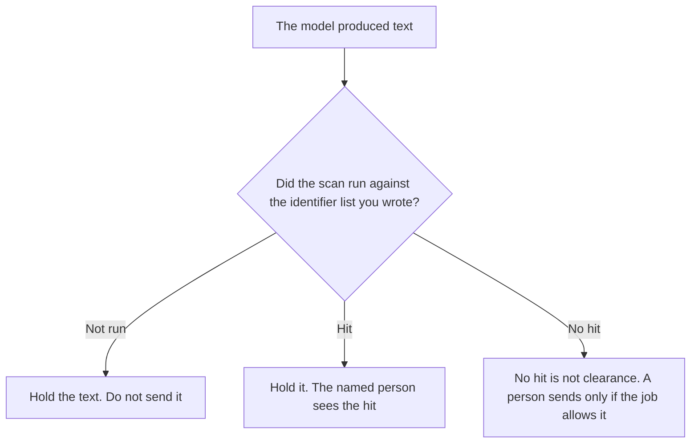

**An AI output PII scan is a check on text the model already produced, before that text is shown, sent, or logged, looking for identifiers a person listed.** Removing identifiers before a prompt leaves is [what AI PII redaction is](/blog/what-is-ai-pii-redaction-2026/). A named check that must return allow before an output is shown is [what an AI safety classifier gate is](/blog/what-is-ai-safety-classifier-gate-2026/). The scan can be one input to that gate. Stripping a secret from text you will still show is [what an AI output redaction pass is](/blog/what-is-ai-output-redaction-pass-2026/).

This page does not claim a detection rate. We did not run a scanner. A scan that finds nothing is not proof the text is clear. The identifier list is yours.

Claude's prices are the October 24, 2026 read of claude.com/pricing recorded in [Claude pricing explained](/blog/claude-pricing-explained-2026/). ChatGPT's Plus price is the same-day plan-page figure recorded in [ChatGPT pricing explained](/blog/chatgpt-pricing-explained-2026/). Notion and Grammarly prices are from directory pages checked October 16, 2026. Published October 24, 2026. The directory does not list a PII-scan fee.

## What the scan is allowed to use

| Line | Who writes it | A blank means |
|---|---|---|
| Identifier types | You | The scan looks for a shape you never named |
| What happens on a hit | You: hold, or redact, or both | A hit still gets emailed |
| What a miss means | You, in writing | A clear scan is treated as permission to send |
| Who sees the raw hit | A person you named | The identifier lands in a wider log |
| Scanner version | You | Last month's result is compared with a new list |

The list can include an email, a phone number, a government id, a precise address, or an account id paired with a name. If a type is not on the list, the scan was not asked to find it. Add the type in a new version. Do not widen the list inside the same run because the output looked sensitive.

Redaction on the way in can still leave an identifier the model reconstructed or copied from a document. That is why the output has its own scan. The input redaction does not retire this check.

## Where the list is kept

**The identifier list and the hold rule.** [Claude](/tools/claude/) Pro is $17 a month billed annually, $200 up front, or $20 monthly. The Project holds the types so a later prompt does not drop one. The review is [Claude review](/blog/claude-review-2026/).

**One draft you are about to send.** [ChatGPT](/tools/chatgpt/) Plus is $20 a month. Paste the list with the draft. Discard a version that says the text is "clean." The ladder is [ChatGPT pricing explained](/blog/chatgpt-pricing-explained-2026/).

**The register of hits.** [Notion AI](/tools/notion-ai/) Business is $20 a seat a month. Store the scanner version and the reason. Do not paste the raw identifier into a page a wide group can open. The invoice is [Notion AI pricing explained](/blog/notion-ai-pricing-explained-2026/).

**A clarity pass that must not touch the hold.** [Grammarly](/tools/grammarly/) Pro is $12 a member a month billed annually, or $30 monthly, on the October 16 card. Run it only after the scan and the hold are decided. The invoice is [Grammarly pricing explained](/blog/grammarly-pricing-explained-2026/).

A prompt that holds the line:

"Compare this output with the identifier types I pasted. If a type matches, write Hit and quote the type, not a new copy of the value if I told you to mask it. If none match, write No hit on this list. Do not say the text is safe to send."

## What not to delegate

Do not ask the model whether the text is "anonymous enough." Do not skip the scan because the prompt was redacted. Do not log the raw hit in a channel the whole company reads. The owner of the list decides what a hit does. No hit is not a send decision.

## FAQ

### How is this different from PII redaction?

Redaction masks or removes identifiers before the prompt is sent or a log is stored. The scan looks at the model's output before that output is shown or sent. You can redact on the way in and still scan on the way out. One does not replace the other. A reconstructed email in the answer is an output problem.

### How is this different from a safety classifier gate?

The gate holds an output until a named classifier returns allow. The scan is one check you can feed that gate: did the identifier list match? A gate can block for other reasons. A scan can hit and still need a person. Do not treat a scan result as the whole gate.

### How is this different from an output redaction pass?

The redaction pass strips a secret from text you still intend to show. The scan decides whether a listed identifier is present and what you do on a hit, which may be to hold the text instead of showing a stripped copy. If the rule is hold, do not redact and send in the same step.

### Does no hit mean the text is safe?

No. It means this scanner version did not match the types you listed. A type you forgot is still in the text. A person sends the text only when the job allows it. We did not measure how often a scan misses.

## Last verified

October 24, 2026 for Claude and for ChatGPT's plan page, via the posts cited above. October 16, 2026 for Notion and Grammarly. Published October 24, 2026.

**Sources:** [Claude pricing](https://claude.com/pricing), [ChatGPT and Codex pricing](https://learn.chatgpt.com/docs/pricing), [Notion pricing](https://www.notion.com/pricing), [Grammarly pricing](https://www.grammarly.com/plans).

*Published by Andrew for [AI Tools Optimizer](https://aitoolsoptimizer.com).*

[Claude](/tools/claude/) is in the [chatbots and assistants directory](/tools/category/chatbots-assistants/). Directory pages may use affiliate links. A purchase through them may earn us a commission at no extra cost to you.
