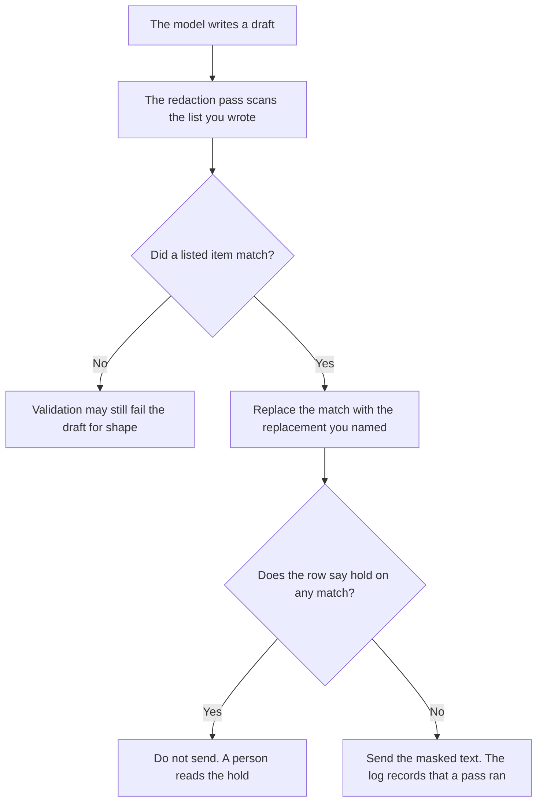

**An AI output redaction pass is a step after the model writes and before a person or another system sees the text.** It removes or masks items on a list you already wrote: a customer id pattern, a secret format, a name your policy forbids in this channel. The model does not decide the list. A confident answer that still contains a forbidden token has not finished.

Stripping an identifier before the prompt leaves your side is [what AI PII redaction is](/blog/what-is-ai-pii-redaction-2026/). The gate that checks shape and required fields is [what AI output validation is](/blog/what-is-ai-output-validation-2026/). The fields you require are [what an AI output schema is](/blog/what-is-ai-output-schema-2026/). A mark on the file, visible or not, is [what an AI output watermark is](/blog/what-is-ai-output-watermark-2026/).

Claude's prices are from claude.com/pricing on October 24, 2026. ChatGPT Plus is $20 a month on learn.chatgpt.com/docs/pricing that day. Notion and Grammarly prices are from directory pages checked October 16, 2026. Published October 24, 2026. We did not score detectors. The directory does not list a redaction-pass fee.

## What the pass is allowed to touch

| Piece | Who writes it | The pass may |
|---|---|---|
| The list of patterns or exact strings | You | Mask a match. It may not add a pattern because the text "looks sensitive" |
| The replacement | You: a token such as REDACTED, or a deletion | Copy it. It may not invent a plausible substitute |
| Where it runs | You: before send, before log, or both | Skip a stage you did not name |
| What a match does to the send | You: send the masked text, or hold | Hold if the row says hold. Do not send and apologize later |

Input redaction and this pass are not substitutes. A prompt can be clean and the answer can still echo a secret the model saw in a tool result. Run the pass on the text that will leave, including tool output you are about to show.

## Where it is defined

**The list.** [Claude](/tools/claude/) Pro is $17 a month billed annually, $200 up front, or $20 monthly. The Project holds the patterns and the replacement. The review is [Claude review](/blog/claude-review-2026/).

**One draft of the pass note from fields you paste.** [ChatGPT](/tools/chatgpt/) Plus is $20 a month. Discard a pattern you did not paste. The ladder is [ChatGPT pricing explained](/blog/chatgpt-pricing-explained-2026/).

**The register.** [Notion AI](/tools/notion-ai/) Business is $20 a seat a month. Pattern, replacement, channel, owner. The invoice is [Notion AI pricing explained](/blog/notion-ai-pricing-explained-2026/).

**A clarity pass on the note that explains the hold.** [Grammarly](/tools/grammarly/) Pro is $12 a member a month billed annually, or $30 monthly, on the October 16 card. It must not rewrite a pattern into an example that contains a real value. The invoice is [Grammarly pricing explained](/blog/grammarly-pricing-explained-2026/).

A prompt that holds the line:

"Describe the output redaction pass from the patterns, the replacement, and the hold rule I pasted. If the replacement is missing, write Replacement not set. Do not add a pattern. Do not include a realistic example of the secret."

## What not to delegate

Do not ask the model to "find anything sensitive" and treat that as the list. Do not put a live secret in the prompt so the pass can be demonstrated. Do not skip the pass because validation passed. Shape and secrets are different checks.

## FAQ

### How is this different from PII redaction?

PII redaction on this site is the strip before the prompt leaves. The output pass runs after the model writes. You can need both. A clean prompt does not guarantee a clean answer when tools return raw records.

### How is this different from output validation?

Validation checks the shape you required: fields present, enums allowed, a refusal when you asked for one. Redaction checks for listed secrets and identifiers. A valid JSON object can still contain a customer id. Run the pass even when the schema matches.

### How is this different from a watermark?

A watermark marks the file as machine-written or as belonging to a system. Redaction removes content. A watermarked leak is still a leak. Do not treat a mark as a mask.

### Who may shrink the pattern list?

The owner of the pass, with the reason. A false hold is a reason to look at the pattern. It is not a reason to delete the list in the incident channel. If a pattern was wrong, retire it with a date and keep the text of the rule the old runs used.

## Last verified

October 24, 2026 for Claude and for ChatGPT's plan page. October 16, 2026 for Notion and Grammarly. Published October 24, 2026.

**Sources:** [Claude pricing](https://claude.com/pricing), [ChatGPT and Codex pricing](https://learn.chatgpt.com/docs/pricing), [Notion pricing](https://www.notion.com/pricing), [Grammarly pricing](https://www.grammarly.com/plans).

*Published by Andrew for [AI Tools Optimizer](https://aitoolsoptimizer.com).*

[Claude](/tools/claude/) is in the [chatbots and assistants directory](/tools/category/chatbots-assistants/). Directory pages may use affiliate links. A purchase through them may earn us a commission at no extra cost to you.
