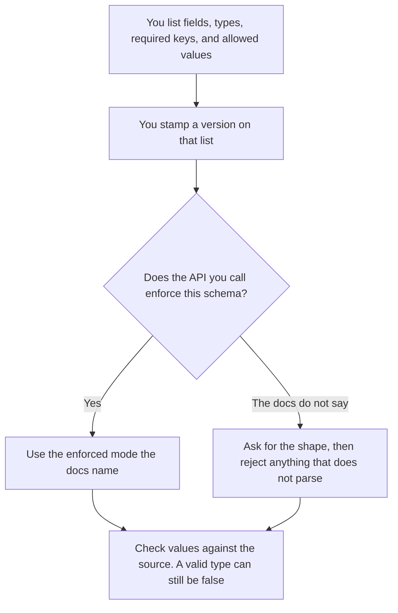

**An AI output schema is the list of fields, types, and required keys you want a model answer to follow.** It is the contract. Structured output is a product mode that tries to enforce a contract. A prompt that says "reply in JSON" is neither. The model can still add a sentence, drop a key, or invent a value that happens to have the right type.

The enforcement mode is [what structured output is](/blog/what-is-structured-outputs-2026/). Calling a tool with arguments is [what function calling is](/blog/what-is-function-calling-in-ai-2026/). A value that fits the type and is still false is [what an AI hallucination is](/blog/what-is-ai-hallucination-2026/). The pieces being constrained are still [tokens](/blog/what-are-ai-tokens-explained-2026/).

Prices are US list prices excluding tax from directory pages checked October 16, 2026. Published October 24, 2026. This page does not name an API parameter. Read the card you will call.

## What you write in the contract

| Line | What you put on it | What the model still must not do |
|---|---|---|
| Field name | A name the next system already uses, such as `owner` | Rename it to something friendlier |
| Type | String, number, boolean, or a list of those | Put a sentence in a number field |
| Required | The keys that must appear | Omit `owner` and hope a person notices |
| Enum | The only values allowed, such as `open` or `closed` | Add a third status to be helpful |
| Version | The schema version this job uses | Quietly follow last year's field list |

Write the schema before the prompt. If you cannot name the fields, you do not have a contract. You have a wish that the answer be tidy. The next system, a sheet or a workflow, will guess. Guessing is how a missing owner becomes a name the model made up.

## Where the schema meets a product

**A chat that might enforce it.** [ChatGPT](/tools/chatgpt/) Plus is $20 a month. [Claude](/tools/claude/) Pro is $20 a month, or $17 billed annually. A Project or a custom instruction can hold the field list so you do not re-paste it. Holding the list is not the same as an API that rejects a bad shape. If you are in a chat window, validate the paste before a workflow consumes it. The reviews are [ChatGPT review](/blog/chatgpt-review-2026/) and [Claude review](/blog/claude-review-2026/).

**A workflow with fixed fields.** [Zapier](/tools/zapier/) Professional is $19.99 a month billed annually, for 750 tasks, on the October 16 card. Free is 100 tasks a month. [Make](/tools/make/) Core starts at $9 a month billed annually for 10,000 credits. Free is 1,000 credits a month. Both map fields you name. They do not know that `revenue` was invented upstream. Validate, then map. A mapped hallucination is still a hallucination, now inside the system of record.

An enum is the kindest line you can write. If status is only `open` or `closed`, say so. "Be concise" does not constrain status. The model will invent `pending review` because it sounds plausible.

## What the schema should refuse to be

It should refuse to be the prompt. The prompt can point at schema version 3. The schema is the versioned list, stored where a change is reviewed. Editing the field list inside a chat and forgetting to update the parser is how production breaks on a Tuesday.

It should also refuse to fill unknowns. Required means the field must be present. It does not mean the model must know the value. Use a literal such as `unknown` that your parser treats as missing, and only if you added that literal to the enum on purpose. A required number with no source should fail the job, not receive a zero.

## FAQ

### Is the schema the same as structured output?

The schema is the contract you wrote. Structured output is one way a vendor tries to make the model follow it. You can have a schema and only a prompt. You can turn on a vendor mode and still forget to check that the values are true. Keep both pages. This one is the list. Theirs is the enforcement.

### How many fields is too many?

Enough that a person can say what each one means. A schema that mirrors a 200-column export will be filled with blanks the model completes. Start with the fields the next system actually reads.

### Do we version it?

Yes, once anything downstream parses it. Adding a field is a version. Renaming a field is a version. A silent rename is an outage. The old job should keep accepting the old version until you move it on purpose.

### Can the schema include a prose summary?

Yes, as one string field, clearly optional or required. Do not hide five facts inside that paragraph if the next step needed them as fields. If you needed them as fields, they are fields.

## Last verified

October 16, 2026 for ChatGPT, Claude, Zapier, and Make. Published October 24, 2026.

**Sources:** [ChatGPT pricing](https://chatgpt.com/pricing/), [Claude pricing](https://claude.com/pricing), [Zapier pricing](https://zapier.com/pricing), [Make pricing](https://www.make.com/en/pricing).

*Published by Andrew for [AI Tools Optimizer](https://aitoolsoptimizer.com).*

[Zapier](/tools/zapier/) is in the [automation and agents directory](/tools/category/automation-agents/). Directory pages may use affiliate links. A purchase through them may earn us a commission at no extra cost to you.
