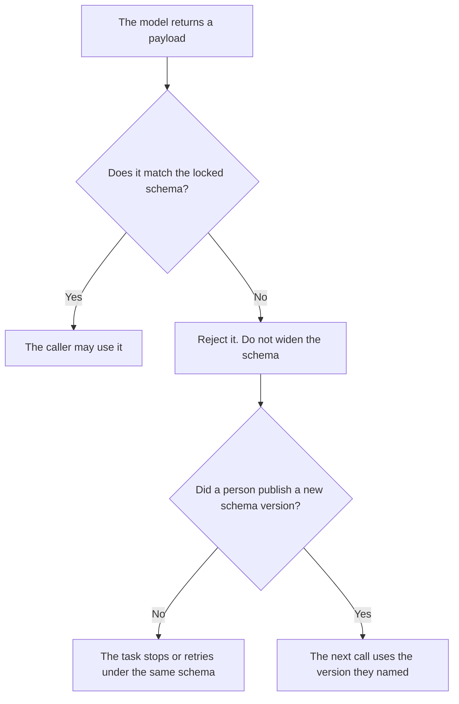

**An AI output schema lock is a rule that refuses to ship a model response unless it matches a schema a person already accepted, and refuses to widen that schema because the response did not fit.** The shape itself is [what an AI output schema is](/blog/what-is-ai-output-schema-2026/). Checking the fields after the fact is [what AI output validation is](/blog/what-is-ai-output-validation-2026/). Asking the model to emit JSON at all is [what structured outputs are](/blog/what-is-structured-outputs-2026/). A lock is the part that fails closed.

Claude's prices are from claude.com/pricing on October 24, 2026. ChatGPT's seat price is the October 24 Codex plan page recorded in [ChatGPT pricing explained](/blog/chatgpt-pricing-explained-2026/). Cursor and Notion prices are from directory pages checked October 16, 2026. Published October 24, 2026. We did not score how often models obey a schema.

## What the lock is allowed to do

| Event | The lock does | The lock does not do |
|---|---|---|
| A required field is missing | Reject the response | Fill the field with a guess |
| A field has the wrong type | Reject the response | Coerce a sentence into a number |
| The model wants a new field | Keep the old schema | Add the field because it "looks useful" |
| A person changes the schema | Accept the new version they named | Treat a chat suggestion as the new version |

A schema that "usually" matches is not locked. A lock has a version, an owner, and a fail path. If the fail path is "let the model repair the JSON by adding keys," you do not have a lock. You have a second schema nobody reviewed. The extraction that fills those keys from a document you pasted is [what AI structured extraction is](/blog/what-is-ai-structured-extraction-2026/). Extraction can propose values. The lock decides whether the payload is allowed to leave.

## Where you keep the version

**The contract in a Project.** [Claude](/tools/claude/) Pro is $17 a month with annual billing, $200 up front, or $20 monthly, on the October 24 page. Put the schema at the top of the Project. A response that adds a key is a failed draft, not a better draft. The review is [Claude review](/blog/claude-review-2026/).

**One payload, from a paste.** [ChatGPT](/tools/chatgpt/) Plus is $20 a month on the October 24 plan page. Ask it to emit the object. If a key is missing, the draft says the key is missing. Plus does not sit in your API and reject traffic.

**The code that enforces it.** [Cursor](/tools/cursor/) Plus is $8 a month, or $80 a year, on the October 16 card. The editor can show you the check. You still read the diff. The ladder is [Cursor pricing explained](/blog/cursor-pricing-explained-2026/).

**The page that names the version.** [Notion AI](/tools/notion-ai/) Business is $20 a seat a month if that is where the schema changelog lives. Plus at $10 is not the full AI tier on that card. The chat is not the lock.

A prompt that holds the line:

"Return only the fields in the schema I pasted. If a value is not in the source, write null for that field. Do not add a field. Do not rename a field."

## What not to delegate

Do not let a model version the schema because a call failed. Do not turn a lock off "for the demo" and leave it off. Do not describe a prompt that says "use JSON" as a lock. A prompt is a request. A lock is a reject.

## FAQ

### How is a lock different from validation?

Validation reports that a payload failed. A lock is the decision to refuse shipment, and to refuse a silent schema change, when validation fails. You can validate in a log and still store the bad payload. That is not a lock.

### How is a lock different from structured output mode?

Structured output mode asks the provider to constrain decoding. A lock is your rule about what you will accept, including after a provider changes the mode. If the provider's mode and your schema disagree, your reject path still runs.

### Who may change the schema?

The owner named on the version. A failed call is evidence that something did not fit. It is not a signature on a wider contract.

### What if the source really has a new field?

A person adds the field to the schema, names the version, and then the next call may emit it. The model does not get to ship the new field on the call that discovered it.

## Last verified

October 24, 2026 for Claude and for the ChatGPT seat price recorded from the Codex plan page. October 16, 2026 for Cursor and Notion. No schema-lock fee is recorded in the directory. Published October 24, 2026.

**Sources:** [Claude pricing](https://claude.com/pricing), [ChatGPT and Codex pricing](https://learn.chatgpt.com/docs/pricing), [Cursor pricing](https://cursor.com/help/account-and-billing/pricing), [Notion pricing](https://www.notion.com/pricing).

*Published by Andrew for [AI Tools Optimizer](https://aitoolsoptimizer.com).*

[Claude](/tools/claude/) is in the [chatbots and assistants directory](/tools/category/chatbots-assistants/). Directory pages may use affiliate links. A purchase through them may earn us a commission at no extra cost to you.
