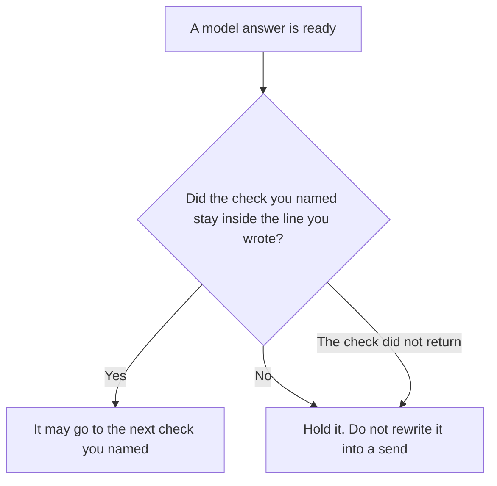

**An AI output toxicity gate holds a model answer when a check a person named crosses a line that person wrote, for categories that person listed.** If the check does not return, the answer stays held. The categories and the line are the gate. A general rule that any named classifier must return allow is [what an AI safety classifier gate is](/blog/what-is-ai-safety-classifier-gate-2026/). This page is one class of check: harmful content you defined. It does not decide the container, and it does not strip personal data.

The container you allowed is [what an AI output format gate is](/blog/what-is-ai-output-format-gate-2026/). A scan for personal data is [what an AI output PII scan is](/blog/what-is-ai-output-pii-scan-2026/). Those can run on the same answer. A format pass is not a toxicity pass.

Claude's prices are the October 24, 2026 read of claude.com/pricing recorded in [Claude pricing explained](/blog/claude-pricing-explained-2026/). ChatGPT's Plus price is the October 24 plan-page figure recorded in [ChatGPT pricing explained](/blog/chatgpt-pricing-explained-2026/). Notion and Grammarly prices are from directory pages checked October 16, 2026. A live fetch of Grammarly's plans URL returned HTTP 401 on October 24, as the Business pricing article records. Published October 24, 2026. We did not measure toxicity. We did not publish a score for any model. The directory does not list a toxicity-gate fee.

## What the gate has to say

| Line | Who writes it | A blank means |
|---|---|---|
| The categories | You | "Toxic" means whatever the model feels |
| The check | You name it | A second model freelances a judgment |
| The line that holds | You: a label, or a number you defined | The answer is shown because it "seems fine" |
| What hold looks like | You: hold, or hold and notify | The answer is rewritten and sent |
| Who may release a hold | A person | The model talks itself through |

A rewrite that softens an insult and then sends the text has skipped the hold. The gate's job is to stop the send. A person releases it, or they do not. Grammarly may later fix a comma on text a person has already accepted. It is not the gate.

If you did not list the categories, you do not have this gate. Harassment, threats, or sexual content involving minors are not a style preference. This page does not tell you to generate those categories so you can test the gate. The owner names the categories the product must hold. The model does not invent a new category in the answer and then clear itself.

## Where the rule is written

**The definition.** [Claude](/tools/claude/) Pro is $17 a month billed annually, $200 up front, or $20 monthly. A Project can hold the categories and the line so a later edit does not replace them with "be appropriate." The review is [Claude review](/blog/claude-review-2026/).

**One statement of the line.** [ChatGPT](/tools/chatgpt/) Plus is $20 a month. Discard a draft that adds a category you did not paste, or that sets a numeric line you did not write. The ladder is [ChatGPT pricing explained](/blog/chatgpt-pricing-explained-2026/).

**The page that records a hold.** [Notion AI](/tools/notion-ai/) Business is $20 a seat a month. The row is the answer id, the category, the line, and who may release it. Plus at $10 is not the full AI tier. The invoice is [Notion AI pricing explained](/blog/notion-ai-pricing-explained-2026/).

**A clarity pass after a person releases text.** [Grammarly](/tools/grammarly/) Pro is $12 a member a month billed annually, or $30 monthly, on the October 16 card. It does not clear a hold. The invoice is [Grammarly pricing explained](/blog/grammarly-pricing-explained-2026/).

A prompt that holds the line:

"Restate the toxicity gate from the categories and the hold line I pasted. If either is missing, write Gate not set. Do not add a category. Do not invent a score. Do not release a held answer."

## What not to delegate

Do not ask the model whether an answer is "toxic enough" with no line. Do not let it rewrite and send. Do not treat a format check, or a PII scan, as this gate. Do not publish a toxicity number this page did not measure.

## FAQ

### How is this different from a safety classifier gate?

The safety classifier gate is the pattern: a named classifier must return allow, or the output stays held. The toxicity gate is one use of that pattern, for the harmful-content categories and the line you wrote. A classifier that checks something else, such as a tool permission, is not this page. Use the classifier page for the pattern. Use this page for the toxicity line.

### How is this different from a format gate?

The format gate asks whether the container is JSON, a table, CSV, or prose you allowed. The toxicity gate asks whether the content crossed a line you wrote. A clean JSON object can still be held. A polite paragraph can still be the wrong container. Run the check you named for each.

### Does a vendor safety filter replace the line?

Only if you have written that the vendor's filter is the check, and you have written what hold means when it trips. "The model is safe" is not a line. If the vendor does not return a result, the answer stays held, unless your rule says otherwise in writing.

### Who may release a hold?

The person named on the gate. A second draft that avoids the words is not a release. The original answer stays held until that person says otherwise.

## Last verified

October 24, 2026 for Claude and for ChatGPT's plan page, via the posts cited above. October 16, 2026 for Notion and Grammarly. Published October 24, 2026. Grammarly's plans URL returned HTTP 401 on October 24. No toxicity score was measured for this article.

**Sources:** [Claude pricing](https://claude.com/pricing), [ChatGPT and Codex pricing](https://learn.chatgpt.com/docs/pricing), [Notion pricing](https://www.notion.com/pricing), [Grammarly pricing](https://www.grammarly.com/plans).

*Published by Andrew for [AI Tools Optimizer](https://aitoolsoptimizer.com).*

[Claude](/tools/claude/) is in the [chatbots and assistants directory](/tools/category/chatbots-assistants/). Directory pages may use affiliate links. A purchase through them may earn us a commission at no extra cost to you.
