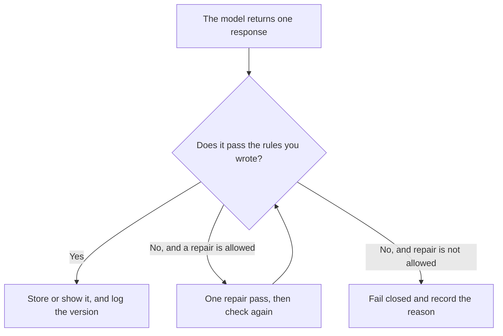

**AI output validation is a check you run on one model response, against rules you already wrote, before that response is stored, shown, or allowed to trigger a tool.** The fields you require are [what an AI output schema is](/blog/what-is-ai-output-schema-2026/). The mode that makes a model emit that shape is [what structured output is](/blog/what-is-structured-outputs-2026/). Whether a source you supplied supports a sentence is [what AI groundedness is](/blog/what-is-ai-groundedness-2026/). Validation is the gate on this response: pass, fail, or a named repair. It is not a score for the model in general.

The frozen rows you re-run on purpose are [what an AI eval dataset is](/blog/what-is-ai-eval-dataset-2026/). The check that sits in front of an action is [what AI guardrails are](/blog/what-is-ai-guardrails-2026/). A confident sentence with nothing behind it is [what an AI hallucination is](/blog/what-is-ai-hallucination-2026/).

Prices are US list prices excluding tax from directory pages checked October 16, 2026. A live fetch of vendor pricing pages returned HTTP 401 on October 24, 2026, so this page stays on the directory record. Published October 24, 2026. We did not measure how often any validator catches a bad answer.

## What the gate can check

| Check | A pass | A fail |
|---|---|---|
| Required fields | Every field you named is present and the type matches | A missing field, or a string where you required a number |
| Allowed values | The status is one of the labels you listed | A new label the model invented |
| Citations | Each claim points at a source id you passed in | A sentence with no source id |
| Limits | Length, item count, and currency stay inside the bounds | A 2,000-word answer where you allowed 120 words |
| Forbidden content | The text does not contain the phrases or data classes you banned | A customer secret, or a promise you did not authorize |
| Tool permission | The proposed action is on the allow list | A refund, an email, or a delete you did not list |

A validator that "fixes" a response by filling a missing price has become a second model. The repair pass may only do what the rule says: delete the extra sentence, or mark the field Missing. It may not invent the value. The person who must see a failed case before it counts is [what human-in-the-loop AI is](/blog/what-is-human-in-the-loop-ai-2026/).

## Where people actually run the check

**The rule list.** [Claude](/tools/claude/) Pro is $20 a month, or $17 billed annually, when the rules live in a Project next to two passing examples and one failing example. The seat does not enforce the schema. Your gate does. The review is [Claude review](/blog/claude-review-2026/).

**A saved check you paste into.** [ChatGPT](/tools/chatgpt/) Plus is $20 a month when the habit is a project that reads "check this JSON against these fields." Plus is the seat for that habit. Pro, from $100 a month, is a different bill. The review is [ChatGPT review](/blog/chatgpt-review-2026/).

**The action after a pass.** [Zapier](/tools/zapier/) Professional is $19.99 a month billed annually. A zap that writes the CRM should run only after the gate passes. A zap that writes first and checks later has already acted. Filters do not count as tasks. The invoice is [Zapier pricing explained](/blog/zapier-pricing-explained-2026/).

**The record of fails.** [Notion AI](/tools/notion-ai/) Business is $20 a seat a month when the team needs a page of failed responses with the rule that fired. Plus at $10 is not the full AI seat. The page needs an owner either way.

A prompt that holds the line:

"Check this response against the rules I pasted. Reply with pass or fail, the rule id, and the field. Do not rewrite the response. Do not fill a missing value. If a rule is ambiguous, write Rule unclear and stop."

## What not to treat as validation

Do not call a careful reading by the same model "validation" and then auto-send. Do not turn a failure into a silent success by loosening the rule after the fact. Do not score the model. A pass means this response met these rules. It does not mean the answer is true, kind, or ready for a customer. Truth against a source is the groundedness check. The gate and the source check can both be required. They are two lines on the log.

## FAQ

### Is validation the same as an output schema?

The schema is the shape. Validation is the decision to accept or reject a response against that shape and any other rules you added, such as an allow list or a ban on unsourced numbers. A response can match the types and still fail a citation rule.

### How many repair passes are allowed?

The number you wrote down. One is a common cap. A loop that repairs until the text looks fine will spend the retry you did not budget. The cap on tries is [what an AI retry budget is](/blog/what-is-ai-retry-budget-2026/).

### Can a chat window be the validator?

A chat can show you the fail. It cannot stop a downstream system unless that system refuses to run without a pass. Paste-and-hope is a review. A gate is code or a workflow that will not proceed on fail.

### Who changes the rules?

The owner named on the rule list. A failure that surprises you is a reason to edit the rule in the open, with a date. It is not a reason for the model to invent a softer rule in the same response.

## Last verified

October 16, 2026 for Claude, ChatGPT, Zapier, and Notion AI. Published October 24, 2026. Live pricing fetches returned HTTP 401 that day.

**Sources:** [Claude pricing](https://claude.com/pricing), [ChatGPT pricing](https://chatgpt.com/pricing/), [Zapier pricing](https://zapier.com/blog/zapier-pricing/), [Notion pricing](https://www.notion.com/pricing).

*Published by Andrew for [AI Tools Optimizer](https://aitoolsoptimizer.com).*

[Zapier](/tools/zapier/) is in the [automation and agents directory](/tools/category/automation-agents/). Directory pages may use affiliate links. A purchase through them may earn us a commission at no extra cost to you.
