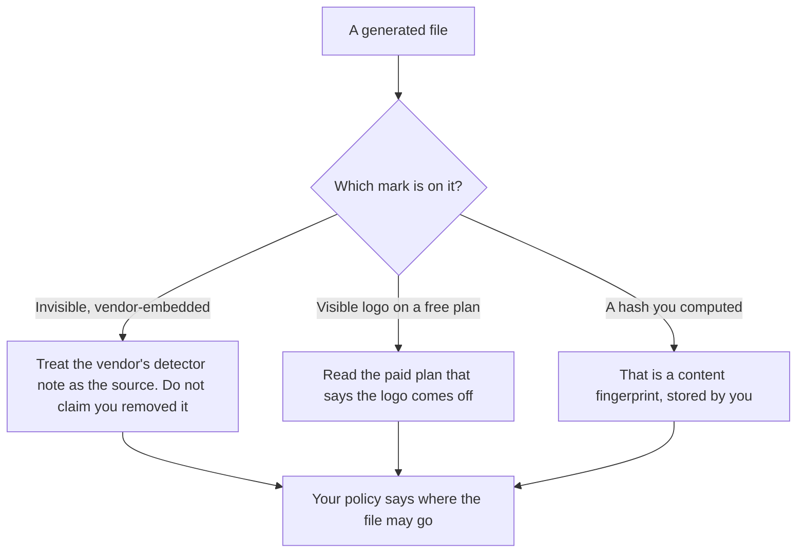

**An AI output watermark is a mark the producer attaches to a generated image, video, or audio so a later reader can tell the file was generated, or which product generated it.** The mark can be invisible, embedded in the file, or visible, like a logo in the corner. Removing a logo by paying for a plan is a licensing choice the vendor published. Stripping an embedded mark so a file looks ungenerated is a different act, and this page does not provide a way to do it.

A fingerprint you compute on a file you already have is [what an AI content fingerprint is](/blog/what-is-ai-content-fingerprint-2026/). A check that the answer matches a schema is [what AI output validation is](/blog/what-is-ai-output-validation-2026/). The image bill after DALL·E left the API is [DALL·E pricing explained](/blog/dall-e-pricing-explained-2026/).

Gemini Notebook's watermark language below is from Google's help page on October 24, 2026. HeyGen and Synthesia plan stickers are from their pricing pages the same day. ChatGPT's seat prices are from the directory page checked October 16, 2026, because chatgpt.com/pricing returned HTTP 403. Published October 24, 2026. We did not test whether a mark survives a screenshot, a crop, or a re-encode.

## Two marks people mix up

| Mark | What a reader can see | What this page will say |
|---|---|---|
| An invisible watermark, such as SynthID on the models Gemini Notebook names | Nothing, unless a detector the vendor documents can read it | The October 24 help page says Veo, Omni, and Nano Banana outputs in Gemini Notebook include it |
| A visible watermark on a generated image or video | A mark on the picture | The same help page says one is added, and that Pro and Ultra have a toggle, with a forced visible mark in India, South Korea, and Vietnam |
| A product logo on a free video plan | The vendor's name on the clip | HeyGen Free and Synthesia Basic describe a watermark. Paid rows describe removing it |
| A hash you store | Whatever you print next to the file | That is a content fingerprint. It is your record, not the vendor's mark |

Google's Gemini Notebook help page, fetched October 24, 2026, says all outputs generated there with Veo, Omni, or Nano Banana include invisible SynthID watermarks, and that a visible watermark is also added to generated images and videos. It says eligible Google One AI Pro and Ultra subscribers can control the visible mark with a "Visible watermarking" toggle, and that a visible watermark is applied automatically for residents of India, South Korea, or Vietnam. This page does not extend that sentence to other Google products the help page did not name.

## Where you meet the mark

**A research notebook.** [Gemini Notebook](/tools/gemini-notebook/) is free with a Google account. Higher limits follow Google AI plans. On October 24, 2026, Google AI Plus was $4.99 a month, Pro was $19.99, and Ultra started at $99.99 or $199.99, on gemini.google/subscriptions. The notebook caps are [Gemini Notebook pricing explained](/blog/gemini-notebook-pricing-explained-2026/).

**A free avatar test.** [HeyGen](/tools/heygen/) Free is $0, with 3 videos a month, watermarked, up to 1 minute, on the October 24 pricing page. Creator is $29 a month and lists 1080p and removal of HeyGen branding. The invoice is [HeyGen pricing explained](/blog/heygen-pricing-explained-2026/).

**A free lesson test.** [Synthesia](/tools/synthesia/) Basic is $0, with a watermark, 10 minutes, and 500 credits a month, on the October 24 page. Starter is $29 a month billed monthly and lists logo removal. The invoice is [Synthesia pricing explained](/blog/synthesia-pricing-explained-2026/).

**A chat image.** [ChatGPT](/tools/chatgpt/) Free includes limited image creation on the October 16 directory card. Plus is $20 a month. The directory does not record a SynthID line for ChatGPT Images. Do not copy Gemini Notebook's watermark sentence onto a ChatGPT file.

A prompt that holds the line:

"Describe the watermark rules I pasted. Do not say a file is unmarked. Do not give steps to strip a mark. If the vendor page I pasted is silent, write Not stated."

## What not to delegate

Do not ask a model to remove SynthID or any other embedded mark. Do not tell a customer a file is "unmarked" because you cannot see a logo. Do not treat a paid plan's logo removal as proof the file has no invisible mark. The logo and the embedded mark are different rows in the table above.

## FAQ

### How is a watermark different from a content fingerprint?

The producer attaches a watermark. You compute a fingerprint, usually a hash, and you store it. A fingerprint can change when the pixels change. A vendor watermark is their claim about the file, documented on their page, not a hash you invented.

### Does every AI image have SynthID?

This page does not say that. The October 24 sentence we read is about Gemini Notebook outputs that use Veo, Omni, or Nano Banana. A tool that is silent on watermarks stays in the "Not stated" cell.

### If I pay, does the visible logo go away?

On the October 24 HeyGen page, Creator lists removal of HeyGen branding. On the Synthesia page, Starter lists logo removal and Basic carries a watermark. Gemini Notebook's help page separates a visible toggle for eligible Pro and Ultra users from the invisible SynthID line, and it names three countries where a visible mark still applies. Read the row for the product you pay.

### Can the model tell me if a file is watermarked?

Only by quoting a vendor page you pasted, or a detector result you pasted. A guess from a screenshot is not a result. If you need a yes, use the method the vendor documents and file that output.

## Last verified

October 24, 2026 for Gemini Notebook help, Google AI subscription prices, HeyGen, and Synthesia. October 16, 2026 for ChatGPT plan prices. Published October 24, 2026.

**Sources:** [Gemini Notebook plans](https://support.google.com/gemininotebook/answer/16213268?hl=en), [Google AI subscriptions](https://gemini.google/subscriptions/), [HeyGen pricing](https://www.heygen.com/pricing), [Synthesia pricing](https://www.synthesia.io/pricing).

*Published by Andrew for [AI Tools Optimizer](https://aitoolsoptimizer.com).*

[Gemini Notebook](/tools/gemini-notebook/) is in the [research and search directory](/tools/category/research-search/). Directory pages may use affiliate links. A purchase through them may earn us a commission at no extra cost to you.
