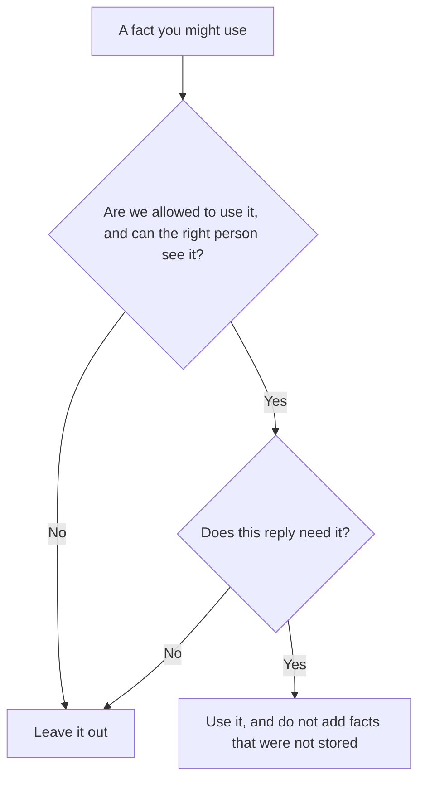

**AI personalization is a product choice to change a reply, a recommendation, or a draft using information you are allowed to use: a setting the user picked, a segment you defined, or notes they can see and delete.** A first name in a template is the small version. A support answer that mentions the plan on the account, read from the CRM, is the useful version. A hidden score the user cannot see is a different practice, and it needs a policy, not a prompt.

Notes the model keeps between chats are [what AI memory is](/blog/what-is-ai-memory-2026/). The instruction you hid in the product is [what a system prompt is](/blog/what-is-a-system-prompt-2026/). Changing the model on your data is [what fine-tuning is](/blog/what-is-fine-tuning-ai-2026/). Personalization can use any of those. It is still a decision about which fact is allowed in the reply.

Prices are US list prices from directory pages checked October 16, 2026. Published October 24, 2026. We did not score how "personal" any assistant feels.

## Where the extra fact comes from

| Source | The user can | A fair use | Stop |
|---|---|---|---|
| A setting they toggled | Turn it off | "Use short answers" | Treating the toggle as permission to read their files |
| A segment you defined | Hear which segment, if it changes what they are offered | New customers see the setup checklist | A segment built from data your policy forbids |
| The account record | Ask support what you store | The reply names the plan the CRM holds | Guessing a plan the record does not contain |
| Memory in the chat product | View and delete it, if the product allows that | Drafts match a tone they saved | Quiet notes they cannot find |
| A document they are working on | See the document | The edit follows the style guide on the page | Pulling other customers' docs into the same draft |

The failure mode is a fluent detail that was never stored. That is [what an AI hallucination is](/blog/what-is-ai-hallucination-2026/). "Welcome back, your renewal is Friday" is a serious sentence. It belongs in the draft only when the system of record has that date. Which box wins is [what a system of record for AI is](/blog/what-is-a-system-of-record-for-ai-2026/).

## What the common seats actually store

**A consumer chat.** [ChatGPT](/tools/chatgpt/) Free includes text chat. Plus is $20 a month and adds projects and memory features on the directory card's description of higher plans. Go is $8. Business is $20 a user a month billed annually, or $25 monthly, for two or more users, and does not train on business data by default. If you need a team to know what is remembered, Business is the admin conversation. Plus is an individual seat. The ladder is [ChatGPT Go vs Plus vs Pro](/blog/chatgpt-go-vs-plus-vs-pro-2026/).

**A writing seat with projects.** [Claude](/tools/claude/) Pro is $20 a month, or $17 billed annually. Projects hold instructions and files you put there. That is personalization you assembled on purpose. The directory records Team as a per-seat plan for 2 to 150 people and does not print a Team dollar. Do not invent one. The container is [Claude Projects vs ChatGPT Projects](/blog/claude-projects-vs-chatgpt-projects-2026/).

**The workspace, which already has the pages.** [Notion AI](/tools/notion-ai/) Business is $20 a seat a month. An agent that answers from the wiki is personalized to the company, which is what you want, and it is only as current as the pages. The card is [Notion AI pricing explained](/blog/notion-ai-pricing-explained-2026/).

**A rewrite that follows a tone you set.** [Grammarly](/tools/grammarly/) Pro is $12 a member a month billed annually and includes tone adjustment. That is personalization of a sentence, not of a customer record. The card is [Grammarly pricing explained](/blog/grammarly-pricing-explained-2026/).

A shared list of approved instructions is [what a prompt library is](/blog/what-is-a-prompt-library-2026/). Put the personalization rules there: which fields may appear, and which must not.

## The line

Use the smallest fact that helps the task. A shipping update needs the order status. It does not need a guess about the person's mood. A tutorial can be shorter because the user asked for short answers. It should not quietly change the technical steps.

Do not personalize from data the person would be surprised you used. If you cannot say, in one sentence, where the fact came from, leave it out. The check before a reply goes out is [what AI guardrails are](/blog/what-is-ai-guardrails-2026/).

Do not describe a fine-tune as "it knows our customers" unless you can name the data, the date, and the opt-out. A prompt that includes the account plan is easier to audit than a model you cannot inspect.

## FAQ

### Is personalization the same as memory?

Memory is one storage place. Personalization is the decision to use a stored fact in this reply. You can have memory turned on and still refuse to use it for a refund amount. You can personalize from the CRM without using chat memory at all.

### Should marketing emails be personalized with AI?

Only with fields you already store and a person who can send. A model that fills "I loved your recent launch" without a source is making up a relationship. The drafting habit is [how to write customer emails with AI](/blog/how-to-write-customer-emails-with-ai-2026/).

### Does a free plan personalize?

Some products remember settings while you are logged in. Read that product's memory controls before you rely on them. This page does not claim a free tier remembers the same things as a paid seat.

### Can personalization hurt a support bot?

Yes. If it mixes two accounts, the reply is a privacy incident. Scope every lookup to the signed-in account, and test that scope. The scheduled test of rules you already wrote is [what AI red teaming is](/blog/what-is-ai-red-teaming-2026/).

## Last verified

October 16, 2026 for ChatGPT, Claude, Notion, and Grammarly prices named above. The directory does not list a Claude Team dollar. Published October 24, 2026.

**Sources:** [ChatGPT pricing](https://chatgpt.com/pricing), [Claude pricing](https://claude.com/pricing), [Notion pricing](https://www.notion.com/pricing).

*Published by Andrew for [AI Tools Optimizer](https://aitoolsoptimizer.com).*

[ChatGPT](/tools/chatgpt/) is in the [chatbots and assistants directory](/tools/category/chatbots-assistants/). Directory pages may use affiliate links. A purchase through them may earn us a commission at no extra cost to you.
