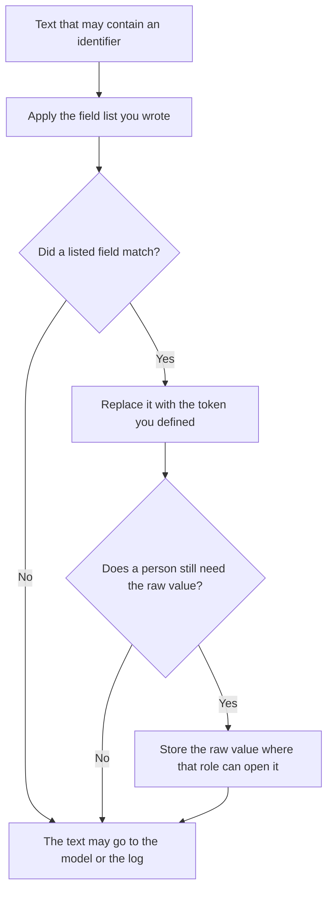

**AI PII redaction is the step that masks or removes personal identifiers from text before that text is sent to a model, written to a log, or pasted into a ticket a wider group can read.** The identifier is the part a person could use to find someone: a name paired with an account, an email, a phone number, a government id, a precise address. The rule for how long the remaining text may be kept is [what an AI data retention policy is](/blog/what-is-ai-data-retention-policy-2026/). This page is the removal, which has to happen before retention even starts.

What you store about the call, after the identifiers are gone, is [what structured logging for AI is](/blog/what-is-structured-logging-for-ai-2026/). The boundary on what a tool may touch is [what an AI tool sandbox is](/blog/what-is-ai-tool-sandbox-2026/). A person who still has to see the original, for a case they are allowed to handle, is [what human-in-the-loop AI is](/blog/what-is-human-in-the-loop-ai-2026/).

Prices are US list prices excluding tax from directory pages checked October 16, 2026. A live fetch of several vendor pricing pages returned HTTP 401 on October 24, 2026, so this page stays on the directory record. Published October 24, 2026. The directory does not list a redaction-product fee. We did not measure how often any tool finds an email address.

## What you decide before anyone pastes

| Decision | You write | A redaction step that will leak |
|---|---|---|
| Which fields | Email, phone, account id, and the others your counsel named | "Anything sensitive" |
| The replacement | A token such as EMAIL_1 that stays stable inside one document | Deleting so much context the ticket becomes useless, or leaving the raw value in a footnote |
| Where it runs | Before the model call and before the log | After the answer, on the copy you happened to remember |
| Who can reverse it | A named role, with a reason | Anyone with the chat link |
| What stays | The problem, with the identifier gone | The full header, because the model "might need it" |

A model that is asked to "remove any PII" is a draft of this step. It is not the step. Models miss identifiers and sometimes invent replacements that look real. The field list and the replacement token are yours. A second check by a person on a sample is part of the design, which is the human-in-the-loop page.

## Where the redacted text is handled

**The policy note.** [Claude](/tools/claude/) Pro is $20 a month, or $17 billed annually, when the field list is a document counsel will read. Paste only examples you have already redacted. The review is [Claude review](/blog/claude-review-2026/).

**A one-off paste.** [ChatGPT](/tools/chatgpt/) Plus is $20 a month can show you a redacted copy of text you are allowed to paste. Check every identifier yourself before you send the original anywhere. The review is [ChatGPT review](/blog/chatgpt-review-2026/).

**The ticket body.** [Notion AI](/tools/notion-ai/) Business is $20 a seat a month if the case lives in a page. Redact before the page is shared with a wider group. The invoice is [Notion AI pricing explained](/blog/notion-ai-pricing-explained-2026/).

**The code that masks a field.** [Cursor](/tools/cursor/) Plus is $8 a month, or $80 a year, when the replacement is a function. You review the field list in the diff. A generated regex that "covers names" will both miss and over-match. The ladder is [Cursor pricing explained](/blog/cursor-pricing-explained-2026/).

A prompt that holds the line:

"Redact only the field types I listed, using the tokens I listed. Do not invent an identifier that was not in the text. If you are unsure whether a span is one of those fields, leave a marker that says Review and do not guess."

## What not to delegate

Do not paste a production export into a free chat to "see if the redaction works." Do not log the raw prompt and the redacted prompt side by side in a tool the whole company can search. Do not treat a vendor's "we do not train on your data" sentence as a substitute for removing identifiers you did not need to send. Training is one use. A breach of the log is another.

## FAQ

### Is redaction the same as a retention policy?

Retention says how long a record lives and who deletes it. Redaction says which characters never enter the record, or enter only as a token. You want the identifier gone before the retention clock starts.

### Can I rely on the model to find names?

Use it as a second pair of eyes on text you are allowed to process. The decision list is the fields you wrote down. A name the model missed is still in the prompt you were about to send.

### What about a customer who must be in the prompt?

Then the prompt is allowed to carry that identifier, and the access rule has to say so. Redaction is for the copies that do not need it: the eval row, the log line, the example in a prompt library, the screenshot in a ticket. The customer-facing case file is a different store, with its own access.

### Does a token like EMAIL_1 count as anonymous?

It counts as removed from that text. If the token can be joined back to a person by anyone who has the map, the map is the sensitive store. Protect the map the way you protect the original.

## Last verified

October 16, 2026 for Claude, ChatGPT, Notion AI, and Cursor. No redaction-product fee is recorded in the directory. Published October 24, 2026.

**Sources:** [Claude pricing](https://claude.com/pricing), [ChatGPT pricing](https://chatgpt.com/pricing/), [Notion pricing](https://www.notion.com/pricing), [Cursor pricing](https://cursor.com/help/account-and-billing/pricing).

*Published by Andrew for [AI Tools Optimizer](https://aitoolsoptimizer.com).*

[Claude](/tools/claude/) is in the [chatbots and assistants directory](/tools/category/chatbots-assistants/). Directory pages may use affiliate links. A purchase through them may earn us a commission at no extra cost to you.
