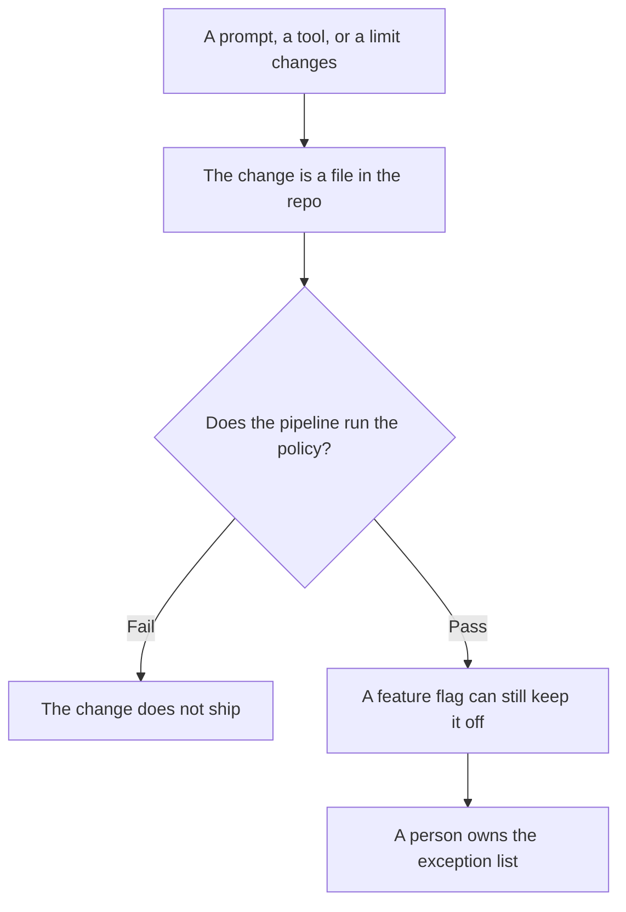

**AI policy as code is a rule, written in a file your pipeline can run, that allows, stops, or sends for review a model call, a tool, or a prompt change before it reaches a customer.** A paragraph in a wiki can explain the rule. The file is what fails the build. If the check can be skipped by editing a chat setting, it is a preference, not a policy.

The check that sits in front of an answer is [what AI guardrails are](/blog/what-is-ai-guardrails-2026/). Turning a model off without a redeploy is [what AI feature flags are](/blog/what-is-ai-feature-flags-2026/). The wording, with a number, is [what prompt versioning is](/blog/what-is-prompt-versioning-2026/). A dollar line the same file can enforce is [what AI budget caps are](/blog/what-is-ai-budget-caps-2026/).

Prices are US list prices excluding tax from directory pages checked October 16, 2026. Published October 24, 2026. The directory does not list a policy-as-code vendor fee, so this page does not invent one. We did not score policy engines.

## What belongs in the file

| Rule | Put it in code when | Leave it in the wiki |
|---|---|---|
| This tool may not send email | The product can actually send email | You are still deciding whether email is a feature |
| This prompt version is the one in production | A change can ship through the repo | Someone is brainstorming wording in a doc |
| Spend above a number stops the job | Finance has signed the number | The number is still a guess |
| A human approves refunds | The tool can issue a refund | The refund path does not exist yet |
| Customer text is untrusted | The model reads tickets or web pages | There is no retrieval yet |

An exception list without an owner becomes the real policy. Name the owner. The person who may override a stop is [what human-in-the-loop AI is](/blog/what-is-human-in-the-loop-ai-2026/).

## Where the draft of the rule is written

**The long policy in plain language.** [Claude](/tools/claude/) Pro is $20 a month, or $17 billed annually. Put the signed rules in a Project so the next draft cannot drift them. The container is [Claude Projects vs ChatGPT Projects](/blog/claude-projects-vs-chatgpt-projects-2026/).

**The team default.** [ChatGPT](/tools/chatgpt/) Business is $20 a user a month billed annually for two or more users, or $25 monthly, with admin controls and no training on business data by default. Plus at $20 is a personal seat. A company policy does not live only in one person's Plus account.

**The file that fails the build.** [Cursor](/tools/cursor/) Plus is $8 a month or $80 a year for new customers, and it withholds Cloud Agents and third-party models. A team seat starts at $30 a month. The invoice is [Cursor pricing explained](/blog/cursor-pricing-explained-2026/).

**The editor the company already uses.** [GitHub Copilot](/tools/github-copilot/) Business is $19 a user a month, with governance and IP indemnity on that plan. The team comparison is [Cursor vs GitHub Copilot for teams](/blog/cursor-vs-github-copilot-for-teams-2026/). Copilot can draft the check. It does not become the policy because it drafted it.

## What the file should say out loud

Write the allow and the stop as data a test can read: tool name, environment, maximum spend, and whether a person must approve. Keep the essay in the pull-request description. The instruction the user does not see, if you also version that, is [what a system prompt is](/blog/what-is-a-system-prompt-2026/).

Do not encode a rule you cannot enforce. A comment that says "be safe" will pass every build.

## FAQ

### Is a PDF policy enough?

It is enough to explain the decision. It is not enough to stop a deploy. The PDF and the file should name the same rule. When they disagree, the file is what shipped, and someone should fix the drift.

### Can one repository hold every team's AI rules?

Only if each rule has an owner and a test. A shared file that nobody can change without a fight will be copied around it. Start with the tools that can move money, send messages, or read customer data.

### Does policy as code replace a lawyer?

No. Counsel writes the obligation. The file checks the pieces a program can check. A tone rule that needs judgment stays with a person.

### Should the model edit its own policy file?

No. A change to the policy goes through the same review as any other production change. The model may draft the diff. A person merges it.

## Last verified

October 16, 2026 for Claude, ChatGPT, Cursor, and GitHub Copilot prices named above. No policy-as-code product fee is recorded in the directory. Published October 24, 2026.

**Sources:** [Claude pricing](https://claude.com/pricing), [ChatGPT pricing](https://chatgpt.com/pricing/), [GitHub Copilot](https://github.com/features/copilot).

*Published by Andrew for [AI Tools Optimizer](https://aitoolsoptimizer.com).*

[Claude](/tools/claude/) is in the [chatbots and assistants directory](/tools/category/chatbots-assistants/). Directory pages may use affiliate links. A purchase through them may earn us a commission at no extra cost to you.
