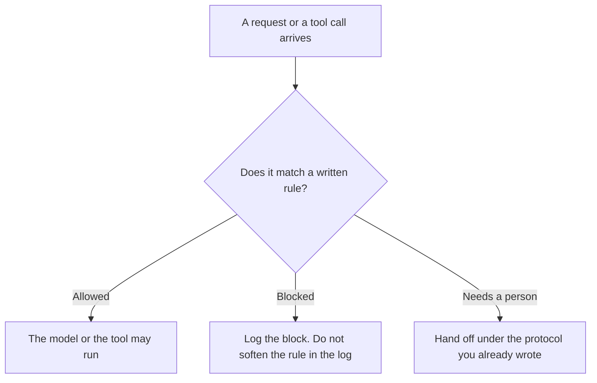

**An AI policy enforcement layer is a check that runs against a written rule before a model call or a tool call is allowed to proceed. If the request breaks the rule, the layer blocks it, asks a person, or sends it down the path the rule names.** A sentence inside the prompt that says "be careful" is advice. The layer is the gate. The yes for one tool, which is a narrower control, is [what an AI tool permission prompt is](/blog/what-is-ai-tool-permission-prompt-2026/). The moment one agent hands work to a person or to another agent is [what an AI agent handoff protocol is](/blog/what-is-ai-agent-handoff-protocol-2026/).

Claude's prices are from claude.com/pricing on October 24, 2026. GitHub Copilot and Cursor prices are from directory pages checked October 16, 2026. ChatGPT Business figures are from learn.chatgpt.com/docs/pricing on October 24, 2026. Published October 24, 2026. We did not grade any vendor's safety filter. The directory does not sell a policy-enforcement-layer SKU.

## What the layer can decide

| Input | A rule you can enforce | What the layer does |
|---|---|---|
| A prompt | A forbidden topic or a missing required line | Block, or return the lint failure |
| A tool call | The tool is not on the allow list, or the budget is spent | Do not run the tool |
| An output | A pattern you forbade, such as a raw account number | Hold it for a person |
| A handoff | The destination is not on the list | Stop and show the owner |

Vendor safety filters exist, and they are that vendor's rules. Your layer is the rule your company wrote: which data may leave, which tool may run, which output may be sent. Both can fire. Either one is enough to stop. A rate limit on abusive traffic, which is a different gate, is [what an AI abuse rate limit is](/blog/what-is-ai-abuse-rate-limit-2026/). A policy layer can block a perfectly polite request that asks for the wrong data.

## Where the rule is written

**The project that states the rule.** [Claude](/tools/claude/) Pro is $17 a month billed annually, $200 up front, or $20 monthly. Team standard seats are $20 a seat a month billed annually, or $25 monthly, for 2 to 150 people, on that October 24 page. The seat does not enforce the rule by itself. The review is [Claude review](/blog/claude-review-2026/).

**The company coding seat.** [GitHub Copilot](/tools/github-copilot/) Business is $19 a user a month on the October 16 card, with admin controls and IP indemnity on that card. Those controls are GitHub's. Your layer is still the rule you wrote about what the agent may touch. The invoice is [GitHub Copilot Business pricing explained](/blog/github-copilot-business-pricing-explained-2026/).

**The editor, where a diff can break the rule.** [Cursor](/tools/cursor/) Plus is $8 a month, or $80 a year, on the October 16 card. A policy that says "do not edit the billing folder" has to be something you can verify in the diff. The ladder is [Cursor pricing explained](/blog/cursor-pricing-explained-2026/).

**The workspace, when the data is company data.** [ChatGPT](/tools/chatgpt/) Business is $20 a user a month billed annually for two or more users, or $25 monthly, on the October 24 page. The page says Business does not train on business data by default. That sentence is a data term. It is not your enforcement layer. The seat article is [ChatGPT Team pricing explained](/blog/chatgpt-team-pricing-explained-2026/).

A prompt that holds the line:

"If this request conflicts with the rule I pasted, refuse it and quote the rule. Do not offer a workaround. Do not rewrite the rule so the request can pass."

## What not to delegate

Do not let the model edit the rule to complete the task. Do not log "allowed" because the prose was polite. Do not treat a vendor filter's silence as approval of your policy. Silence means that filter did not speak.

## FAQ

### How is this different from a tool permission prompt?

The permission prompt is the yes for one call. The enforcement layer is the rulebook that can block the call before that yes is even offered, and can also block a prompt or an output that never touches a tool.

### How is this different from a handoff protocol?

The handoff says who receives the work when a person must take it. The layer decides that this request must not proceed automatically. The handoff is the path after that decision, when your rule says to hand it over.

### Can the prompt be the layer?

A prompt can state the rule. It cannot guarantee the rule was applied. If the only control is a sentence in the prompt, say that in the design doc. A layer you can audit is a check outside the model's good intentions.

### Who changes a rule?

The owner of the policy. An agent that is blocked does not get to propose the exception and then apply it. An exception is a new line a person writes, with a scope and an end.

## Last verified

October 24, 2026 for Claude, including Team seat prices, and for ChatGPT Business. October 16, 2026 for GitHub Copilot and Cursor. No policy-enforcement-layer fee is recorded in the directory. Published October 24, 2026.

**Sources:** [Claude pricing](https://claude.com/pricing), [ChatGPT and Codex pricing](https://learn.chatgpt.com/docs/pricing), [GitHub Copilot](https://github.com/features/copilot), [Cursor pricing](https://cursor.com/help/account-and-billing/pricing).

*Published by Andrew for [AI Tools Optimizer](https://aitoolsoptimizer.com).*

[Claude](/tools/claude/) is in the [chatbots and assistants directory](/tools/category/chatbots-assistants/). Directory pages may use affiliate links. A purchase through them may earn us a commission at no extra cost to you.
