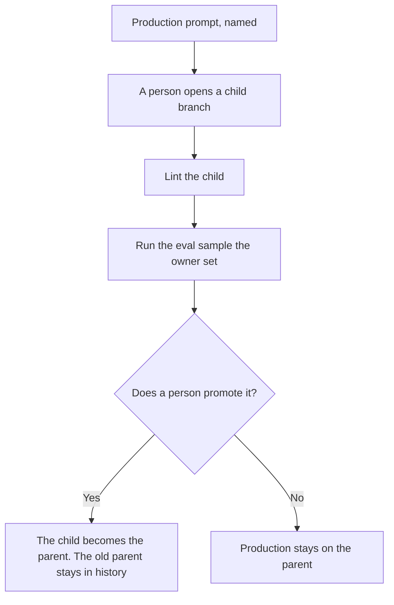

**AI prompt branching means a prompt has a named parent and one or more named children. A test runs a child. Production keeps the parent until a person promotes a child.** The line-by-line comparison of two versions is [what an AI prompt diff is](/blog/what-is-ai-prompt-diff-2026/). A check that the text contains a required line, before anyone runs it, is [what an AI prompt lint rule is](/blog/what-is-ai-prompt-lint-rule-2026/). The number of cases you owe before you trust a child is [what an AI eval sample size is](/blog/what-is-ai-eval-sample-size-2026/).

Claude's prices are from claude.com/pricing on October 24, 2026. ChatGPT Plus is $20 a month on learn.chatgpt.com/docs/pricing that day. Cursor and Notion prices are from directory pages checked October 16, 2026. Published October 24, 2026. We did not score prompts. The directory does not list a prompt-branching fee.

## What a branch records

| Field | Who writes it | Production may use it when |
|---|---|---|
| Parent name and version | The owner | It is the current production version |
| Child name | The person who opened the branch | A person promotes it |
| Why the child exists | That person, in one sentence | The reason is still the reason you are shipping |
| The diff against the parent | The change itself | You can read the diff |
| The eval that must pass | The owner | The sample you required has been read |

Two chats that both say "use the refund prompt" are not branches. They are unlabeled copies. A branch has a name you can point to in a change request. The request itself is [how to write a prompt change request with AI](/blog/how-to-write-a-prompt-change-request-with-ai-2026/). Editing production in place, then hoping the last good wording is still in the scrollback, is how a Friday prompt becomes the only copy.

## Where the versions live

**The project with the rules.** [Claude](/tools/claude/) Pro is $17 a month billed annually, $200 up front, or $20 monthly. Keep the parent in the Project and the child in a named note until you promote it. The review is [Claude review](/blog/claude-review-2026/).

**One experiment.** [ChatGPT](/tools/chatgpt/) Plus is $20 a month. Name the chat with the branch, and do not paste the child into the production custom GPT until the owner says so. The review is [ChatGPT review](/blog/chatgpt-review-2026/).

**A repo, if the prompt is a file.** [Cursor](/tools/cursor/) Plus is $8 a month, or $80 a year, on the October 16 card. A git branch is a fine prompt branch when the prompt is in the repo. You still review the diff. The ladder is [Cursor pricing explained](/blog/cursor-pricing-explained-2026/).

**The page people will find.** [Notion AI](/tools/notion-ai/) Business is $20 a seat a month if the library lives in Notion. Plus at $10 is not the full AI tier on that card. The invoice is [Notion AI pricing explained](/blog/notion-ai-pricing-explained-2026/).

A prompt that holds the line:

"Draft this as a child of the parent I named. Show the diff. Do not tell me to replace production. Leave the parent text unchanged in your draft of the parent."

## What not to delegate

Do not let the model promote its favorite wording. Do not merge two children because both "tested well" in a single chat. Do not delete the parent after a promotion. The history is how you go back.

## FAQ

### How is a branch different from a diff?

A diff is the comparison. A branch is the named version you can run, keep, or throw away. You diff a child against its parent. The diff is not the branch.

### How is a branch different from a lint rule?

Lint checks the text before a run: a required line is present, a forbidden line is absent. A branch is the version those checks run against. Lint does not choose which version is production.

### Do I need a new branch for a typo?

If production text will change, yes. A typo fix is a small child. It still has a name, a diff, and a person who promotes it. A silent edit of the parent is how the typo fix picks up an extra sentence.

### Who may promote a child?

The owner of the prompt. An eval report can recommend promotion. The report is not the promotion. The shape of that report is [how to create a model eval report with AI](/blog/how-to-create-a-model-eval-report-with-ai-2026/).

## Last verified

October 24, 2026 for Claude and for ChatGPT Plus. October 16, 2026 for Cursor and Notion. No prompt-branching fee is recorded in the directory. Published October 24, 2026.

**Sources:** [Claude pricing](https://claude.com/pricing), [ChatGPT and Codex pricing](https://learn.chatgpt.com/docs/pricing), [Cursor pricing](https://cursor.com/help/account-and-billing/pricing), [Notion pricing](https://www.notion.com/pricing).

*Published by Andrew for [AI Tools Optimizer](https://aitoolsoptimizer.com).*

[Claude](/tools/claude/) is in the [chatbots and assistants directory](/tools/category/chatbots-assistants/). Directory pages may use affiliate links. A purchase through them may earn us a commission at no extra cost to you.
