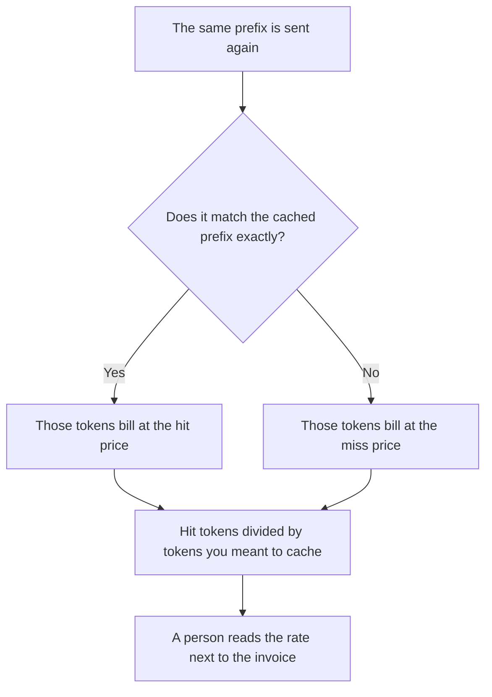

**An AI prompt cache hit rate is the share of input tokens, or of requests, that reused a cached prefix instead of paying the full price to read that prefix again.** The feature that stores the prefix is [what prompt caching is](/blog/what-is-prompt-caching-2026/). The mechanism inside the model that keeps the already-read prefix is [what a KV cache is](/blog/what-is-kv-cache-2026/). A product that bills a repeated prefix as its own object is [what a context cache is](/blog/what-is-a-context-cache-2026/). This page is the ratio: hits divided by the inputs you meant to cache. A high rate is a billing fact. It is not a quality score.

A cache that matches by meaning, which can return the wrong answer for a similar question, is [what semantic caching for an LLM is](/blog/what-is-semantic-caching-for-llm-2026/). The unit on both the hit and the miss is [what AI tokens are](/blog/what-are-ai-tokens-explained-2026/). Which team pays is [what AI cost attribution is](/blog/what-is-ai-cost-attribution-2026/).

Prices below are US list prices. DeepSeek's per-million figures are from the directory, checked October 16, 2026, for the deepseek-flash model. The directory does not record a per-token cache discount for Claude, ChatGPT, or Cursor seats, so this page does not invent one. Published October 24, 2026. We did not measure hit rates on a workload.

## How to read the rate

| Number | What it says | What it does not say |
|---|---|---|
| Hit tokens / input tokens you hoped to cache | How much of the repeated prefix was billed as a hit | That the answer was correct |
| Requests with any hit / all requests | How often the prefix matched at all | How much money you saved. A one-token hit is still a hit |
| Miss tokens | The prefix was rewritten, reordered, or too new to be cached | That the vendor is broken |
| The dollar gap | Hit price versus miss price, on a card that publishes both | A gap you estimated for a vendor that does not publish one |

What you put in the prefix, and in which order, decides whether the next call can hit. That ordering is [what context packing is](/blog/what-is-context-packing-2026/). A compacted prompt that changes every time will miss. That trade is [what prompt compaction is](/blog/what-is-prompt-compaction-2026/).

## A card that publishes both prices

DeepSeek's directory record for deepseek-flash, which the card identifies as DeepSeek-V4.1-Flash, lists input prices per 1 million tokens. A cache hit is $0.003 off-peak and $0.006 at peak. A cache miss is $0.15 off-peak and $0.30 at peak. Output is $0.60 off-peak and $1.20 at peak. Peak hours on that card are 01:00–04:00 and 06:00–10:00 UTC on weekdays, excluding Chinese public holidays. The chat app is free. The full table is [DeepSeek pricing explained](/blog/deepseek-pricing-explained-2026/).

On those figures, an off-peak miss costs 50 times an off-peak hit: $0.15 divided by $0.003. That ratio is arithmetic on the recorded card. It is not a promise that your traffic will hit. If the prefix changes every call, the rate is zero and you pay the miss price on every token.

**Claude, ChatGPT, and Cursor** sell seats, and the directory pages checked October 16 do not print a hit price and a miss price for those seats. [Claude](/tools/claude/) Pro is $20 a month, or $17 billed annually. [ChatGPT](/tools/chatgpt/) Plus is $20 a month. [Cursor](/tools/cursor/) Plus is $8 a month. Quoting a cache discount for those plans would be an invention. Read the API card you are actually billed on, and keep the seat price separate from the token price.

## What to write down

Write the prefix you expect to hit, the rate formula you will use, the vendor prices you are using, and the date you read them. A hit rate without the miss price next to it is a percentage with no invoice. Review the rate when you edit the system prompt, because an edit is a miss until the new prefix is cached.

## FAQ

### Is a 90 percent hit rate a good model?

It means 90 percent of the tokens you counted reused a prefix, under the formula you wrote. The answers can still be wrong. Track quality on the eval rows you already have. Track the hit rate on the bill.

### Do chat subscriptions have a hit rate?

Only if the vendor meters one. A Plus or Pro seat can include caching inside the product without showing you a hit price. Do not back into a rate from a seat price. If you need the rate, you need an API bill that separates hits and misses.

### Does a semantic cache count as a hit?

Not on this page. A semantic cache returns a stored answer for a similar question. A prompt-cache hit reuses the computed prefix and still runs the new question. Similar questions are not the same request. Keep those rates in different columns.

### What moves the rate?

A stable prefix, identical bytes, in the same order. Changing a date at the top of the system prompt, or inserting the user name before the cached document, can turn the rest of the prompt into a miss. Put the stable text first and the variable text after it.

## Last verified

October 16, 2026 for DeepSeek, Claude, ChatGPT, and Cursor. Published October 24, 2026.

**Sources:** [DeepSeek API pricing](https://api-docs.deepseek.com/quick_start/pricing), [Claude pricing](https://claude.com/pricing), [ChatGPT pricing](https://chatgpt.com/pricing/), [Cursor pricing](https://cursor.com/pricing).

*Published by Andrew for [AI Tools Optimizer](https://aitoolsoptimizer.com).*

[DeepSeek](/tools/deepseek/) is in the [chatbots and assistants directory](/tools/category/chatbots-assistants/). Directory pages may use affiliate links. A purchase through them may earn us a commission at no extra cost to you.
