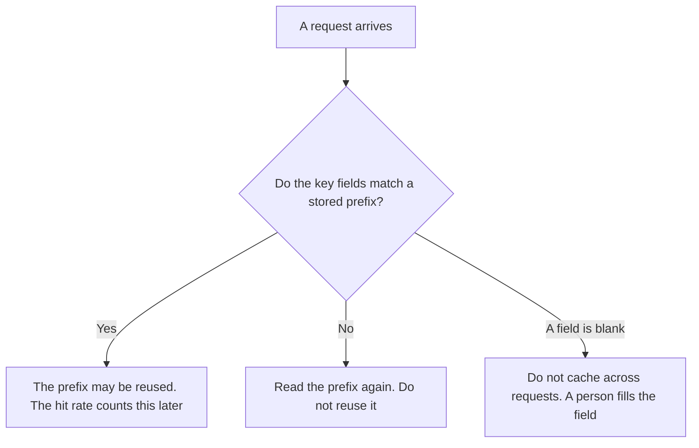

**An AI prompt cache key is the set of fields a person lists so the system can decide whether two requests may reuse the same cached prefix.** Same key, a later request may reuse that prefix. A different key, it may not. The share of requests that actually reused a prefix is [what an AI prompt cache hit rate is](/blog/what-is-ai-prompt-cache-hit-rate-2026/). The feature that stores the prefix is [what prompt caching is](/blog/what-is-prompt-caching-2026/). This page is the key. It does not store the prefix, and it does not report the rate.

The mechanism that keeps an already-read prefix inside the model is [what a KV cache is](/blog/what-is-kv-cache-2026/). A product that bills a repeated prefix as its own object is [what a context cache is](/blog/what-is-a-context-cache-2026/). A key that refuses a second charge on retry is [what AI idempotency is](/blog/what-is-ai-idempotency-2026/). Those are different strings. A cache key is not a secret, and it is not an idempotency key.

Claude's prices are the October 24, 2026 read of claude.com/pricing recorded in [Claude pricing explained](/blog/claude-pricing-explained-2026/). ChatGPT's Plus price is the October 24 plan-page figure recorded in [ChatGPT pricing explained](/blog/chatgpt-pricing-explained-2026/). Cursor's Plus price is the October 24 help-center figure recorded in [Cursor Business pricing explained](/blog/cursor-business-pricing-explained-2026/). The directory does not list a fee for writing a cache key, and it does not record a per-token cache discount for those three seats, so this page does not invent one. Published October 24, 2026. We did not measure hit rates.

## What the key has to include

| Field | Who writes it | A blank means |
|---|---|---|
| Model id | You | Two models can share a prefix they should not |
| System prompt, or its hash | You | A prompt edit still hits yesterday's prefix |
| Tool list | You | A new tool rides on a cache built without it |
| Temperature, if your policy says it is part of the key | You | A hotter sample reuses a colder prefix |
| Tenant or workspace | You | One customer's text can be reused for another |

If temperature is on the key, changing it is a miss on purpose. The rule for which temperatures you allow is [what an AI prompt temperature policy is](/blog/what-is-ai-prompt-temperature-policy-2026/). If tenant is missing, two workspaces can share a prefix that contains one workspace's text. Put every field that would make sharing unsafe onto the key. A short key is not a cheaper key when the miss is the safe outcome.

The key does not contain the customer's document. It names the fields that must match. The prefix itself stays in the cache the product already bills. This page does not add a new dollar to that bill.

## Where the key is written

**The definition of the fields you allow.** [Claude](/tools/claude/) Pro is $17 a month billed annually, $200 up front, or $20 monthly. A Project can hold the field list so a later edit does not drop the tenant. The review is [Claude review](/blog/claude-review-2026/).

**One request's key, from a paste.** [ChatGPT](/tools/chatgpt/) Plus is $20 a month. Go is $8 a month on that October 24 plan page. Plus is the seat for a saved field list. The ladder is [ChatGPT pricing explained](/blog/chatgpt-pricing-explained-2026/).

**The diff, if the key lives next to the call in a repo.** [Cursor](/tools/cursor/) Plus is $8 a month, or $80 a year, on the October 24 help page. You review a diff that removes the tenant from the key. Teams seats on that page are $30, $100, or $200 a seat a month. The individual ladder is [Cursor pricing explained](/blog/cursor-pricing-explained-2026/).

**The ratio, after the key exists.** [DeepSeek](/tools/deepseek/) is the vendor the hit-rate article uses for a recorded hit price and a miss price. This page does not restate those per-million figures. Read them on [what an AI prompt cache hit rate is](/blog/what-is-ai-prompt-cache-hit-rate-2026/).

A prompt that holds the line:

"List the cache-key fields from the model, the system prompt, the tool list, and the tenant I pasted. If a field is missing, write Field not set. Do not mark two requests as the same key. Do not drop the tenant."

## What not to delegate

Do not ask the model which fields are "safe to skip." Do not reuse a key across tenants because the system prompts look alike. Do not treat a high hit rate as proof the key is correct. A high rate can mean the key is too short. The owner of the call sets the fields. A generated list is not the key.

## FAQ

### How is this different from a cache hit rate?

The hit rate is hits divided by the inputs you meant to cache. The key is the rule that makes a hit possible. You can have a key and a rate of zero. You should not publish a rate for requests that never shared a key definition. Use the hit-rate page for the ratio. Use this page for the fields.

### How is this different from an idempotency key?

An idempotency key refuses a second charge for the same request. A cache key allows a second request to reuse a prefix. One blocks a duplicate side effect. The other saves a repeated read of a prefix. They can both be strings on the same call. They are not interchangeable.

### How is this different from a KV cache?

A KV cache is the model's internal store of an already-read prefix. The cache key is the label your system uses to decide whether that store may be shared with the next request. You can have a KV cache on a single request with no cross-request key at all. Write the key when a second request might reuse the first.

### Who may change a key?

The person named on the call. Dropping the tenant, the tool list, or the model id is a new key, with a date. Yesterday's hits stay attached to the key they used. A model suggestion is not a change.

## Last verified

October 24, 2026 for Claude, for ChatGPT's plan page, and for Cursor's help page, via the posts cited above. Published October 24, 2026. No cache-key fee is listed on those pages.

**Sources:** [Claude pricing](https://claude.com/pricing), [ChatGPT and Codex pricing](https://learn.chatgpt.com/docs/pricing), [Cursor pricing](https://cursor.com/help/account-and-billing/pricing).

*Published by Andrew for [AI Tools Optimizer](https://aitoolsoptimizer.com).*

[Claude](/tools/claude/) is in the [chatbots and assistants directory](/tools/category/chatbots-assistants/). Directory pages may use affiliate links. A purchase through them may earn us a commission at no extra cost to you.
