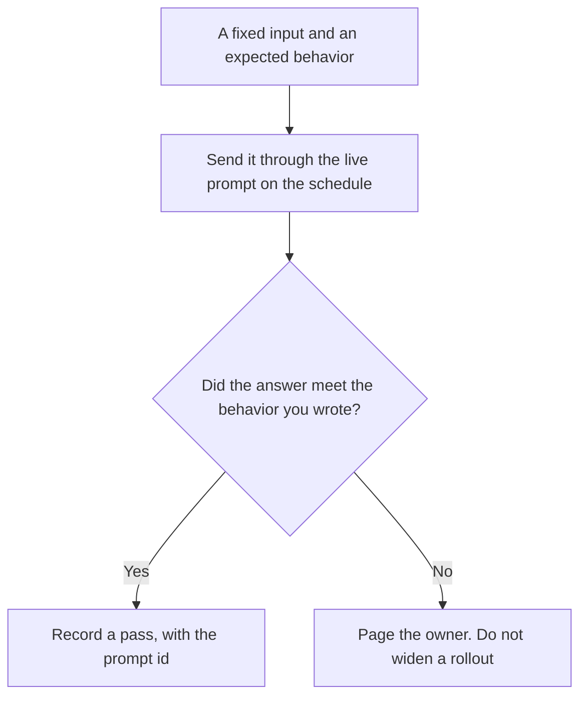

**An AI prompt canary is a fixed probe: an input you wrote, plus the behavior you already said is acceptable, sent through the live prompt or model on a schedule.** You are checking whether a known failure has come back. You are not sampling customers. A small slice of real traffic is [what an AI canary release is](/blog/what-is-ai-canary-releases-2026/). The batch of cases you run before anyone is on the new prompt is [what an AI eval regression suite is](/blog/what-is-ai-eval-regression-suite-2026/).

The line that changed is [what an AI prompt diff is](/blog/what-is-ai-prompt-diff-2026/). A rule the prompt must keep satisfying is [what an AI prompt lint rule is](/blog/what-is-ai-prompt-lint-rule-2026/).

Claude's prices are from claude.com/pricing on October 24, 2026. Cursor, ChatGPT, and Notion prices are from directory pages checked October 16, 2026. chatgpt.com/pricing returned HTTP 403 on October 24. Published October 24, 2026. We did not score how often a canary should run.

## What the probe contains

| Piece | Who writes it | A failure means |
|---|---|---|
| The input | You, and it stays fixed until you change it on purpose | You sent a different question and called it the same canary |
| The expected behavior | You: a phrase that must appear, or a phrase that must not | The live answer missed that rule |
| The prompt and model ids | The deploy you are watching | You compared two versions and did not record which |
| The schedule | You | A canary that never runs is a document |

A canary that uses a fresh customer question is a sample, not a canary. The point is that you know the answer you require. If the requirement is "sounds helpful," you cannot fail the probe. Write a string that must show up, or a string that must not.

## Where the probe is kept

**The expected line.** [Claude](/tools/claude/) Pro is $17 a month billed annually, $200 up front, or $20 monthly. Keep the probe in a Project so a later edit does not "improve" the expected text. The review is [Claude review](/blog/claude-review-2026/).

**The prompt file.** [Cursor](/tools/cursor/) Plus is $8 a month, or $80 a year, on the October 16 card. A diff to the prompt is still a diff you review. The canary does not merge it. The ladder is [Cursor pricing explained](/blog/cursor-pricing-explained-2026/).

**One probe, written down.** [ChatGPT](/tools/chatgpt/) Plus is $20 a month on the October 16 card. Ask it to format the input and the expected line. Discard a version that softens the expected line.

**The page the owner opens.** [Notion AI](/tools/notion-ai/) Business is $20 a seat a month. Put the last pass and the last fail next to the prompt id. The invoice is [Notion AI pricing explained](/blog/notion-ai-pricing-explained-2026/).

A prompt that holds the line:

"Format this canary from the input and the expected behavior I pasted. Do not change the expected line. If the expected line is missing, write Expected behavior not set."

## What not to delegate

Do not let the model invent the expected answer after it sees the live output. That is grading your own homework. Do not treat a passing canary as permission to skip the regression suite. The suite is the broad set. The canary is the few failures you refuse to meet in production again. Do not send customer data as the probe.

## FAQ

### How is this different from a canary release?

A canary release sends the new prompt to a slice of real users. A prompt canary sends a probe you wrote, on a timer, and compares it to a behavior you wrote. You can run the probe during a canary release. They are not the same switch.

### How is this different from a regression suite?

The suite is the set you run before you ship, often offline. The prompt canary hits the live path on a schedule, including after you thought you were done. A suite that never runs in production will not see a config change that happened on Tuesday.

### What if the expected line is too brittle?

Then you wrote a brittle line, and you change it on purpose, in the same change as the prompt. You do not let the live answer rewrite the expectation. A canary that updates itself cannot fail.

### Who is paged?

The owner named on the probe. A passing log is not a page. A failing log with no owner is a file nobody opens.

## Last verified

October 24, 2026 for Claude. October 16, 2026 for Cursor, ChatGPT, and Notion. No prompt-canary SKU is on those pages. Published October 24, 2026.

**Sources:** [Claude pricing](https://claude.com/pricing), [Cursor pricing](https://cursor.com/help/account-and-billing/pricing), [ChatGPT pricing](https://chatgpt.com/pricing/), [Notion pricing](https://www.notion.com/pricing).

*Published by Andrew for [AI Tools Optimizer](https://aitoolsoptimizer.com).*

[Claude](/tools/claude/) is in the [chatbots and assistants directory](/tools/category/chatbots-assistants/). Directory pages may use affiliate links. A purchase through them may earn us a commission at no extra cost to you.
