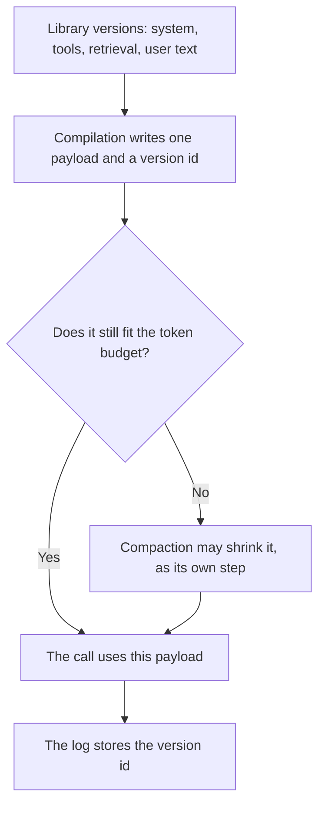

**AI prompt compilation is the build step that assembles versioned pieces into the single payload a model will see: the system text, the tool list, the retrieved passages, and the user message, with a version id for the result.** The library stores the pieces. Compilation is how they become one request. If you cannot point at the payload that was sent, you did not compile. You pasted.

The place the pieces live is [what an AI prompt library is](/blog/what-is-ai-prompt-library-2026/). The line-level change between two versions is [what an AI prompt diff is](/blog/what-is-ai-prompt-diff-2026/). Shrinking a prompt so it fits a token budget is [what prompt compaction is](/blog/what-is-prompt-compaction-2026/). Compaction shortens. Compilation assembles. They are different steps, and a build can do both, in that order, only if a person can see each one.

Cursor and GitHub Copilot prices are from directory pages checked October 16, 2026. The X Subscription page fetched October 24 still lists Plus at $8 a month or $80 a year. Claude's prices are from claude.com/pricing that day. ChatGPT's seat price is from the October 16 card. chatgpt.com/pricing returned HTTP 403 on October 24. Published October 24, 2026. We did not score prompt wording.

## What the build is allowed to include

| Piece | It enters the payload when | It stays out when |
|---|---|---|
| System text | The library says this version is current | A draft is newer and nobody accepted the diff |
| Tool list | Every tool is on the allowlist for this product | A piece names a tool the review did not see |
| Retrieved passages | They are the passages this query returned, with ids | A passage was "usually relevant" and was not fetched |
| User message | It is the message this turn received | The compiler adds a task the user did not ask |

A chat that says "I combined your instructions" is not a compiler. The compiler's output is text plus an id. The next incident should be able to load that id and see the tools the model was offered. If the id only points at the system paragraph, the tool list and the passages are invisible, and the build is partial.

Retrieved text is an input to compilation, not a piece you edit by hand in the same step. Changing a passage during the build is how a citation stops matching the source. The weight that pulled a source forward, if you use one, is [what an AI retrieval boost is](/blog/what-is-ai-retrieval-boost-2026/).

## Where the payload is built

**Next to the code that sends it.** [Cursor](/tools/cursor/) Plus is $8 a month, or $80 a year. A function that concatenates strings is a compiler if it records the version. The review is still a person's. The ladder is [Cursor pricing explained](/blog/cursor-pricing-explained-2026/).

**A long system piece.** [Claude](/tools/claude/) Pro is $17 a month billed annually, $200 up front, or $20 monthly. Keep the current system text in a Project. Ask for a list of pieces, not a new essay. The review is [Claude review](/blog/claude-review-2026/).

**A suggestion in the editor.** [GitHub Copilot](/tools/github-copilot/) Pro is $10 a user a month on the October 16 card. Business at $19 a user a month is the governance seat on that card. A suggestion that inlines a secret into the payload is a defect. The invoice is [GitHub Copilot pricing explained](/blog/github-copilot-pricing-explained-2026/).

**One payload, from pieces you paste.** [ChatGPT](/tools/chatgpt/) Plus is $20 a month on the October 16 card. Paste the pieces with labels. Discard a reply that merges them into a paragraph with no labels left.

A prompt that holds the line:

"Assemble the payload from the labeled pieces I pasted. Keep each piece's version id. Do not add a tool, a policy, or a passage. If a piece is missing, write Missing piece."

## What not to delegate

Do not let the model decide which library version is current. Do not compile from memory of "the usual prompt." Do not skip the diff because the build "only concatenated." Concatenation is where a removed constraint disappears. The cases you run after the id changes are [what an AI eval regression suite is](/blog/what-is-ai-eval-regression-suite-2026/).

## FAQ

### How is compilation different from a prompt library?

The library stores versions and an owner. Compilation reads the current versions and writes the payload for one call. A library without a build step means every caller assembles a different prompt. A build without a library means you cannot roll the pieces back.

### How is compilation different from compaction?

Compilation decides what is included. Compaction shortens what was included so the call fits. If you compact first, you may shrink a piece that the build was not supposed to send. Assemble, then shrink, and log both ids if both steps change the text.

### Do I need a special compiler product?

You need a deterministic step and a version id. A function in the repo is enough. A chat can draft the step. A person accepts the diff before it runs in production.

### Who changes the current pointer?

The owner on the library entry. A successful call is not a signature. The payload id in the log tells you what ran. It does not tell you that the next call should change.

## Last verified

October 24, 2026 for Claude and the X Subscription Plus price. October 16, 2026 for GitHub Copilot and ChatGPT. No prompt-compilation product fee is recorded in the directory. Published October 24, 2026.

**Sources:** [Cursor pricing](https://cursor.com/help/account-and-billing/pricing), [X Subscription pricing](https://docs.x.ai/x-subscription/pricing), [Claude pricing](https://claude.com/pricing), [GitHub Copilot](https://github.com/features/copilot), [ChatGPT pricing](https://chatgpt.com/pricing/).

*Published by Andrew for [AI Tools Optimizer](https://aitoolsoptimizer.com).*

[Cursor](/tools/cursor/) is in the [coding directory](/tools/category/coding/). Directory pages may use affiliate links. A purchase through them may earn us a commission at no extra cost to you.
