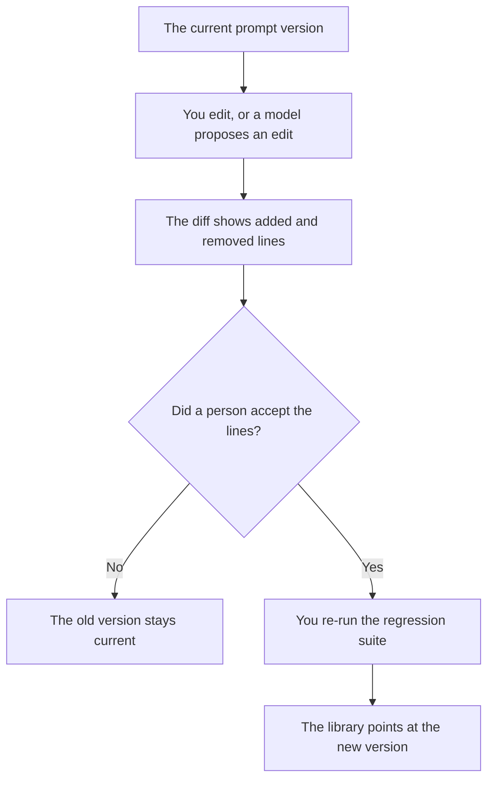

**An AI prompt diff is the line-level change between two versions of a prompt, reviewed the way you review code.** Someone can see what was added, what was removed, and which version is current. A library that only stores the latest wording has no diff. The place the current prompt lives is [what an AI prompt library is](/blog/what-is-ai-prompt-library-2026/). The cases you re-run after the diff is [what an AI eval regression suite is](/blog/what-is-ai-eval-regression-suite-2026/). The person who reads a risky change is [what an AI human review queue is](/blog/what-is-ai-human-review-queue-2026/).

Cursor, GitHub Copilot, and ChatGPT prices are from directory pages checked October 16, 2026. chatgpt.com/pricing returned HTTP 403 on October 24. Claude's prices are from claude.com/pricing that day. Published October 24, 2026. We did not score which wording is better.

## What a reviewer is looking at

| Line in the diff | A reviewer can accept it when | A reviewer stops when |
|---|---|---|
| A sentence added | It matches a requirement you wrote | It adds a policy, a price, or a tool the old prompt did not have |
| A sentence removed | You meant to drop that constraint | A safety line disappeared and nobody named it |
| A tool name changed | The new tool is on the allowlist | The diff swaps in a tool with a wider side effect |
| A version id | The library points at this version | Two pages still name the old id |

A chat transcript is not a diff. The model will say it "tightened the tone" and you will not be able to see which line now promises a refund. Store the prompt as text with a version. Review the version. Then point the product at it.

If the prompt is assembled from pieces, diff the pieces. A one-paragraph summary of a 200-line system prompt hides the line that removed "do not invent a price."

## Where the diff is reviewed

**Next to the code.** [Cursor](/tools/cursor/) Plus is $8 a month, or $80 a year, on the October 16 card. A prompt file in the repo gets the same review as the function that loads it. The ladder is [Cursor pricing explained](/blog/cursor-pricing-explained-2026/).

**A long system prompt.** [Claude](/tools/claude/) Pro is $17 a month billed annually, $200 up front, or $20 monthly, on the October 24 page. Paste the old and the new. Ask for the added lines only. The review is [Claude review](/blog/claude-review-2026/).

**A suggestion inside the editor.** [GitHub Copilot](/tools/github-copilot/) Pro is $10 a user a month on the October 16 card. A suggestion is not merged until the diff is accepted. Business at $19 a user a month is the governance seat on that card, when the company requires it. The invoice is [GitHub Copilot pricing explained](/blog/github-copilot-pricing-explained-2026/).

**A single rewording.** [ChatGPT](/tools/chatgpt/) Plus is $20 a month on the October 16 card. Ask for the new text and a list of lines that changed. Discard a reply that only describes the change in adjectives.

A prompt that holds the line:

"Show added and removed lines between the two prompts I pasted. Do not add a third version. If a removed line is a constraint, mark it Removed constraint. Do not decide which version is better."

## What not to delegate

Do not accept a diff because the new version is shorter. Do not let the model update the library's current pointer. Do not skip the regression suite because the diff was "only wording." Wording is the product. The suite is how you see what the wording did to the cases you care about.

## FAQ

### How is a prompt diff different from a prompt library?

The library is where the current prompt, and the older versions, are stored, with an owner. The diff is the comparison between two of those versions. A library without versions cannot produce a diff. A diff that is never filed does not update the library.

### Do I need a special diff tool?

You need the two texts and a way to see inserted and deleted lines. A code review tool is enough if the prompt lives in the repo. A model can list the lines. A person accepts them.

### What if the model rewrote the whole prompt?

Treat every line as added and every old line as removed. That is a large diff, and it needs a person. Ask for a smaller edit if you only meant to change one instruction.

### Who may mark a version current?

The owner named on the library entry. A passing eval suite is an input to that person. It is not a signature.

## Last verified

October 24, 2026 for Claude. October 16, 2026 for Cursor, GitHub Copilot, and ChatGPT. No prompt-diff product fee is recorded in the directory. Published October 24, 2026.

**Sources:** [Cursor pricing](https://cursor.com/help/account-and-billing/pricing), [Claude pricing](https://claude.com/pricing), [GitHub Copilot](https://github.com/features/copilot), [ChatGPT pricing](https://chatgpt.com/pricing/).

*Published by Andrew for [AI Tools Optimizer](https://aitoolsoptimizer.com).*

[Claude](/tools/claude/) is in the [chatbots and assistants directory](/tools/category/chatbots-assistants/). Directory pages may use affiliate links. A purchase through them may earn us a commission at no extra cost to you.
