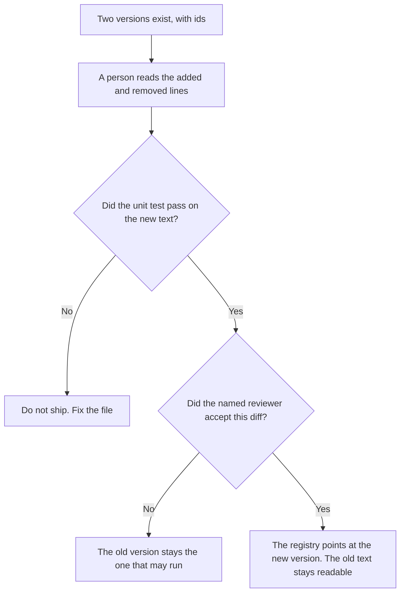

**An AI prompt diff review is a person's read of the change between two versions of a prompt, before the new version is allowed to run.** The reviewer looks at what was added, what was removed, and whether the owner still matches. A check that the file contains a required clause, before any model runs, is [what an AI prompt unit test is](/blog/what-is-ai-prompt-unit-test-2026/). The list of prompts that may run is [what an AI prompt registry is](/blog/what-is-ai-prompt-registry-2026/).

The checklist a reviewer can follow is [how to create a prompt review checklist with AI](/blog/how-to-create-a-prompt-review-checklist-with-ai-2026/). The id on the wording is [what prompt versioning is](/blog/what-is-prompt-versioning-2026/). A diff review uses those versions. It does not replace them.

Cursor, Notion, and Grammarly prices are from directory pages checked October 16, 2026. Claude's prices are the October 24, 2026 read of claude.com/pricing recorded in [Claude pricing explained](/blog/claude-pricing-explained-2026/). Published October 24, 2026. We did not score prompt quality. The directory does not list a diff-review fee.

## What the review is allowed to decide

| The reviewer sees | The reviewer may | The reviewer may not |
|---|---|---|
| The old text and the new text | Say what changed, in words | Approve a change they did not read |
| A required clause you named | Mark the clause missing | Invent a new required clause in the review |
| The owner on the registry row | Confirm the owner is unchanged, or name the new owner a person already assigned | Reassign the prompt because the diff was small |
| A forbidden phrase you listed | Mark it present | Soften the phrase and call the diff clean |

A unit test can pass while the diff still changes the task. The test checks clauses you listed. The review checks the change itself. A green test is not an acceptance. A short diff is not a small change. One deleted sentence can remove the limit.

Grammarly can flag a wording change after the meaning is stable. It does not decide that the meaning is the same. Compare the limit line before and after any suggestion.

## Where the diff is read

**The file, if the prompt lives in a repo.** [Cursor](/tools/cursor/) Plus is $8 a month, or $80 a year, on the October 16 card. You read the diff. The model does not merge it. The ladder is [Cursor pricing explained](/blog/cursor-pricing-explained-2026/).

**A summary of the change, from the two pastes.** [Claude](/tools/claude/) Pro is $17 a month billed annually, $200 up front, or $20 monthly. Ask for the added and removed lines only. The review is [Claude review](/blog/claude-review-2026/).

**The register.** [Notion AI](/tools/notion-ai/) Business is $20 a seat a month. The row stores the old version id, the new version id, the reviewer, and the date. The invoice is [Notion AI pricing explained](/blog/notion-ai-pricing-explained-2026/).

**A clarity pass that must not touch the limit.** [Grammarly](/tools/grammarly/) Pro is $12 a member a month billed annually, or $30 monthly, on the October 16 card. Reject a suggestion that changes the required clause. The invoice is [Grammarly pricing explained](/blog/grammarly-pricing-explained-2026/).

A prompt that holds the line:

"List the added lines and the removed lines between the two prompt versions I pasted. If a version id is missing, write Version not set. Do not call the change safe. Do not rewrite the prompt."

## What not to delegate

Do not ask whether the new prompt is "better." Do not accept a diff because the unit test passed. Do not let the model rewrite the prompt while it explains the diff. The named reviewer accepts the change. The registry updates after that, not before.

## FAQ

### How is this different from a prompt unit test?

The unit test checks properties of one file: version, owner, a required clause, a forbidden phrase. The diff review compares two files and asks a person to accept the change. A test can pass on both versions while the task changed. Run the test. Still read the diff.

### How is this different from the registry?

The registry says which version may run, and who owns it. The diff review is how a new version earns that pointer. A registry edit without a review is a swap. Keep the old text. Point at the new id only after the reviewer is named on the row.

### How is this different from a review checklist?

The checklist is the list of questions the reviewer uses every time. The diff review is one occasion: these two versions, this date, this person. The checklist does not accept a change. The review records that a person did. If you have no checklist yet, the review still has to name the reviewer. Do not skip it because the checklist page is unfinished.

### Who may accept the diff?

The owner on the registry row, or the reviewer that owner named for this change. A formatted summary is not acceptance. If the owner changed, the row has to say who assigned the new owner. The diff does not assign them.

## Last verified

October 16, 2026 for Cursor, Notion, and Grammarly. October 24, 2026 for Claude, via the pricing article. Published October 24, 2026.

**Sources:** [Cursor pricing](https://cursor.com/help/account-and-billing/pricing), [Claude pricing](https://claude.com/pricing), [Notion pricing](https://www.notion.com/pricing), [Grammarly pricing](https://www.grammarly.com/plans).

*Published by Andrew for [AI Tools Optimizer](https://aitoolsoptimizer.com).*

[Cursor](/tools/cursor/) is in the [coding directory](/tools/category/coding/). Directory pages may use affiliate links. A purchase through them may earn us a commission at no extra cost to you.
