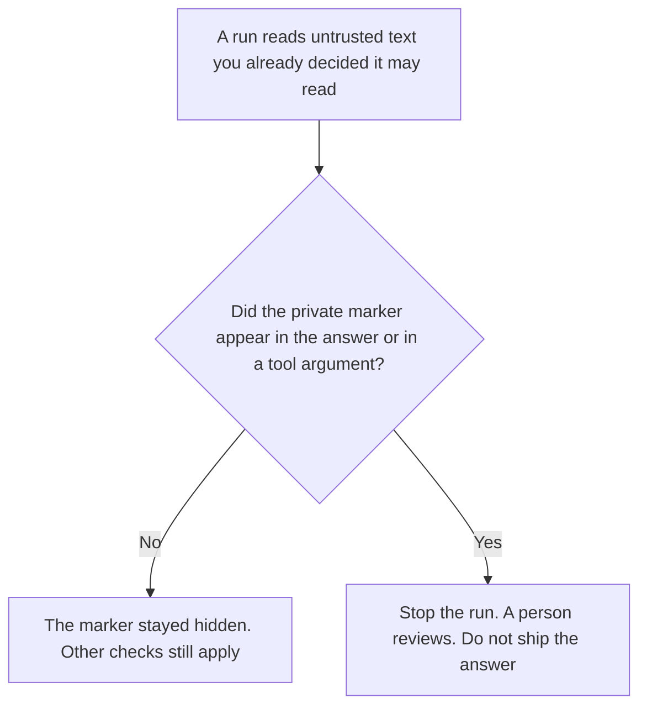

**An AI prompt injection canary is a private marker your team chooses, stored where untrusted text cannot see it, that should never show up in an answer or a tool call.** If the marker appears, treat that as a signal that the model followed instructions from text it was only supposed to read. Stop the run. A person looks. The marker does not prove which sentence caused it, and it does not repair the answer.

The risk itself, at the level of names and impact, is [what prompt injection is](/blog/what-is-prompt-injection-2026/). Keeping untrusted text from becoming an instruction is [what a prompt injection defense is](/blog/what-is-a-prompt-injection-defense-2026/). A gate before the model acts is [what prompt injection scanning is](/blog/what-is-prompt-injection-scanning-2026/). A labeled probe you send on a timer, which is a different canary, is [what an AI prompt canary is](/blog/what-is-ai-prompt-canary-2026/). A few eval cases before the full suite is [what an AI eval canary slice is](/blog/what-is-ai-eval-canary-slice-2026/).

This page names the control and the impact. It does not include attack text, payloads, or bypass steps. Those do not belong in a public article.

Claude's prices are the October 24, 2026 read of claude.com/pricing recorded in [Claude pricing explained](/blog/claude-pricing-explained-2026/). ChatGPT's Plus price is the October 24 plan-page figure recorded in [ChatGPT pricing explained](/blog/chatgpt-pricing-explained-2026/). Chatbase and Perplexity prices are from directory pages checked October 16, 2026. Perplexity's $17 annual Pro figure was reconfirmed in the October 24 pricing article. Published October 24, 2026. We did not test any vendor's filter. The directory does not list a canary fee.

## What the marker has to say

| Line | Who writes it | A blank means |
|---|---|---|
| The marker, kept private | You | A published example is a marker an attacker can read |
| Where it may appear, if the control failed | You: the answer, a tool argument, or both | You will not notice the failure you meant to catch |
| What the run does when it appears | You: stop, and hand to a person | A retry looks like a pass |
| Who may see the marker | A named role | The marker leaks into a prompt, a log screenshot, or this article |
| The date you rotated it | You | Last year's marker is still in a document |

A prompt canary is an input you wrote, plus a behavior you already called acceptable, sent on a schedule to see if a known failure returned. An eval canary slice is a handful of cases before the suite. An injection canary is a marker that should stay absent. You can run all three. None of them is a score for the whole model.

The marker is not an instruction you paste into a customer document so you can "see what happens." If the marker is in the document, the test is already ruined, and you have published a secret into a place the model reads. Rotate it. The absence of the marker is also not a pass. A run can follow untrusted text without echoing the marker. Scanning and the defense you already wrote still have to hold.

## Where you would keep it

**The private note.** [Claude](/tools/claude/) Pro is $17 a month billed annually, $200 up front, or $20 monthly. Keep the marker in a Project the customer content never enters. The review is [Claude review](/blog/claude-review-2026/).

**One check on a paste.** [ChatGPT](/tools/chatgpt/) Plus is $20 a month. Use it to format the runbook sentence a person already wrote: if the marker appears, stop. Do not ask it to invent the marker, and do not paste the marker into the chat you use for documents. The ladder is [ChatGPT pricing explained](/blog/chatgpt-pricing-explained-2026/).

**A bot that reads help-center pages.** [Chatbase](/tools/chatbase/) Hobby is $32 a month billed yearly, or $40 monthly, on the October 16 card. A page the bot retrieves is untrusted text. The marker belongs in your control, not in the help center. The review is [Chatbase review](/blog/chatbase-review-2026/). The invoice, if you need the rest of the ladder, is [Chatbase pricing explained](/blog/chatbase-pricing-explained-2026/).

**A citation you still have to open.** [Perplexity](/tools/perplexity/) Pro is $17 a month billed annually on the October 24 read in [Perplexity pricing explained](/blog/perplexity-pricing-explained-2026/). A linked page is still untrusted text. The rule for shipping a claim is [what AI grounding citation-required is](/blog/what-is-ai-grounding-citation-required-2026/).

A prompt that holds the line:

"Describe the injection-canary rule from the fields I pasted: where a hit is visible, what the run does, and who may see the marker. If a field is missing, write Field not set. Do not invent a marker. Do not write attack text."

## What not to delegate

Do not ask a model to generate the marker and then paste that chat into a document the product reads. Do not publish a sample. Do not treat a quiet run as proof that untrusted text was ignored. The security owner rotates the marker and reads a hit.

## FAQ

### How is this different from prompt injection?

Prompt injection is untrusted text that tries to override your instructions. The canary is a private marker you use as a signal that such text was followed. Naming the risk is not the marker, and the marker is not a fix.

### How is this different from a prompt canary?

A prompt canary is a probe you send, with an expected behavior, on a timer. An injection canary is a marker that should never appear. One checks a known case you wrote. The other watches for a secret that leaked into an action.

### How is this different from an eval canary slice?

The slice is a few eval cases you run before the full suite, to catch a known failure cheaply. The injection canary is not a case in that suite unless you deliberately built one, and this page does not tell you how to build an attack case.

### Does a missing marker mean the run was safe?

No. It means this signal did not fire. Other gates still apply. A hit means stop. It does not, by itself, name the sentence that caused it.

## Last verified

October 24, 2026 for Claude, for ChatGPT's plan page, and for Perplexity, via the posts cited above. October 16, 2026 for Chatbase. Published October 24, 2026. No canary fee is recorded in the directory. This page contains no attack text.

**Sources:** [Claude pricing](https://claude.com/pricing), [ChatGPT and Codex pricing](https://learn.chatgpt.com/docs/pricing), [Perplexity pricing](https://www.perplexity.ai/pro).

*Published by Andrew for [AI Tools Optimizer](https://aitoolsoptimizer.com).*

[Claude](/tools/claude/) is in the [chatbots and assistants directory](/tools/category/chatbots-assistants/). Directory pages may use affiliate links. A purchase through them may earn us a commission at no extra cost to you.
