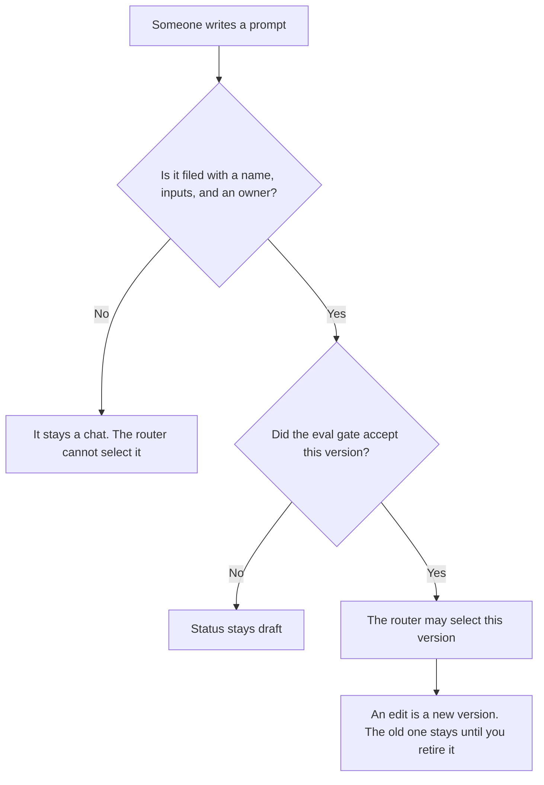

**An AI prompt library is a catalog of prompts the team is allowed to reuse, where each prompt has a name, an owner, a version, and the inputs it requires.** A chat someone liked on Tuesday is not in the library until a person files it. The router that picks a template for this kind of ask is [what an AI prompt router is](/blog/what-is-ai-prompt-router-2026/). How often a reused prefix actually hits cache is [what an AI prompt cache hit rate is](/blog/what-is-ai-prompt-cache-hit-rate-2026/). The check that can block a bad version from shipping is [what an AI eval gate is](/blog/what-is-ai-eval-gate-2026/).

Prices are US list prices excluding tax from directory pages checked October 16, 2026. A live fetch of vendor pricing pages on October 24, 2026 returned HTTP 401, so this page stays on the directory record. Published October 24, 2026. The directory does not list a prompt-library fee. We did not score prompts.

## What a library row contains

| Field | Who fills it | Empty means |
|---|---|---|
| Name | The owner | The prompt is not filed. A chat title is not a name |
| Version | The owner, when the text changes | The router must keep serving the last accepted version |
| Required inputs | The owner | The prompt stops and asks. It does not invent the missing fact |
| Owner | A person | Nobody may mark this prompt as the one production uses |
| Status | Draft, accepted, or retired | Draft is not eligible for the router |

The library is the catalog. The router is the switch that chooses a row. The cache hit rate tells you whether a stable prefix is being reused. Mixing the three into one sentence is how a team "has prompts" and cannot say which sentence production sent last week.

A prompt that embeds a customer's name, a price you did not approve, or a policy you hope is current does not belong in the catalog. Put a slot in the prompt. Fill the slot from the source of record at send time.

## Where the catalog lives

**The page the team already opens.** [Notion AI](/tools/notion-ai/) Business is $20 a seat a month when the library is a database with the fields above. Plus at $10 a seat is the workspace plan, and the full agent experience is not that row. The invoice is [Notion AI pricing explained](/blog/notion-ai-pricing-explained-2026/).

**The long draft of one prompt.** [Claude](/tools/claude/) Pro is $20 a month, or $17 billed annually, when a prompt and its examples sit in a Project. The model may format the row. It may not mark the row accepted. The review is [Claude review](/blog/claude-review-2026/).

**A short prompt you will paste into the wiki.** [ChatGPT](/tools/chatgpt/) Plus is $20 a month. Go is $8 a month and may include ads, on the directory card. A production prompt is a poor fit for a plan the card associates with ads. The review is [ChatGPT review](/blog/chatgpt-review-2026/).

**The prompt that lives in code.** [Cursor](/tools/cursor/) Plus is $8 a month, or $80 a year, when the accepted text is a file in the repo. You review the diff. A generated edit that changes the instructions and skips the version bump is a defect. The ladder is [Cursor pricing explained](/blog/cursor-pricing-explained-2026/).

A prompt that holds the line:

"Format a library row from the name, inputs, and owner I pasted. Status is draft. Do not mark it accepted. If an input is missing, write Input missing and stop."

## What not to delegate

Do not let the model retire a prompt because a newer chat "sounded better." Retirement is a status change by the owner. Do not store two accepted versions under one name. Do not put a secret, a customer record, or a live price in the template text.

## FAQ

### How is a prompt library different from a prompt router?

The library is the list of prompts you are willing to run. The router chooses one row for this request, using rules you wrote. A router with no library is a switch with nothing safe to select. A library with no router is a wiki people copy from by hand.

### Do I need an eval gate before a prompt is accepted?

If the prompt will be selected in production, yes. The gate is the check that can block the version. A person's glance is still required for the status change. The gate does not replace the owner.

### What about the cache?

Cache hit rate measures reuse of a prefix you already froze. It does not tell you the prompt is the right one. Change the accepted text and you should expect the rate to move. That movement is not, by itself, a quality result.

### Can Free Notion hold the library?

Free includes a trial of Notion AI, on the directory card. The catalog can be an ordinary database. The agent features that sit on Business are a separate decision. The page is the system of record either way. The chat is not.

## Last verified

October 16, 2026 for Notion, Claude, ChatGPT, and Cursor. No prompt-library product fee is recorded in the directory. Published October 24, 2026.

**Sources:** [Notion pricing](https://www.notion.com/pricing), [Claude pricing](https://claude.com/pricing), [ChatGPT pricing](https://chatgpt.com/pricing/), [Cursor pricing](https://cursor.com/help/account-and-billing/pricing).

*Published by Andrew for [AI Tools Optimizer](https://aitoolsoptimizer.com).*

[Notion AI](/tools/notion-ai/) is in the [productivity and notes directory](/tools/category/productivity-notes/). Directory pages may use affiliate links. A purchase through them may earn us a commission at no extra cost to you.
