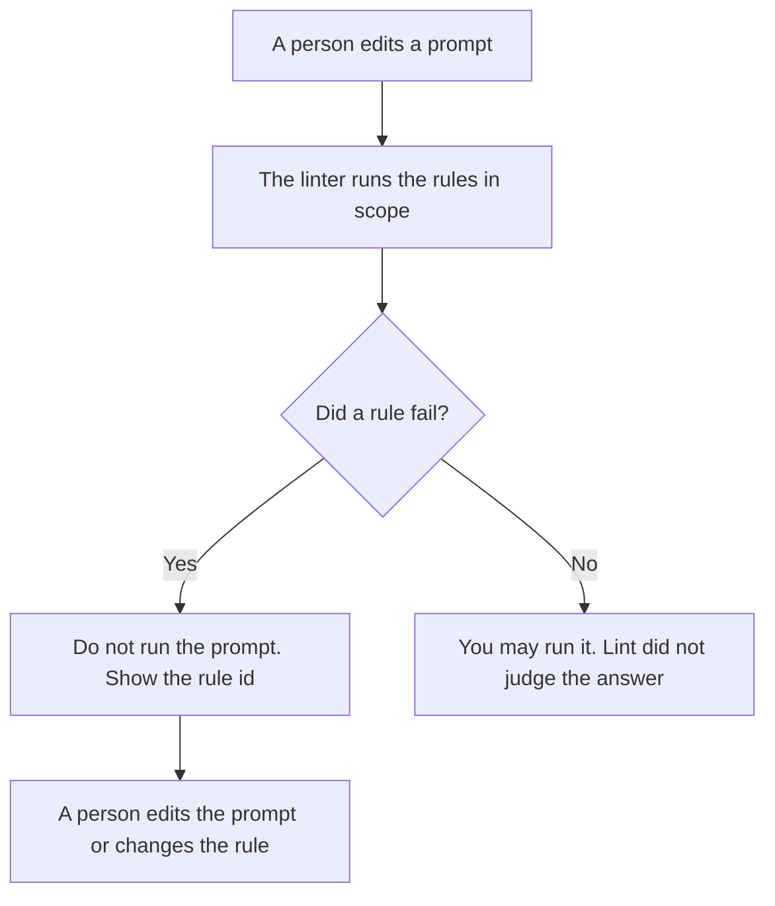

**An AI prompt lint rule is one named check that a prompt must pass before anyone runs it: a required line is present, a forbidden line is absent, or a slot is filled.** The program that runs a set of those checks is [what a prompt linter is](/blog/what-is-prompt-linter-2026/). The difference between two prompt versions is [what an AI prompt diff is](/blog/what-is-ai-prompt-diff-2026/). A test that runs the prompt and looks at the answer is [what prompt unit testing is](/blog/what-is-prompt-unit-testing-2026/). A lint rule does not grade the answer. It fails the prompt.

Claude's prices are from claude.com/pricing on October 24, 2026. ChatGPT's Plus price is from the October 24 Codex plan page recorded in [ChatGPT pricing explained](/blog/chatgpt-pricing-explained-2026/). Cursor and Grammarly prices are from directory pages checked October 16, 2026. Published October 24, 2026. We did not score writing quality. The directory does not list a prompt-lint fee.

## What a rule is allowed to say

| A rule may say | A rule may not say | A failure looks like |
|---|---|---|
| "The prompt contains the schema version" | "The prompt sounds careful" | Fail, with the rule id |
| "The prompt does not contain a price the author did not paste" | "The prompt is persuasive" | Fail, and the line that matched |
| "The owner slot is not the word TBD" | "A senior person would approve this" | Fail, until a person fills the slot |
| "This rule applies to the refund prompt only" | "All prompts, forever, whatever they are" | A scope line, so you can turn one rule off |

A style preference is not a lint rule until it can fail in a way two people would agree on. "Be concise" fails that test. "The prompt is under 1,200 characters" can be a rule if you want that cap. The library those prompts live in is [what an AI prompt library is](/blog/what-is-ai-prompt-library-2026/). A rule that is not in the library, with an owner, will drift into a chat message and disappear.

## Where the rule is written

**The shared instruction.** [Claude](/tools/claude/) Pro is $17 a month billed annually, $200 up front, or $20 monthly. Put the rule text in the Project next to the prompts it covers. The review is [Claude review](/blog/claude-review-2026/).

**One prompt, one pass.** [ChatGPT](/tools/chatgpt/) Plus is $20 a month. Paste the prompt and the rule. Ask whether the rule passes. A model that rewrites the prompt while checking it has left the job.

**The check in the repo.** [Cursor](/tools/cursor/) Plus is $8 a month, or $80 a year, on the October 16 card, if the rule is a script beside the prompt files. You read the diff before you trust the script. The ladder is [Cursor pricing explained](/blog/cursor-pricing-explained-2026/).

**A grammar pass, which is not lint.** [Grammarly](/tools/grammarly/) Pro is $12 a member a month billed annually, or $30 monthly. It may fix a sentence. It may not decide that a required line is optional. The invoice is [Grammarly pricing explained](/blog/grammarly-pricing-explained-2026/).

A prompt that holds the line:

"Check this prompt against the rule I pasted. Reply pass or fail, then quote the line that decided it. Do not rewrite the prompt. Do not add a rule."

## What not to delegate

Do not let the model invent rules from a vibe. Do not turn a failed rule into a warning you ignore by default. Do not treat a green lint run as a good answer. The answer still needs the tests you wrote, on the cases you froze.

## FAQ

### How is a rule different from a linter?

The linter is the runner. The rule is one check. You can have a linter with a bad rule, and you can write a rule before you have a product that runs it. Name the rule even if you run it by hand.

### How is lint different from a unit test?

Lint looks at the prompt text before a model call. A unit test looks at the output on a case you stored. A prompt can pass lint and fail the test. Keep both. Skipping the test because lint was green is how a missing fact ships.

### Can one rule cover every prompt?

Only if you want every prompt to carry the same line. A refund prompt and a release note do not share every check. Scope the rule, or the failures become noise and people turn the linter off.

### Who may delete a rule?

The owner of the prompt library. A failed run is a reason to look. It is not a reason for the model to retire the rule.

## Last verified

October 24, 2026 for Claude and for the ChatGPT Plus price. October 16, 2026 for Cursor and Grammarly. No prompt-lint fee is recorded in the directory. Published October 24, 2026.

**Sources:** [Claude pricing](https://claude.com/pricing), [ChatGPT and Codex pricing](https://learn.chatgpt.com/docs/pricing), [Cursor pricing](https://cursor.com/help/account-and-billing/pricing), [Grammarly plans](https://www.grammarly.com/plans).

*Published by Andrew for [AI Tools Optimizer](https://aitoolsoptimizer.com).*

[Claude](/tools/claude/) is in the [chatbots and assistants directory](/tools/category/chatbots-assistants/). Directory pages may use affiliate links. A purchase through them may earn us a commission at no extra cost to you.
