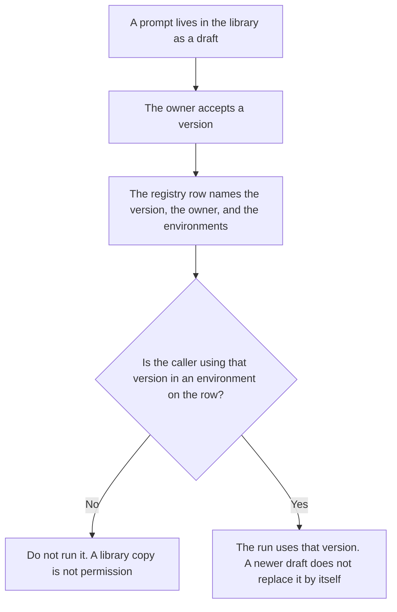

**An AI prompt registry is the list of prompts that are allowed to run in a named environment, each with an owner, a version, and the places it may be called.** A folder of drafts is not a registry. That folder is [what an AI prompt library is](/blog/what-is-ai-prompt-library-2026/). The note that says what changed between versions is [how to create a prompt library changelog with AI](/blog/how-to-create-a-prompt-library-changelog-with-ai-2026/). The line-by-line comparison of two texts is [what an AI prompt diff is](/blog/what-is-ai-prompt-diff-2026/).

A small live trial of a prompt you already approved is [what an AI prompt canary is](/blog/what-is-ai-prompt-canary-2026/). The registry says the canary was allowed. It does not judge the trial.

Claude's prices are from claude.com/pricing on October 24, 2026. Notion, ChatGPT, and Cursor prices are from directory pages checked October 16, 2026, except ChatGPT Plus, which is from learn.chatgpt.com/docs/pricing on October 24. Published October 24, 2026. We did not score prompts. The directory does not list a registry fee.

## What a registry row contains

| Column | Who fills it | A blank cell means |
|---|---|---|
| Prompt id and version | You | Two texts can share a nickname |
| Owner | A person, not a team alias with no name | Nobody can approve a change |
| Environments where it may run | You | It is a draft, even if the text looks finished |
| Status: draft, canary, or allowed | You | The runtime must not treat it as allowed |

Production reads the registry. It does not read the latest chat. If the library has a newer paragraph and the registry still names the old version, the old version is the one that may run.

## Where the row is kept

**The wording of the prompt.** [Claude](/tools/claude/) Pro is $17 a month billed annually, $200 up front, or $20 monthly. Projects hold the text. The registry holds the permission. The review is [Claude review](/blog/claude-review-2026/).

**The table.** [Notion AI](/tools/notion-ai/) Business is $20 a seat a month. One database, with the columns above. The invoice is [Notion AI pricing explained](/blog/notion-ai-pricing-explained-2026/).

**A one-row draft from fields you paste.** [ChatGPT](/tools/chatgpt/) Plus is $20 a month. Discard a row that invents an owner. The ladder is [ChatGPT pricing explained](/blog/chatgpt-pricing-explained-2026/).

**The check in the repo, if the prompt is loaded from code.** [Cursor](/tools/cursor/) Plus is $8 a month, or $80 a year. You review the diff that reads the registry id. The ladder is [Cursor pricing explained](/blog/cursor-pricing-explained-2026/).

A prompt that holds the line:

"Add a registry row from the id, the version, the owner, and the environments I pasted. If the owner is missing, write Owner not set. Do not mark the status allowed unless I wrote allowed."

## What not to delegate

Do not let the model decide a prompt is ready because the prose is polished. Do not share one id across two texts. Do not delete a row to hide a bad run. Mark it retired, with the date, and keep the text the run used.

## FAQ

### How is this different from a prompt library?

The library stores texts, including drafts and experiments. The registry stores permission: which version may run, where, and who owns it. A large library with no registry means every draft is one paste away from production.

### How is this different from a changelog?

The changelog records what changed. The registry records what is allowed now. A changelog entry is not approval. Approval is a status on the registry row, set by the owner.

### How is this different from a prompt diff?

The diff shows the text that moved. The registry says whether that new text is the one production may call. You can diff two drafts that are both forbidden. The diff does not promote either one.

### Who may mark a prompt allowed?

The owner on the row. A shared login has no owner. If the owner leaves, the status goes back to draft until a new owner is named. Do not leave "allowed" on a row with Owner not set.

## Last verified

October 24, 2026 for Claude and for ChatGPT's plan page. October 16, 2026 for Notion and Cursor Plus. Published October 24, 2026.

**Sources:** [Claude pricing](https://claude.com/pricing), [Notion pricing](https://www.notion.com/pricing), [ChatGPT and Codex pricing](https://learn.chatgpt.com/docs/pricing), [Cursor pricing](https://cursor.com/help/account-and-billing/pricing).

*Published by Andrew for [AI Tools Optimizer](https://aitoolsoptimizer.com).*

[Notion AI](/tools/notion-ai/) is in the [productivity and notes directory](/tools/category/productivity-notes/). Directory pages may use affiliate links. A purchase through them may earn us a commission at no extra cost to you.
