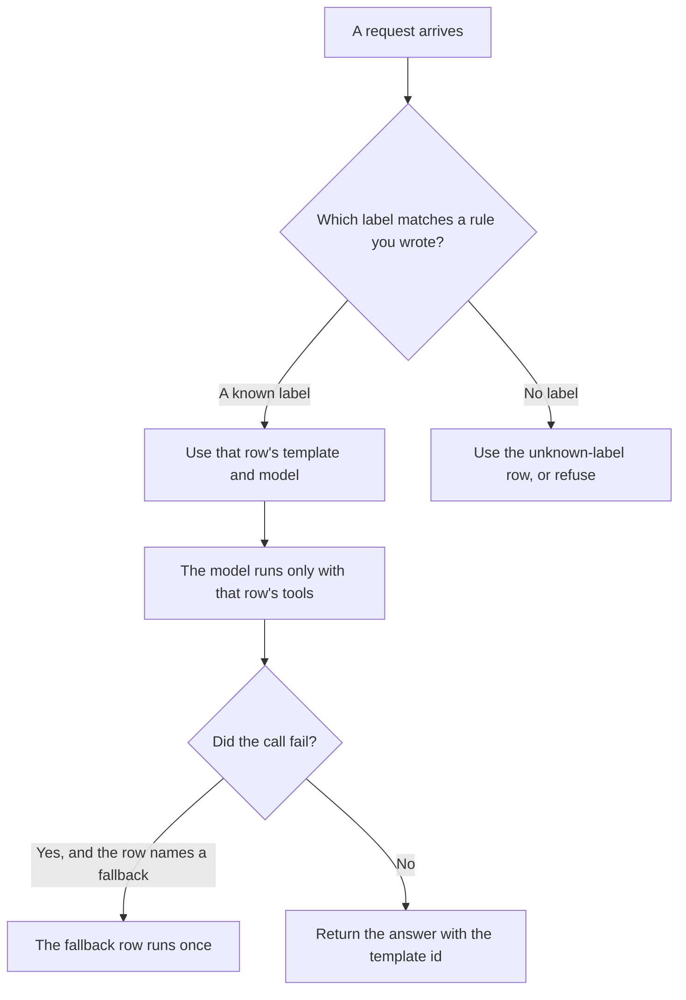

**An AI prompt router is a table you wrote that sends a labeled kind of request to one prompt template and one model, before that model runs.** The broader rule that sends an easy job to a cheaper model is [what AI routing is](/blog/what-is-ai-routing-2026/). The second model you call after the first one fails is [what AI fallback routing is](/blog/what-is-ai-fallback-routing-2026/). The single door in front of many models is [what a model gateway is](/blog/what-is-a-model-gateway-2026/). This page is the row: an invoice question uses template B and model C. A password reset does not.

The instruction the user does not see, which a template may contain, is [what a system prompt is](/blog/what-is-a-system-prompt-2026/). A shared prompt with an owner is [what a prompt library is](/blog/what-is-a-prompt-library-2026/). The wording with a number on it is [what prompt versioning is](/blog/what-is-prompt-versioning-2026/).

Prices are US list prices excluding tax from directory pages checked October 16, 2026. A live fetch of vendor pricing pages returned HTTP 401 on October 24, 2026, so this page stays on the directory record. Published October 24, 2026. The directory does not list a prompt-router fee, so this page does not invent one. We did not measure routing accuracy.

## What a row contains

| Column | You write | A router that will drift |
|---|---|---|
| Label | A kind of request you can detect with a rule you can explain | "Looks hard" |
| Template | A versioned prompt id | Whatever the engineer remembers |
| Model | A model id, not a nickname | "The best one" |
| Tools | The tools that template may call | Every tool, because the router forgot |
| Fallback | The next row, or none | A silent jump to a stronger model |
| Owner | A person who can change the row | The last person who edited a prompt |

The label has to be something you can check: a menu choice, a keyword list you maintain, or a classifier whose mistakes you have read. "The model will know" is not a label. Unknown requests need their own row, even if that row is a refusal. A router with no unknown row will force a billing question into the refund template.

## Where the table is kept

**The table in prose.** [Claude](/tools/claude/) Pro is $20 a month, or $17 billed annually, when the router table is long enough to live in a Project and you want a change reviewed against the old rows. The review is [Claude review](/blog/claude-review-2026/).

**A short table you paste.** [ChatGPT](/tools/chatgpt/) Plus is $20 a month when the router is a dozen rows and the habit is a project. The model may format a new row. It may not add a label you did not name. The review is [ChatGPT review](/blog/chatgpt-review-2026/).

**The code that reads the table.** [Cursor](/tools/cursor/) Plus is $8 a month, or $80 a year, when the router is a file in the repo. You review the diff. A generated row that points a refund intent at a draft-only template is a defect. The ladder is [Cursor pricing explained](/blog/cursor-pricing-explained-2026/).

**The zap that branches.** [Zapier](/tools/zapier/) Professional is $19.99 a month billed annually. Paths can branch on a label you already set. Paths do not count as tasks. A path that calls a tool the row did not allow is the wrong branch, even if the task was cheap. The invoice is [Zapier pricing explained](/blog/zapier-pricing-explained-2026/).

A prompt that holds the line:

"Add a router row from the label, template id, model id, tools, and fallback I pasted. Do not invent a label. Do not add a tool. If the unknown-label row is missing from the table I pasted, write Unknown row missing and stop."

## What not to delegate

Do not let the router "pick the smartest model" with no row. Do not hide the template id from the log. When an answer is wrong, you need the row that produced it. Do not use the router to sneak a new prompt into production for everyone. A new template is a version. The slice that sees it first is still a canary if you choose to run one: [what an AI canary release is](/blog/what-is-ai-canary-releases-2026/).

## FAQ

### How is a prompt router different from a model gateway?

A gateway is the door: one place that holds keys, limits, and logs for many models. A prompt router is the table of which template and which model a labeled request uses. You can have a gateway and no router, which means every request gets the same prompt. You can have a router that still sends all of its rows through one gateway.

### Can one request match two labels?

Your rule has to say which row wins, or the request goes to the unknown row. Two templates in one turn is a chain, and a chain needs its own check between steps. That pattern is [what prompt chaining is](/blog/what-is-prompt-chaining-2026/).

### Should the router call a model to choose the label?

Only when you have read the mistakes and the label set is too large for a list you maintain. The classifier is then its own row, with its own timeout and its own eval. A classifier you have never sampled will file refunds under billing forever.

### Who changes a row?

The owner on that row. A prompt edit that does not change the template id will be invisible in the log. Version the template, then point the row at the new id.

## Last verified

October 16, 2026 for Claude, ChatGPT, Cursor, and Zapier. Published October 24, 2026. Live pricing fetches returned HTTP 401 that day.

**Sources:** [Claude pricing](https://claude.com/pricing), [ChatGPT pricing](https://chatgpt.com/pricing/), [Cursor pricing](https://cursor.com/help/account-and-billing/pricing), [Zapier pricing](https://zapier.com/blog/zapier-pricing/).

*Published by Andrew for [AI Tools Optimizer](https://aitoolsoptimizer.com).*

[Cursor](/tools/cursor/) is in the [coding directory](/tools/category/coding/). Directory pages may use affiliate links. A purchase through them may earn us a commission at no extra cost to you.
