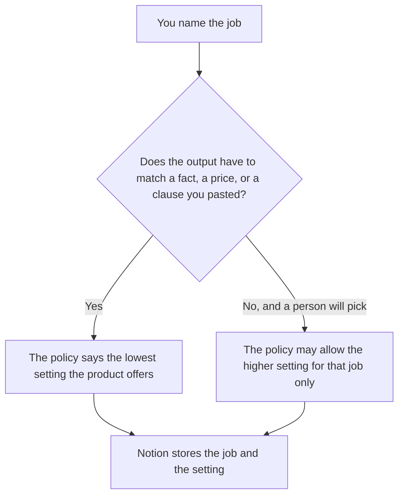

**An AI prompt temperature policy is the rule that says which jobs may use a higher temperature and which jobs must stay at the low setting a person named.** The dial itself is [what temperature in AI models is](/blog/what-is-temperature-in-ai-models-2026/). This page is which job is allowed to move it. A person's read of a prompt change before it ships is [what an AI prompt diff review is](/blog/what-is-ai-prompt-diff-review-2026/). The policy can be one line in that review. The review is not the policy.

This page does not publish a default temperature for ChatGPT, Claude, or Gemini. The directory pages we used do not state one. A policy can say "customer mail: the lowest setting the product offers" and "headline brainstorm: the higher setting, then a person picks" without inventing 0.2 or 0.8.

Claude's prices are the October 24, 2026 read of claude.com/pricing recorded in [Claude pricing explained](/blog/claude-pricing-explained-2026/). ChatGPT's Plus price is the same-day plan-page figure recorded in [ChatGPT pricing explained](/blog/chatgpt-pricing-explained-2026/). Notion and Cursor prices are from directory pages checked October 16, 2026. Published October 24, 2026. We did not score wording. The directory does not list a temperature-policy fee.

## What the policy has to name

| Line | Who writes it | A blank means |
|---|---|---|
| Job | You | Every prompt inherits the last person's slider |
| Allowed setting | You, in the product's own words | A number you guessed becomes the standard |
| What must not vary | You | A refund amount gets "creative" wording |
| Who may raise it | A person | A brainstorm setting lands on a customer mail |
| Where it is recorded | You | The slider in one chat is the only copy |

Temperature does not add a fact. A higher setting on a job that must repeat a price is a policy violation even if the sentence sounds smooth. A lower setting on a brainstorm does not make the ideas true. The policy names the job. It does not grade the idea.

If the product hides the number, the policy names the control you can see: the mode, the slider, or the API field in your own client. Do not paste a number from a forum into the policy and call it the vendor default.

## Where the rule is kept

**The policy text.** [Claude](/tools/claude/) Pro is $17 a month billed annually, $200 up front, or $20 monthly. The Project holds the job list so a later prompt does not quietly raise the setting. The review is [Claude review](/blog/claude-review-2026/).

**One job from a short paste.** [ChatGPT](/tools/chatgpt/) Plus is $20 a month on the October 24 plan page. Go is $8 a month on that same page. Plus is the seat for a saved policy line. The ladder is [ChatGPT pricing explained](/blog/chatgpt-pricing-explained-2026/).

**The register of jobs.** [Notion AI](/tools/notion-ai/) Business is $20 a seat a month. One row per job, the allowed setting, and the owner. The invoice is [Notion AI pricing explained](/blog/notion-ai-pricing-explained-2026/).

**The diff, if the API client sets the field.** [Cursor](/tools/cursor/) Plus is $8 a month, or $80 a year. You review the diff that changes the field for a job. The model does not merge it. The ladder is [Cursor pricing explained](/blog/cursor-pricing-explained-2026/).

A prompt that holds the line:

"Draft the temperature-policy row from the job name and the setting I pasted. If the setting is missing, write Setting not set. Do not invent a number. Do not apply this row to a second job."

## What not to delegate

Do not ask the model for the "best" temperature. Do not copy a setting from a brainstorm job onto a customer mail because the mail sounded stiff. Do not treat a hidden default as permission. The owner of the job sets the row. A fluent paragraph is not a policy.

## FAQ

### How is this different from temperature itself?

Temperature is the dial on variation. The policy says which jobs may touch the dial. You can explain the dial and still have no rule. You can have a rule that never states a vendor's hidden default. Keep the explainer for the mechanism. Keep this page for the jobs.

### How is this different from a prompt diff review?

The review is a person reading what changed in a prompt version. The policy is the rule that review can cite: this job must stay on the low setting. A diff can pass a review and still violate the policy if nobody checked the setting. Name the policy in the review when the setting changed.

### Does a low setting make the answer true?

No. A low setting sticks closer to likely wording. It does not look up a price, a date, or a clause. If the fact is missing, the draft says the fact is missing. The policy does not fix a missing source.

### Who may raise the setting for a job?

The person named on the row, for that job only. A chat that felt creative is not a change to the policy. Customer mail stays on the row you wrote until that person edits the row.

## Last verified

October 24, 2026 for Claude and for ChatGPT's plan page, via the posts cited above. October 16, 2026 for Notion and Cursor. Published October 24, 2026. No vendor default temperature is stated here, because the directory pages do not print one.

**Sources:** [Claude pricing](https://claude.com/pricing), [ChatGPT and Codex pricing](https://learn.chatgpt.com/docs/pricing), [Notion pricing](https://www.notion.com/pricing), [Cursor pricing](https://cursor.com/help/account-and-billing/pricing).

*Published by Andrew for [AI Tools Optimizer](https://aitoolsoptimizer.com).*

[Claude](/tools/claude/) is in the [chatbots and assistants directory](/tools/category/chatbots-assistants/). Directory pages may use affiliate links. A purchase through them may earn us a commission at no extra cost to you.
