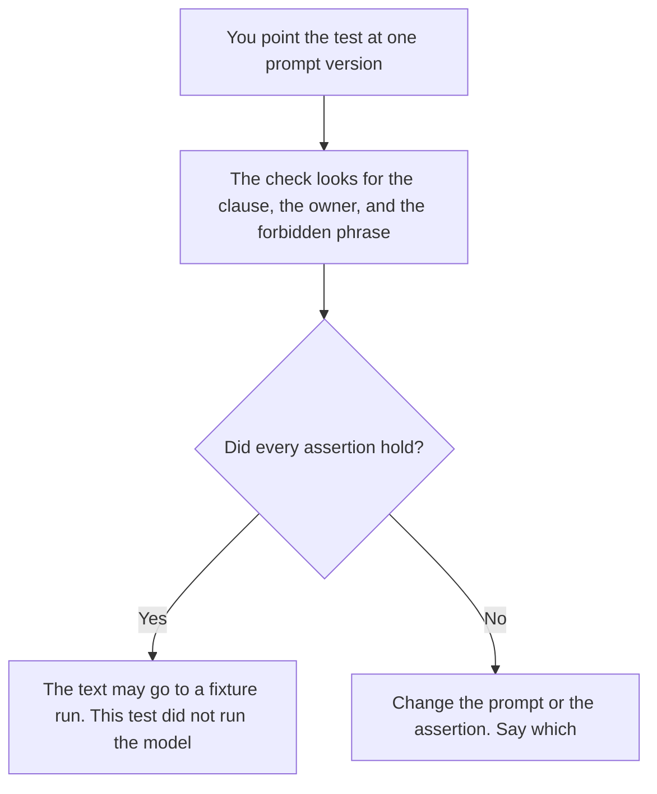

**An AI prompt unit test is a check of the prompt text itself, before any model runs.** The version id is present. The owner is a person. A required clause is in the text. A forbidden phrase is absent. The test fails the file. It does not grade an answer.

Running that prompt on one saved input is [what prompt unit testing is](/blog/what-is-prompt-unit-testing-2026/). The list of prompts allowed to run is [what an AI prompt registry is](/blog/what-is-ai-prompt-registry-2026/). A file check that catches a broken template is [what a prompt linter is](/blog/what-is-prompt-linter-2026/). The id on the wording is [what prompt versioning is](/blog/what-is-prompt-versioning-2026/).

This page is the test of the artifact. A polished paragraph can still fail it. A short paragraph can pass it.

Claude's prices are from claude.com/pricing on October 24, 2026. ChatGPT Plus is $20 a month on learn.chatgpt.com/docs/pricing that day. Notion and Cursor prices are from directory pages checked October 16, 2026. Published October 24, 2026. We did not score prompts. The directory does not list a prompt-unit-test fee.

## What one text check contains

| Piece | The test has | Leave it out when |
|---|---|---|
| Prompt version | The exact text, with an id | You are still brainstorming |
| Required clause | A sentence you wrote must appear | You have not decided the sentence |
| Forbidden phrase | A string that must not appear | You are policing tone by vibe |
| Owner line | A person, not a team alias with no name | Nobody would fix a failure |
| Result | Pass or fail, with the line that failed | The result is "looks ready" |

A fixture run can still fail after this test passes. The text had an owner and the required sentence. The answer on a ticket can still be wrong. That second failure belongs to [prompt unit testing](/blog/what-is-prompt-unit-testing-2026/), which runs the model. Do not collapse the two checks into one green box.

## Where the check is written

**The prompt under test.** [Claude](/tools/claude/) Pro is $17 a month billed annually, $200 up front, or $20 monthly. Keep the required clause in a Project so a later edit is a diff. The review is [Claude review](/blog/claude-review-2026/).

**A one-line assertion from a note you paste.** [ChatGPT](/tools/chatgpt/) Plus is $20 a month. Keep the assertion. Discard a second rule the model invented. The ladder is [ChatGPT pricing explained](/blog/chatgpt-pricing-explained-2026/).

**The check next to the file.** [Cursor](/tools/cursor/) Plus is $8 a month, or $80 a year, when the test is a file in the repo. The editor does not decide the required clause. You do. The ladder is [Cursor pricing explained](/blog/cursor-pricing-explained-2026/).

**The list of clauses.** [Notion AI](/tools/notion-ai/) Business is $20 a seat a month. One row per assertion. Plus at $10 is not the full AI tier. The invoice is [Notion AI pricing explained](/blog/notion-ai-pricing-explained-2026/).

A prompt that holds the line:

"Write prompt unit tests that only check the text I pasted. Assert the version id, the owner, the required clause, and the forbidden phrase I named. If a clause is missing from my paste, write Clause not set. Do not run the prompt. Do not invent an expected answer."

## What not to delegate

Do not ask the model whether the prompt is good. Do not let a test pass because the prose is confident. Do not store a customer secret in the assertion so the test "has a real example." The fixture, if you need one later, uses an input you are allowed to store.

## FAQ

### How is this different from prompt unit testing?

That page runs the prompt on one fixture and checks the answer. This page checks the prompt file before that run. You want the text check first, so you do not spend a model call on a prompt that has no owner.

### How is this different from a linter?

A linter catches a broken template: an unclosed brace, a missing variable. A prompt unit test asserts a product rule you wrote, such as "the refusal sentence is present." Lint can be green while the refusal sentence is gone.

### How is this different from the registry?

The registry says which version may run, and where. The unit test says whether this text meets the checks you listed. A text can pass the test and still be forbidden in production because the registry row is draft.

### Who may change a required clause?

The owner of the prompt. A test that fails after an honest product change is a signal to edit the assertion and say so. A test that was edited until it passed, with no product change, hid the failure.

## Last verified

October 24, 2026 for Claude and for ChatGPT's plan page. October 16, 2026 for Notion and Cursor. Published October 24, 2026.

**Sources:** [Claude pricing](https://claude.com/pricing), [ChatGPT and Codex pricing](https://learn.chatgpt.com/docs/pricing), [Cursor pricing](https://cursor.com/help/account-and-billing/pricing), [Notion pricing](https://www.notion.com/pricing).

*Published by Andrew for [AI Tools Optimizer](https://aitoolsoptimizer.com).*

[Claude](/tools/claude/) is in the [chatbots and assistants directory](/tools/category/chatbots-assistants/). Directory pages may use affiliate links. A purchase through them may earn us a commission at no extra cost to you.
