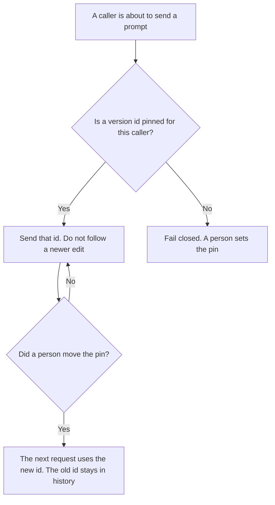

**An AI prompt version pin is the version id a named caller must use.** The caller is a route, a job, or a workspace you wrote down. That caller sends version 14 until a person moves the pin. "Latest" is not a pin. Storing each wording with a number and an owner is [what prompt versioning is](/blog/what-is-prompt-versioning-2026/). This page is the lock. The history can exist, and the live route can still follow whatever was edited this morning.

The shelf of prompts people reuse is [what a prompt library is](/blog/what-is-a-prompt-library-2026/). The row that says a version may run is [what an AI prompt registry is](/blog/what-is-ai-prompt-registry-2026/). A pin does not grant that permission. It only says which id is in force for that caller.

Claude's prices are the October 24, 2026 read of claude.com/pricing recorded in [Claude pricing explained](/blog/claude-pricing-explained-2026/). Notion is the October 16 directory card. ChatGPT's Plus price is the October 24 plan-page figure recorded in [ChatGPT pricing explained](/blog/chatgpt-pricing-explained-2026/). Cursor's Plus price is the October 24 help-center figure recorded in [Cursor Business pricing explained](/blog/cursor-business-pricing-explained-2026/). Published October 24, 2026. We did not score prompts. The directory does not list a pin fee.

## What the pin has to name

| Field | Who writes it | A blank means |
|---|---|---|
| Caller | You: route, job, or workspace | Every caller follows one moving file |
| Version id | You | The caller uses whatever is newest |
| Who may move it | A person | A prompt edit moves production |
| What a missing id does | You: fail closed | The caller guesses a nearby version |
| The date it moved | You, when it moves | You cannot tell which wording a ticket used |

Version 15 can be saved, reviewed, and still not be live. The pin is what makes 14 stay live. A library that auto-publishes the newest file has versioning and no pin. Write the id on the caller. A comment in the prompt that says "v3" is not a pin unless the caller refuses to send anything else.

The note of what changed between ids is [how to create a prompt library changelog with AI](/blog/how-to-create-a-prompt-library-changelog-with-ai-2026/). The changelog explains the move. It does not move the pin.

## Where the pin is written

**The definition, in a Project.** [Claude](/tools/claude/) Pro is $17 a month billed annually, $200 up front, or $20 monthly. Keep the caller and the id in a Project so a later draft does not replace the id with "latest." The review is [Claude review](/blog/claude-review-2026/).

**The page the company opens.** [Notion AI](/tools/notion-ai/) Business is $20 a seat a month. The page lists the caller, the id, and the date. Plus at $10 is not the full AI tier. The invoice is [Notion AI pricing explained](/blog/notion-ai-pricing-explained-2026/).

**One pin from a paste.** [ChatGPT](/tools/chatgpt/) Plus is $20 a month. Go is $8 a month on that October 24 plan page. Plus is the seat for a saved pin. Discard a draft that writes "current." The ladder is [ChatGPT pricing explained](/blog/chatgpt-pricing-explained-2026/).

**The diff, if the pin lives in a repo.** [Cursor](/tools/cursor/) Plus is $8 a month, or $80 a year. You review a diff that points the route at a new id. The individual ladder is [Cursor pricing explained](/blog/cursor-pricing-explained-2026/).

A prompt that holds the line:

"Write the pin from the caller and the version id I pasted. If either is missing, write Pin not set. Do not write latest. Do not move the pin."

## What not to delegate

Do not let a model pick the live version because a newer draft "reads better." Do not unpin a caller to debug and leave it unpinned. Do not treat a changelog entry as the move. A person moves the pin, with a date.

## FAQ

### How is a pin different from versioning?

Versioning stores each wording with a number, an owner, and a reason. The pin says which of those numbers a named caller sends. You can have a full history and still be live on whatever someone edited last. The pin is the line that stops that.

### How is a pin different from a registry row?

The registry says a version is allowed to run at all. The pin says this caller uses this allowed id. An allowed version that is not pinned is not live for that caller. A pinned id that the registry has retired should fail closed until a person picks another id.

### Can two callers pin different ids?

Yes. That is the point. A support route can stay on 14 while a sandbox caller pins 15. Write both pins. Do not average them into "latest."

### Who may move a pin?

The person named on the pin. A model suggestion is not a move. The old id stays addressable after the move so you can put the caller back.

## Last verified

October 24, 2026 for Claude, for ChatGPT's plan page, and for Cursor's help page, via the posts cited above. October 16, 2026 for Notion. Published October 24, 2026. No prompt-version-pin fee is recorded in the directory.

**Sources:** [Claude pricing](https://claude.com/pricing), [Notion pricing](https://www.notion.com/pricing), [ChatGPT and Codex pricing](https://learn.chatgpt.com/docs/pricing), [Cursor pricing](https://cursor.com/help/account-and-billing/pricing).

*Published by Andrew for [AI Tools Optimizer](https://aitoolsoptimizer.com).*

[Claude](/tools/claude/) is in the [chatbots and assistants directory](/tools/category/chatbots-assistants/). Directory pages may use affiliate links. A purchase through them may earn us a commission at no extra cost to you.
