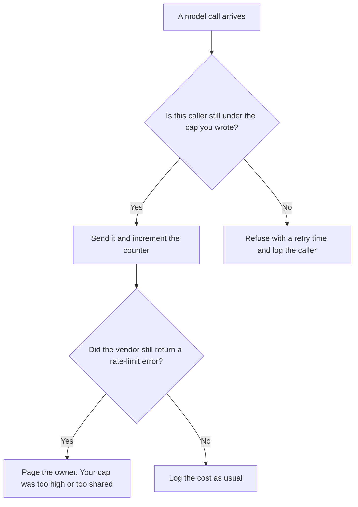

**AI rate limiting is a numeric cap on how many requests a key, a user, an app, or an IP address may send in a window you chose, such as a minute or a day.** When the cap is hit, the next call is refused or delayed, and the caller should see that. The model is unchanged. The door in front of it has a count. A vendor's own cap is a ceiling you do not set. Your limiter is the count you add so production keeps a share before that ceiling arrives.

Who goes first when many callers are waiting is [what AI traffic shaping is](/blog/what-is-ai-traffic-shaping-2026/). A hard stop in dollars, rather than in request counts, is [what AI budget caps are](/blog/what-is-ai-budget-caps-2026/). Which model receives the call that is allowed through is [what AI routing is](/blog/what-is-ai-routing-2026/). The shared front door is [what a model gateway is](/blog/what-is-a-model-gateway-2026/).

Prices are US list prices excluding tax from directory pages checked October 16, 2026. Published October 24, 2026. The directory does not list a rate-limiter product fee, so this page does not invent one. We did not measure any vendor's live request ceiling.

## The count you have to write down

| Decision | Write a number | A bad substitute |
|---|---|---|
| Whose calls share the cap | The key, the team, or the end user | "The company" with no id |
| The window | Per minute for interactive chat, per day for a batch | A window nobody monitors |
| What happens at the cap | A clear refusal with a retry time | A spinner that invites ten retries |
| What is exempt | The path you promised a response time for, with its own smaller cap | Exempting everything that says it is urgent |
| What you log | The caller, the cap, the time, and whether you refused | A 500 that looks like a model outage |

A retry storm is a rate-limit failure. If the client retries immediately, you have multiplied the load you meant to cut. Return a wait. Honor it in the client. The promise you publish for the path that must stay up is [what AI SLA monitoring is](/blog/what-is-ai-sla-monitoring-2026/).

## Seats that are not a limiter

**A chat seat.** [ChatGPT](/tools/chatgpt/) Plus is $20 a month. Business is $20 a user a month billed annually for two or more users, or $25 billed monthly. Those plans have product usage limits that can change. They are not a per-minute cap you author in front of your own API key. The ladder is [ChatGPT Go vs Plus vs Pro](/blog/chatgpt-go-vs-plus-vs-pro-2026/).

**A second seat for writing the policy.** [Claude](/tools/claude/) Pro is $20 a month, or $17 billed annually. Use it to draft the numbers in a sentence finance can read. The gateway enforces the count. The review is [Claude review](/blog/claude-review-2026/).

**A workflow that can be scheduled.** [Make](/tools/make/) Core is $9 a month billed annually for 10,000 credits. A scenario that calls a model on every new row can blow a vendor limit even when the Make bill looks small. Put a cap in front of the model call. Make's credit plan is a different meter. The invoice is [Make pricing explained](/blog/make-pricing-explained-2026/).

**Another task meter, still not the model door.** [Zapier](/tools/zapier/) Professional is $19.99 a month billed annually. Tasks count inside Zapier. They do not count as your model's requests per minute. Read both meters.

The dollars those allowed calls still spend are [what AI cost attribution is](/blog/what-is-ai-cost-attribution-2026/). When the bill jumps inside a cap you thought was safe, the page is [what AI cost anomaly detection is](/blog/what-is-ai-cost-anomaly-detection-2026/).

## Rules that keep a limit honest

Name the caller in the log. A shared key with one bucket means one noisy script starves the product. Split interactive traffic and batch traffic into two caps. Set your cap under the vendor ceiling you have actually seen, and leave headroom for the path you will not refuse.

Do not hide a limit behind a generic error. Support will file it as an outage, and the next incident review will argue about the model instead of the counter. The page for that review is [what AI incident response is](/blog/what-is-ai-incident-response-2026/).

## FAQ

### Is a rate limit the same as a budget cap?

No. A rate limit counts requests in a window. A budget cap counts money. You can be under the dollar cap and still stampede a vendor's per-minute door. You can be under the rate cap and still overspend if each request is huge. Use both when both risks are real.

### Should I limit by user or by API key?

By the thing that can run away. A key shared by a batch job and a website needs two limits. A single internal user with a script needs a user limit. Write the id you will see in the log.

### What do I tell the client at the cap?

The truth: try again after a time you computed, or this action is paused. A client that retries at once will turn a limit into an outage. Document the wait in the API your own app exposes.

### Do vendor plan limits count as my rate limit?

They count as a ceiling. Your limiter is the policy in front of that ceiling. If you only discover the ceiling when customers see errors, you do not have a limit yet. You have an incident.

## Last verified

October 16, 2026 for ChatGPT, Claude, Make, and Zapier. No rate-limiter vendor fee is recorded in the directory. Published October 24, 2026.

**Sources:** [ChatGPT pricing](https://chatgpt.com/pricing/), [Claude pricing](https://claude.com/pricing), [Make pricing](https://www.make.com/en/pricing).

*Published by Andrew for [AI Tools Optimizer](https://aitoolsoptimizer.com).*

[Make](/tools/make/) is in the [automation and agents directory](/tools/category/automation-agents/). Directory pages may use affiliate links. A purchase through them may earn us a commission at no extra cost to you.
