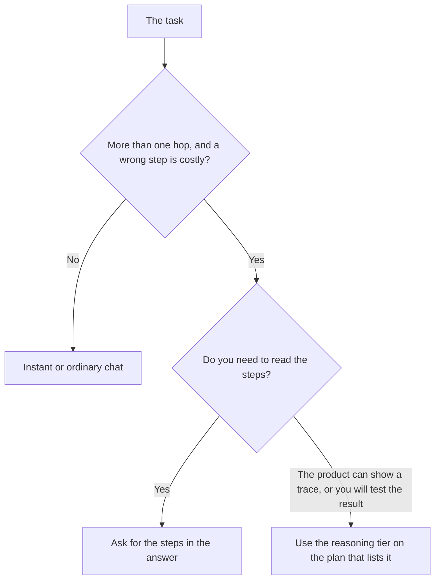

**A reasoning model spends extra steps, often hidden, before it writes the final answer.** You pay for those steps in waiting and in usage. The point is a task with more than one hop: a bug that depends on three files, a schedule with constraints, a calculation you would otherwise have to check line by line. The point is not a headline.

Asking a normal model to "show your work" is a prompt. That prompt is [what chain-of-thought prompting is](/blog/what-is-chain-of-thought-prompting-2026/). A reasoning model is the product doing extra compute whether or not you asked to see it. If you cannot open the trace, you still have to check the answer. Hidden steps are not a proof.

Prices and model rows below come from directory pages checked October 16, 2026, and from the ChatGPT plan matrix recorded October 24, 2026. We did not run a benchmark. There is no reasoning score on this page.

## Prompting versus a reasoning tier

| | Chain-of-thought prompt | Reasoning model or mode |
|---|---|---|
| Who spends the extra tokens | You asked for steps in the reply | The product spends them before the reply, and may hide them |
| What you can audit | The steps, if the model actually wrote them | The final answer, plus a trace only if the product shows one |
| What you pay | Ordinary chat usage | A plan that lists the mode, and a larger slice of the cap |
| When it is wasted | The format was already specified | A rewrite, a short summary, a brainstorm |

OpenAI's recorded matrix puts advanced reasoning on Plus, not on Go. Go stays on the instant tier. Plus, at $20, lists GPT-6 reasoning. Pro, from $100, lists Pro reasoning with GPT-6 Astra and higher GPT-6.1 Sol access. Those names move. The stable fact is the row: reasoning is a Plus feature, and a larger reasoning pool is a Pro feature. The window sizes recorded in that same matrix are 256K for the Plus reasoning window and 400K for Pro. Your paste is smaller than the headline, because instructions and the model's own work share it. The full ladder is [ChatGPT Go vs Plus vs Pro](/blog/chatgpt-go-vs-plus-vs-pro-2026/).

## Which card lists the extra step

| Plan | What this directory recorded | Do not infer |
|---|---|---|
| [ChatGPT](/tools/chatgpt/) Plus, $20 | Advanced reasoning, expanded deep research, projects, expanded Codex | That Go at $8 includes the same reasoning row. It does not, on the October 24 matrix |
| [ChatGPT](/tools/chatgpt/) Pro, $100, $200, or $500 | More usage. Ultrafast is tied to the $500 tier | That Pro is a quality upgrade you can see without hitting a Plus cap |
| [Claude](/tools/claude/) Pro, $20 or $17 billed annually | More usage, more models, Projects, Claude Code | A specific "reasoning" SKU. The directory does not price one separately from the model list |
| [Claude](/tools/claude/) Max, $100 or $200 | 5× or 20× Pro usage | That the multiple is a smarter model. It is capacity |
| [Gemini](/tools/gemini/) Google AI Pro, $19.99 | Gemini 4 Argon, 4× usage, Gemini in Gmail and Docs | That Free's Flash-Lite is the same model. The three-way comparison says it is not |
| [DeepSeek](/tools/deepseek/) | Free chat. API input from $0.15 per 1 million tokens off-peak on a cache miss | A consumer reasoning surcharge. None is recorded here |

Claude's capacity jump is [Claude Pro vs Max](/blog/claude-pro-vs-max-2026/). Gemini's place next to the other two assistants is [ChatGPT vs Gemini vs Claude](/blog/chatgpt-vs-gemini-vs-claude-2026/). A coding agent that spends the reasoning budget inside a repo is a different purchase: [Cursor vs Claude Code vs Codex](/blog/cursor-vs-claude-code-vs-codex-2026/). [Cursor](/tools/cursor/) Plus is $8 on The X Subscription. That $8 is an editor pool, not OpenAI's reasoning row.

## When the wait is the wrong purchase

**The task is a rewrite.** Instant chat is the tool. Reasoning mode will burn the cap and return a slower paragraph. Writing plans are compared in [ChatGPT vs Claude for writing](/blog/chatgpt-vs-claude-for-writing-2026/).

**You will not check the result.** Extra steps do not remove [hallucinations](/blog/what-is-ai-hallucination-2026/). A wrong number with a longer scratchpad is still wrong. Ask for the steps in the answer when you intend to read them.

**You needed a source, not a deduction.** Retrieval is [what RAG is](/blog/what-is-rag-explained-2026/). A reasoning model can still invent a citation if you did not give it the page. [Perplexity](/tools/perplexity/) is the product that ships the link. Pro is $17 a month billed annually.

**You are under the cap.** Do not buy Pro at $100 because a blog said reasoning is better. Buy it when Plus limits stop work you already do. The same rule is why Max exists for Claude.

Temperature and sampling are a different knob. They change how varied the draw is. They are not the reasoning tier. That glossary is [what temperature in AI models is](/blog/what-is-temperature-in-ai-models-2026/).

## FAQ

### Is GPT-6 a reasoning model?

The recorded plans split the family. Free includes GPT-6 text chats with limits on tools. Go stays on the instant tier. Plus is where the advanced reasoning row starts. Pro adds the larger reasoning access, including GPT-6 Astra on the October 24 matrix. Quote the row, not a single model name, when you are buying.

### Does Gemini 4 Argon require Ultra?

No. Google AI Pro at $19.99 lists Gemini 4 Argon. Ultra at $99.99 or $199.99 is a limits and storage step, including YouTube Premium on the higher tier. Free is Flash-Lite on the comparison we recorded.

### Should I use reasoning for every coding question?

Use it when the bug crosses files or the test is failing for a reason you cannot see. A rename, a docstring, and a one-line fix do not need it. Codex on Plus is the coding seat inside ChatGPT. Claude Code starts on Claude Pro. Both still need a human review.

### Are hidden steps chain-of-thought?

They are the vendor's scratchpad. Chain-of-thought, in the glossary this site uses, is the instruction you write so the steps appear in the answer. You can do both. You cannot audit what you cannot see.

## Last verified

October 24, 2026 for the ChatGPT reasoning rows and window figures, as recorded in the Go versus Plus versus Pro article. October 16, 2026 for Claude, Gemini, DeepSeek, Cursor, and Perplexity list prices. Published October 24, 2026.

**Sources:** [ChatGPT pricing](https://chatgpt.com/pricing/), [Claude pricing](https://claude.com/pricing), [Google AI subscriptions](https://gemini.google/subscriptions/).

*Published by Andrew for [AI Tools Optimizer](https://aitoolsoptimizer.com).*

[ChatGPT](/tools/chatgpt/) and [Claude](/tools/claude/) are in the [chatbots directory](/tools/category/chatbots-assistants/). Directory pages may use affiliate links. A purchase through them may earn us a commission at no extra cost to you.
