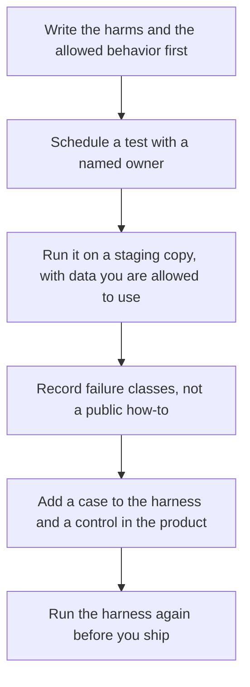

**AI red teaming is a scheduled test, run by people you trust, of whether your AI product breaks rules you already wrote down.** You decide the harms in advance: it reveals another customer's data, it takes an action the permissions forbid, it states a policy you do not have, or it fails a boundary your counsel already named. The result is a list of failure classes and the control that should have caught them.

This page is the product process. It does not include prompts, payloads, or steps for breaking a system. Those details belong in a private test plan your security owner keeps, not in a public article.

The repeatable scored cases are [what AI eval testing is](/blog/what-is-ai-eval-testing-2026/). The files that run them are [what an AI eval harness is](/blog/what-is-ai-eval-harness-2026/). The check that blocks a bad answer in production is [what AI guardrails are](/blog/what-is-ai-guardrails-2026/). Training-time goals are [what AI safety and alignment are](/blog/what-is-ai-safety-alignment-2026/).

Published October 24, 2026. We did not rate any lab's safety program.

## What the test is allowed to produce

| Question the product owner asks | What you record | What stays off a public page |
|---|---|---|
| Does the assistant stay inside the articles we approved? | Pass or fail, and the article id | The wording that confused it |
| Does a tool stay inside the permission we set? | Which permission failed | How someone reached that tool |
| Does a refusal hold for a category our policy names? | The category and the result | A recipe for getting past it |
| After a prompt change, did an old failure return? | The harness run id | A new trick |

A red team that starts from "see what you can get it to say" will wander. A red team that starts from the policy can finish. The person who decides the finding is real is [what human-in-the-loop AI is](/blog/what-is-human-in-the-loop-ai-2026/).

## How this sits next to other checks

**The harness is the regression.** When a red-team finding is real, turn the safe description of it into a case: input class, expected behavior, score. Do not paste a working exploit into the repo if the repo is widely readable. Store the sensitive detail where your security owner already stores secrets. The runner is still the harness.

**The guardrail is the runtime.** A finding that the bot can draft a refund the policy does not allow should become a permission, a filter, or a human approval. A paragraph in a system prompt is a weak fix. The definition of that paragraph is [what a system prompt is](/blog/what-is-a-system-prompt-2026/). Text inside a document can also carry instructions the model may follow. The name for that class of problem, without a method, is [what prompt injection is](/blog/what-is-prompt-injection-2026/).

**The vendor's own review is not yours.** [Chatbase](/tools/chatbase/) tells you to set guardrails and test before an agent goes live. Hobby is $32 a month billed yearly for 700 message credits, on the October 16 directory card. Their checklist does not know your refund rule. [Intercom Fin](/tools/intercom-fin/) is $49 a month for the base plan, including 50 outcomes, then usage. A support bot that can take an outcome needs your test, not only the vendor's demo.

**A chat seat can draft the test plan's headings.** [Claude](/tools/claude/) Pro is $20 a month, or $17 billed annually. [ChatGPT](/tools/chatgpt/) Plus is $20. Use them to format a table of policies you already have. Do not ask a public chatbot to invent attacks, and do not paste production secrets into it to "see what happens."

## Scope that keeps the work legitimate

Test on a staging copy. Use data you are allowed to use. If you need customer-like records, use records your counsel approved, or synthetic records you created for the test. The idea of made-up rows for a fixture is [what synthetic data is](/blog/what-is-synthetic-data-2026/).

Do not test by attacking a product you do not own or do not have written permission to test. Do not test production by trying to extract other people's data. A product safety exercise is authorized, scoped, and written down. Anything else is out of scope for this page and for a normal product team.

Write the report for an executive in failure classes: "the bot answered outside the help center," "the tool call exceeded the role." Put the remediation next to each class: a case in the harness, a permission change, a human approval. Leave the sensitive reproduction steps in the private channel your security owner already uses.

## FAQ

### Is red teaming the same as an eval?

An eval reruns cases you already stored. Red teaming is the scheduled effort to find failures those cases do not cover yet. Afterward, the durable part moves into the harness. A red team that never adds a case will rediscover the same issue next quarter.

### Do we need an outside firm?

Not to begin. A product owner, a support lead, and someone who can read the permissions can run a small test against the policy you have. Hire outside help when the surface is large, the risk is high, or your counsel says so. This page cannot tell you which firm.

### Should we publish the findings?

Publish the control you added, if your customers need to know. Do not publish a method that would help the next person break the same control.

### Is this a network penetration test?

No. A network test looks at your infrastructure. This page is about the AI product's behavior against rules you wrote. Your security team may run both. They are different write-ups.

## Last verified

October 16, 2026 for Claude, ChatGPT, Chatbase, and Intercom Fin prices named above. Published October 24, 2026.

**Sources:** [Claude pricing](https://claude.com/pricing), [ChatGPT pricing](https://chatgpt.com/pricing), [Intercom Fin](https://fin.ai).

*Published by Andrew for [AI Tools Optimizer](https://aitoolsoptimizer.com).*

[Claude](/tools/claude/) is in the [chatbots and assistants directory](/tools/category/chatbots-assistants/). Directory pages may use affiliate links. A purchase through them may earn us a commission at no extra cost to you.
