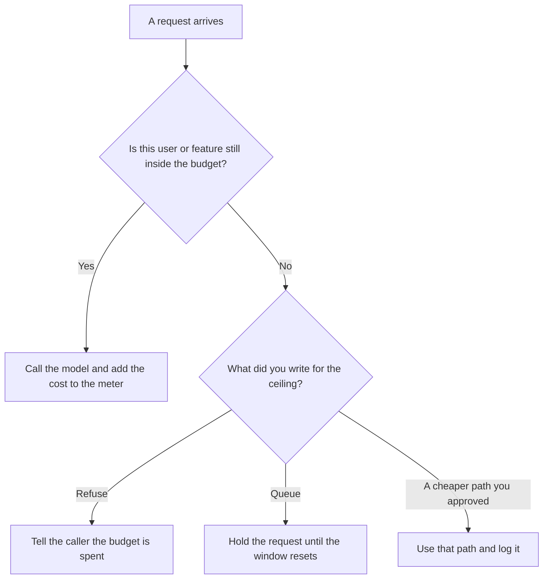

**An AI request budget is the maximum number of model calls, or the maximum spend, that a user, a feature, or a day may consume before the next request is refused or queued.** The cap is a product decision. A chat box with no ceiling will spend the month on one loop.

The counter on a single failed call, which is a different number, is [what an AI retry budget is](/blog/what-is-ai-retry-budget-2026/). The vendor limit on how fast a key may call, which protects the provider, is [what AI rate limiting is](/blog/what-is-ai-rate-limiting-2026/). The unit those calls consume is [what AI tokens are](/blog/what-are-ai-tokens-explained-2026/). A stored answer that can avoid a call is [what AI response caching is](/blog/what-is-ai-response-caching-2026/).

Prices are US list prices excluding tax from directory pages checked October 16, 2026. Published October 24, 2026. The directory does not list a request-budget product fee. We did not measure spend for any team.

## What the budget has to name

| Line | A written budget | An accident |
|---|---|---|
| Who | A user, a feature, or a workspace | "The company," with no owner |
| Count or dollars | A number you can read on a meter | "Reasonable use" |
| Window | A day, a month, or a launch | Forever |
| At the ceiling | Refuse, queue, or a cheaper path you already approved | A silent upgrade to a larger model |
| Exceptions | Named jobs that may pass, with a person | Every internal user |

A seat price is not the budget. [ChatGPT](/tools/chatgpt/) Plus at $20 a month can still sit in front of an API key with no ceiling. The Plus invoice and the API invoice are different meters. Do not add them and call the sum a request budget.

## Where the number is kept

**The policy note.** [Claude](/tools/claude/) Pro is $20 a month, or $17 billed annually, when the budget is a page: who, how many, and what happens at the ceiling. The review is [Claude review](/blog/claude-review-2026/).

**A short card in a project.** [ChatGPT](/tools/chatgpt/) Plus is $20 a month. Business is $20 a user a month billed annually for two or more users, or $25 billed monthly, and does not train on business data by default. Use Business when the budget names customers. The ladder is [ChatGPT Go vs Plus vs Pro](/blog/chatgpt-go-vs-plus-vs-pro-2026/).

**The check in code.** [Cursor](/tools/cursor/) Plus is $8 a month, or $80 a year, when the budget is a constant in the repo. You review the number. A generated "unlimited for admins" line is a defect until someone meant it. The ladder is [Cursor pricing explained](/blog/cursor-pricing-explained-2026/).

**The zap that can fan out.** [Zapier](/tools/zapier/) Professional is $19.99 a month billed annually. A Zap that calls a model once per row can empty a daily budget before lunch. Cap the rows. Zapier's task count is not your model budget. The invoice is [Zapier pricing explained](/blog/zapier-pricing-explained-2026/).

A prompt that holds the line:

"Format a request budget from the owner, the count or dollar ceiling, the window, and the at-ceiling action I pasted. Do not add an exception. If the ceiling action is missing, write Ceiling missing and stop."

## What not to delegate

Do not ask the model what the budget should be. That number comes from the bill you can tolerate and the job the feature does. Do not hide the ceiling from the person who hits it. A spinner that never explains the stop will be reported as an outage. The note you write when a dependency can blow the budget is [how to write a dependency risk note with AI](/blog/how-to-write-a-dependency-risk-note-with-ai-2026/).

## FAQ

### How is this different from a retry budget?

A retry budget limits extra tries of one failed call. A request budget limits how many calls a user or a feature may make in a window, including the ones that succeed. You need both. A tight retry budget inside an uncapped feature still spends the month.

### Should the budget be calls or dollars?

Use the unit you can see on the invoice. If the vendor bills tokens, a call count is a proxy and a long answer costs more than a short one. If you only have a seat, the budget is a habit cap, and you should say so. Do not invent a per-call dollar the vendor did not print.

### Can one user have a larger budget?

Yes, if you name them and why. An unnamed "power user" flag will become everyone. Write the exception, the owner, and the date it expires.

### What belongs in the message at the ceiling?

The window, when it resets, and whether the work was queued. Do not imply the model is down. A spent budget is a limit you set.

## Last verified

October 16, 2026 for Claude, ChatGPT, Cursor, and Zapier. No request-budget fee is recorded in the directory. Published October 24, 2026.

**Sources:** [Claude pricing](https://claude.com/pricing), [ChatGPT pricing](https://chatgpt.com/pricing/), [Cursor pricing](https://cursor.com/help/account-and-billing/pricing), [Zapier pricing](https://zapier.com/blog/zapier-pricing/).

*Published by Andrew for [AI Tools Optimizer](https://aitoolsoptimizer.com).*

[Zapier](/tools/zapier/) is in the [automation and agents directory](/tools/category/automation-agents/). Directory pages may use affiliate links. A purchase through them may earn us a commission at no extra cost to you.
