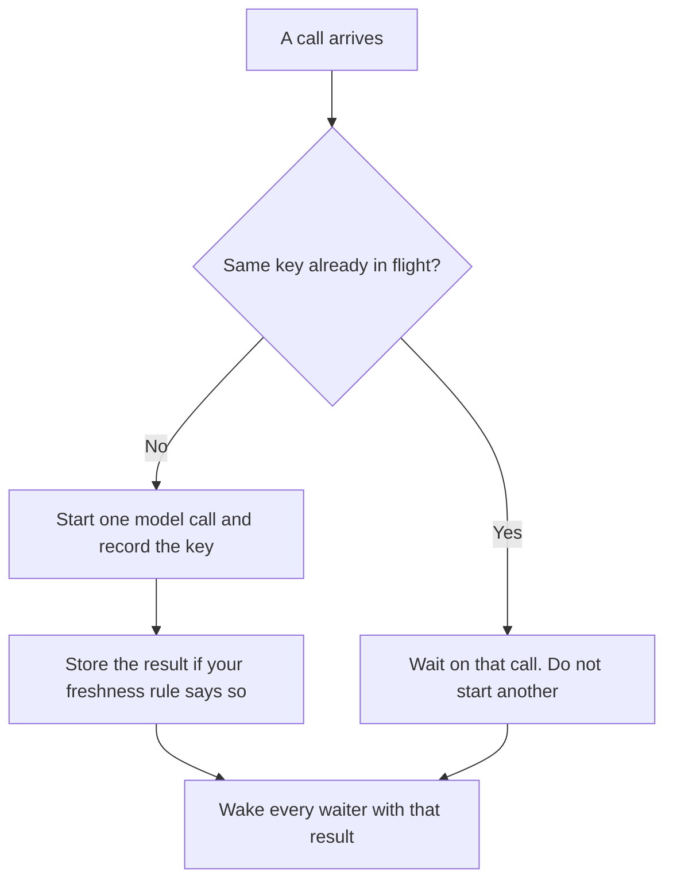

**AI request coalescing means identical calls that are already in flight share one model request, and every waiter receives that one result.** The second click does not start a second generation. It waits on the first. A cache is the result you stored after a call finished. A batch is a pile of different jobs that are allowed to wait.

The pile of different jobs is [what AI batch inference is](/blog/what-is-ai-batch-inference-2026/). A short-window cap on how many calls you start is [what AI rate limiting is](/blog/what-is-ai-rate-limiting-2026/). The monthly share each team may spend is [what AI quota management is](/blog/what-is-ai-quota-management-2026/). Dropping work you can skip is [what AI load shedding is](/blog/what-is-ai-load-shedding-2026/).

Prices are US list prices excluding tax from directory pages checked October 16, 2026. Published October 24, 2026. The directory does not list a coalescing product fee, so this page does not invent one. We did not measure duplicate-call rates for any vendor.

## Three ways the second call can be handled

| Approach | When it applies | What the second caller gets | What it does not do |
|---|---|---|---|
| Coalescing | The same request is already running | The result of that run, when it finishes | It does not answer from yesterday |
| Cache | A finished result is still inside the freshness window you set | The stored result, immediately | It does not help the first stampede, before anything is stored |
| Batch | Many different requests can wait | A later result, on the batch clock | It does not make a live click faster |
| Nothing | Every click is a new call | Its own answer, and its own bill | It does not notice that the prompts matched |

The key is the part you define: model, prompt, tool set, and any header that changes the answer, such as the user id when the answer is personal. Coalescing two users onto one personalized answer is a privacy bug. Coalescing two identical public FAQ lookups is the feature.

## Where the stampede comes from

A status page, a launch email, and a retry loop can ask the same question in the same second. Retries without a shared in-flight map multiply a failure. The switch that should stop a failing dependency is the [circuit breaker](/blog/what-is-ai-circuit-breaker-2026/). Coalescing is for the successful stampede: the model is up, and you are about to pay for the same completion twenty times.

**An API you own the client for.** [DeepSeek](/tools/deepseek/) records input from $0.15 per 1 million tokens off-peak on a cache miss, and output at $0.60 per 1 million tokens off-peak. Duplicate in-flight calls spend that meter twice. Coalescing is a client behavior. The price card does not turn it on.

**A seat product.** [ChatGPT](/tools/chatgpt/) Plus is $20 a month. [Claude](/tools/claude/) Pro is $20 a month, or $17 billed annually. People clicking those websites are not your coalescing layer. Your layer starts when your app calls a model for many users. This page does not invent an API rate for either seat.

**A workflow tool.** [Zapier](/tools/zapier/) Professional is $19.99 a month billed annually. Two Zaps that fire on the same event can still call a model twice. Confirm whether your scenario shares work. Do not assume the plan includes a single-flight map.

The signals that tell you coalescing worked are a count of waiters per key and a count of model calls. Those fields are [AI telemetry](/blog/what-is-ai-telemetry-2026/). If waiters stay at one, you have not seen the stampede yet, and you may not need the map.

## What not to merge

Do not coalesce requests that include a user's private document, even if the question text matches. Do not coalesce a call that has a side effect: sending an email, writing a ticket, charging a card. Share the read. Run the write once, on purpose, with an idempotency key you already designed. A shared generation that triggers two refunds is a worse bug than a duplicate bill for tokens.

Do not hold waiters past a timeout you show in the product. If the leader call hangs, every waiter hangs with it. The leader needs the same timeout you would have used for one call. When it trips, the breaker is the next decision, and the waiters get the fast error you already defined.

## FAQ

### Is coalescing a cache?

A cache answers from a finished result. Coalescing answers from a call that has not finished. You can use both. The cache does not remove the stampede on a cold key. Coalescing does not help a minute later, after the call has completed and a new one starts, unless you also stored the result.

### Will this make the first user faster?

The first user waits on the model, as before. The users who arrive while that call is in flight avoid a second bill and a second queue slot. If you need the first user to be faster, coalescing is the wrong lever. A shorter prompt is [token budgeting](/blog/what-is-token-budgeting-2026/).

### Should personalized answers share a key?

Only when the personalization is not in the prompt. If the prompt contains the user's data, the key includes that user. Two identical questions from two accounts stay two calls.

### Is this the same as vendor prompt caching?

Vendor prompt caching, when a provider offers it, is their discount for a repeated prefix. Coalescing is your decision to start one call. Read the current price card before you assume a discount. This page does not invent one.

## Last verified

October 16, 2026 for DeepSeek, ChatGPT, Claude, and Zapier. Published October 24, 2026. The definition does not depend on a price change.

**Sources:** [DeepSeek API docs](https://api-docs.deepseek.com/), [ChatGPT pricing](https://chatgpt.com/pricing/), [Claude pricing](https://claude.com/pricing), [Zapier pricing](https://zapier.com/pricing).

*Published by Andrew for [AI Tools Optimizer](https://aitoolsoptimizer.com).*

[DeepSeek](/tools/deepseek/) is in the [chatbots and assistants directory](/tools/category/chatbots-assistants/). Directory pages may use affiliate links. A purchase through them may earn us a commission at no extra cost to you.
