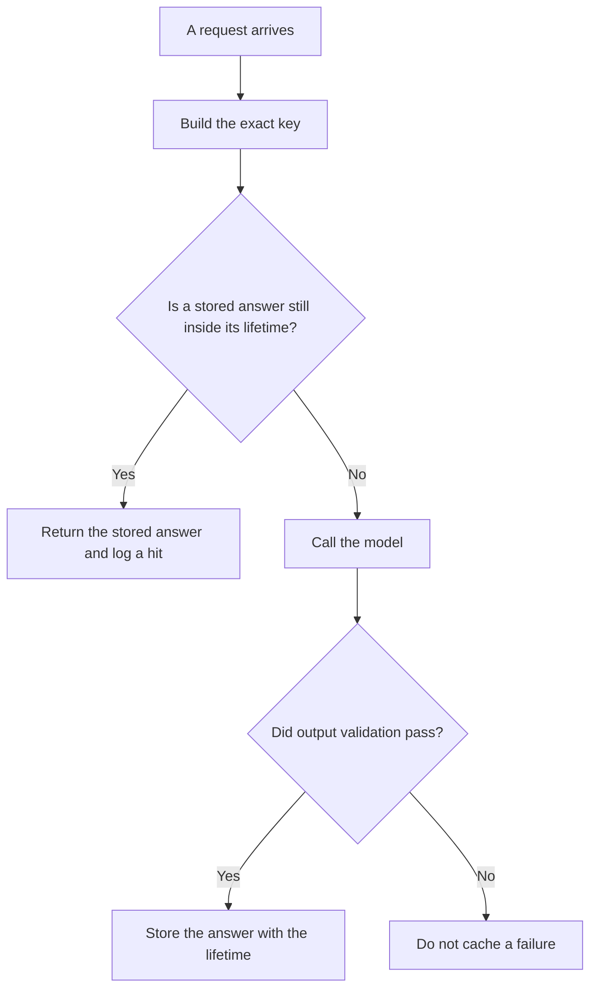

**AI response caching stores one finished answer under an exact request key, and returns that answer on a later request with the same key, without calling the model again.** The feature that reuses a repeated prefix inside a new model call is [what prompt caching is](/blog/what-is-prompt-caching-2026/). The share of input that hit that prefix store is [what an AI prompt cache hit rate is](/blog/what-is-ai-prompt-cache-hit-rate-2026/). A cache that matches by meaning, and can return the wrong answer for a similar question, is [what semantic caching for an LLM is](/blog/what-is-semantic-caching-for-llm-2026/). This page is the whole answer, an exact key, and a lifetime you wrote.

How long you are allowed to keep the stored answer is [what an AI data retention policy is](/blog/what-is-ai-data-retention-policy-2026/). The counter on the call you skipped is still [what AI token metering is](/blog/what-is-ai-token-metering-2026/). A product that bills a repeated prefix as its own object is [what a context cache is](/blog/what-is-a-context-cache-2026/).

Prices are US list prices excluding tax from directory pages checked October 16, 2026. A live fetch of vendor pricing pages returned HTTP 401 on October 24, 2026, so this page stays on the directory record. Published October 24, 2026. The directory does not record a response-cache price for these seats, so this page does not invent one. We did not measure hit rates.

## What belongs in the key

| Piece | Put it in the key | Leave it out |
|---|---|---|
| The exact user text, after your normalizer | Yes | A paraphrase |
| The prompt version | Yes | "The current prompt" with no number |
| The model id | Yes | A family name that can move |
| Retrieval ids that the answer relied on | Yes | A hope that the index did not change |
| The user, when the answer is private | Yes | A shared key for a personal account balance |
| The time bucket, when the fact expires | Yes, if you defined the bucket | Forever |

Do not cache a response that failed validation. Do not cache an answer that includes another user's data under a key that omits the user. Do not treat a hit as proof the answer is still true. The lifetime is the promise that you will call the model again. When the lifetime ends, the stored text is expired even if it looks fine. The gate before you store anything is [what AI output validation is](/blog/what-is-ai-output-validation-2026/).

## Where the rule is written

**The policy paragraph.** [Claude](/tools/claude/) Pro is $20 a month, or $17 billed annually, when the key fields and the lifetime live in a Project the on-call can open. The review is [Claude review](/blog/claude-review-2026/).

**A short reusable card.** [ChatGPT](/tools/chatgpt/) Plus is $20 a month when you keep one project that formats the cache rule the same way each time. The review is [ChatGPT review](/blog/chatgpt-review-2026/).

**A metered API, when you are comparing bills.** [DeepSeek](/tools/deepseek/) publishes separate hit and miss prices for prompt caching on the directory card checked October 16, 2026. That card is about prefix reuse, which is the other article. It is not a license to assume a response cache has the same discount. The invoice is [DeepSeek pricing explained](/blog/deepseek-pricing-explained-2026/).

**A workflow that must not serve a stale row.** [Zapier](/tools/zapier/) Professional is $19.99 a month billed annually. A zap that caches a CRM summary in a table needs the same lifetime and the same key rules. A successful action still counts as a task.

A prompt that holds the line:

"Write the response-cache rule from the key fields and the lifetime I pasted. State that a failed validation is not stored. Do not add a hit-rate target. Do not claim a discount. If the lifetime is missing, write Lifetime missing."

## What not to cache

Do not cache personalized advice, medical or legal conclusions, or anything your retention rule says must not be stored. Do not share one cached answer across tenants. Do not use a semantic neighbor as if it were an exact key. Similar wording is how the wrong price gets served twice. Exact means exact, after a normalizer you can explain.

## FAQ

### How is this different from prompt caching?

Prompt caching saves work inside a model call by reusing a prefix the vendor already computed. You still call the model, and you can still get a new completion. Response caching skips the model call and returns the previous completion. The bills are different. The risks are different.

### Can I cache for a week if the facts are stable?

Only if a person set that lifetime because the source will not change, or because you accept being wrong until the lifetime ends. "Stable" is not a number. Write the duration.

### Should errors be cached?

A validation failure should not be stored as a success. A timeout can be stored only if you meant to remember "this key failed" for a short period so you do not hammer the tool. That is a negative cache, and it needs its own short lifetime. It is not the answer.

### Who deletes the entry?

The owner of the cache, on the retention date, and immediately when the prompt version or the model id in the key is retired. An entry whose key no longer matches production will not be read, and it is still data you are keeping.

## Last verified

October 16, 2026 for Claude, ChatGPT, DeepSeek, and Zapier. Published October 24, 2026. Live pricing fetches returned HTTP 401 that day.

**Sources:** [Claude pricing](https://claude.com/pricing), [ChatGPT pricing](https://chatgpt.com/pricing/), [DeepSeek](https://www.deepseek.com/), [Zapier pricing](https://zapier.com/blog/zapier-pricing/).

*Published by Andrew for [AI Tools Optimizer](https://aitoolsoptimizer.com).*

[DeepSeek](/tools/deepseek/) is in the [chatbots and assistants directory](/tools/category/chatbots-assistants/). Directory pages may use affiliate links. A purchase through them may earn us a commission at no extra cost to you.
