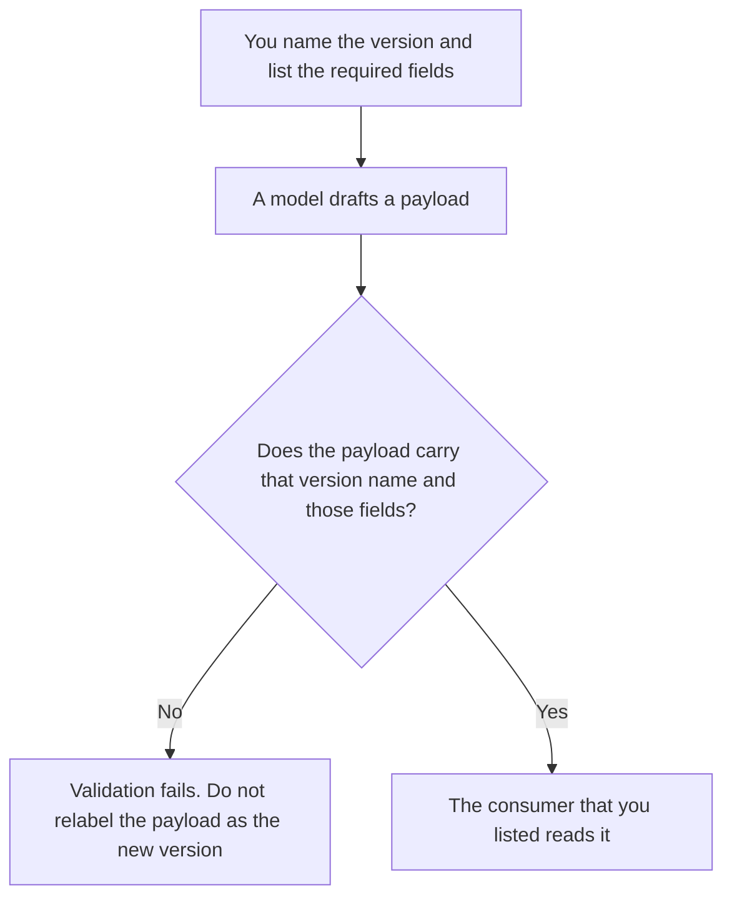

**An AI response schema version is the name you give a response shape, such as `decision.v3`, plus the list of fields that version requires.** Callers match on the name. They do not guess from a sample. The version does not force the model to comply. Forcing a failure when the shape is wrong is [what an AI output schema lock is](/blog/what-is-ai-output-schema-lock-2026/). Checking a tool's return, which is a different payload, is [what an AI tool result schema is](/blog/what-is-ai-tool-result-schema-2026/).

Rejecting a payload that fails the checks you wrote is [what AI output validation is](/blog/what-is-ai-output-validation-2026/). This page is the name and the field list. It is not the validator.

Claude's prices are from claude.com/pricing on October 24, 2026. ChatGPT's Plus price is from learn.chatgpt.com/docs/pricing that day. Cursor and GitHub Copilot prices are from directory pages checked October 16, 2026. Published October 24, 2026. We did not score how often a model matches a shape. The directory does not list a schema-version fee.

## What a version has to carry

| Field | Who writes it | A missing value becomes |
|---|---|---|
| The version name | You | The consumer cannot tell v2 from v3 |
| Required fields, and which older fields you removed | You | A silent drop that breaks a caller |
| The date the version became the one production may emit | You | "Current" with no date |
| The consumer that is allowed to read it | You | Every caller, including ones you forgot |

A model that adds a field and calls the result `v4` has not shipped a version. You ship a version when you write the name, the field list, and the date. Two payloads with the same name and different fields are a bug, not a minor update.

## Where the name lives

**The contract text.** [Claude](/tools/claude/) Pro is $17 a month billed annually, $200 up front, or $20 monthly. Keep the field list in a Project. A chat that "improves" the JSON is not a release. The review is [Claude review](/blog/claude-review-2026/).

**The code that checks the name.** [Cursor](/tools/cursor/) Plus is $8 a month, or $80 a year. You review the diff. The ladder is [Cursor pricing explained](/blog/cursor-pricing-explained-2026/).

**One example payload.** [ChatGPT](/tools/chatgpt/) Plus is $20 a month. Paste the field list. Discard an example that adds a field you did not list. The ladder is [ChatGPT pricing explained](/blog/chatgpt-pricing-explained-2026/).

**The company coding seat.** [GitHub Copilot](/tools/github-copilot/) Business is $19 a user a month on the October 16 card. The schema check is still your test. The invoice is [GitHub Copilot Business pricing explained](/blog/github-copilot-business-pricing-explained-2026/).

A prompt that holds the line:

"Write an example payload for the version name and the required fields I pasted. If a field is not on the list, do not add it. Do not invent a newer version name."

## What not to delegate

Do not let the model bump the version because a response looked richer. Do not keep two field lists under one name. Do not treat a green example in chat as proof the consumer accepts it. Run the validator you already have, and record the version it accepted.

## FAQ

### How is this different from a schema lock?

The lock stops a bad payload from leaving. The version is the name of the shape the lock checks. You can have a version with no lock, which means bad payloads still ship with a confident name. You can have a lock with no version, which means callers cannot tell which contract they passed.

### How is this different from a tool result schema?

A tool result schema describes what a tool returns to the model. A response schema version describes what your system returns to a caller. They can both be JSON. They are not the same contract. Do not reuse the name.

### Can one version add an optional field?

Only if you wrote that the field is optional, and older consumers are allowed to ignore it. If a consumer will break without the field, it is required, and it belongs in a new version name. The model does not get to call a break "optional."

### Who may retire a version?

The owner of the consumer list. Retiring means you named the date and the replacement version. A prompt that stops mentioning the old name has not retired it. Callers still on the old name need the date in writing.

## Last verified

October 24, 2026 for Claude and for ChatGPT's plan page. October 16, 2026 for Cursor Plus and GitHub Copilot. Published October 24, 2026.

**Sources:** [Claude pricing](https://claude.com/pricing), [ChatGPT and Codex pricing](https://learn.chatgpt.com/docs/pricing), [Cursor pricing](https://cursor.com/help/account-and-billing/pricing), [GitHub Copilot](https://github.com/features/copilot).

*Published by Andrew for [AI Tools Optimizer](https://aitoolsoptimizer.com).*

[Claude](/tools/claude/) is in the [chatbots and assistants directory](/tools/category/chatbots-assistants/). Directory pages may use affiliate links. A purchase through them may earn us a commission at no extra cost to you.
