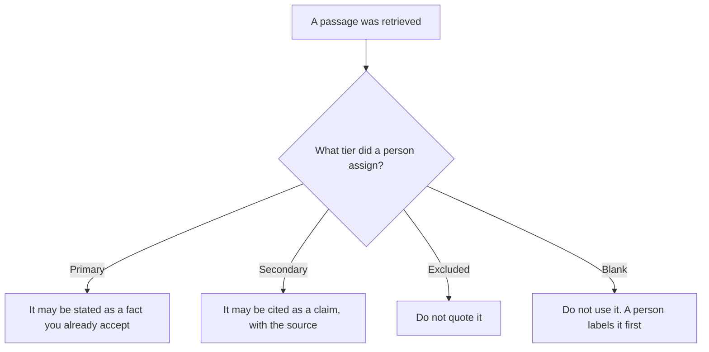

**An AI retrieval authority tier is a label a person puts on a source that says how an answer may use it.** A tier you write might be primary, meaning the passage may be stated as a fact you already accept, secondary, meaning it may be cited as someone else's claim, or excluded, meaning it may not be quoted. The rule that keeps or drops one passage is [what an AI retrieval filter is](/blog/what-is-ai-retrieval-filter-2026/). Which filter binds which collection is [what an AI retrieval filter policy is](/blog/what-is-ai-retrieval-filter-policy-2026/). This page is the trust label. It is not the keep-or-drop rule.

The share of relevant passages you meant to retrieve is [what an AI retrieval recall target is](/blog/what-is-ai-retrieval-recall-target-2026/). How much neighboring text you keep with a chunk is [what AI retrieval chunk overlap is](/blog/what-is-ai-retrieval-chunk-overlap-2026/). Overlap does not make a source primary. A high rank does not assign a tier.

Claude's prices are the October 24, 2026 read of claude.com/pricing recorded in [Claude pricing explained](/blog/claude-pricing-explained-2026/). Perplexity, Notion, and Cursor prices are from directory pages checked October 16, 2026. Perplexity's $17 annual Pro figure was reconfirmed in the October 24 pricing article. A refetch of the hub pricing URL returned HTTP 403, as that article records, so this page does not add a new Perplexity dollar. Published October 24, 2026. We did not score answers. The directory does not list an authority-tier fee.

## What the tier has to say

| Line | Who writes it | A blank means |
|---|---|---|
| Source name | You | Two pages share a nickname |
| Tier | You: primary, secondary, or excluded | The answer treats a marketing page as a fact |
| What the tier allows | You, in words | "Use it" might mean quote, or paraphrase, or ignore |
| Date you labeled it | You | Last year's tier rides on this year's page |
| Who may change the tier | A person | The model promotes a source after one good sentence |

Authority is not relevance. A relevant vendor page can stay secondary. An internal policy you approved can stay primary even if a ranker scored it lower. The model does not pick the tier from the tone of the page. If the passage and the tier disagree with a newer page you have labeled, a person updates the tier. The draft does not average them.

A filter can drop an excluded source before retrieval. The tier still exists for the sources you allowed through. A filter policy without tiers can retrieve the right collection and still let a brochure speak as policy. Write both.

## Where the tier is kept

**The definition of the tiers you allow.** [Claude](/tools/claude/) Pro is $17 a month billed annually, $200 up front, or $20 monthly. The Project holds the three words and what each word permits. The review is [Claude review](/blog/claude-review-2026/).

**A public page you are willing to cite.** [Perplexity](/tools/perplexity/) Pro is $17 a month billed annually on the October 16 card. The citation is the page. The tier is still yours. The invoice is [Perplexity Pro pricing explained](/blog/perplexity-pro-pricing-explained-2026/).

**The register.** [Notion AI](/tools/notion-ai/) Business is $20 a seat a month. One row per source, the tier, the date, and the owner. Plus at $10 is not the full AI tier. The invoice is [Notion AI pricing explained](/blog/notion-ai-pricing-explained-2026/).

**The diff, if the tier lives next to the index config.** [Cursor](/tools/cursor/) Plus is $8 a month, or $80 a year, on the October 24 help page recorded in [Cursor Business pricing explained](/blog/cursor-business-pricing-explained-2026/). You review a diff that moves a source from secondary to primary.

A prompt that holds the line:

"Draft the authority row from the source name and the tier I pasted. If the tier is missing, write Tier not set. Do not quote the passage. Do not promote a source to primary."

## What not to delegate

Do not ask which sources are "authoritative." Do not treat a citation as a tier. Do not let a retrieved brochure fill a blank tier. The owner of the index sets the label. A formatted table is not the tier.

## FAQ

### How is this different from a retrieval filter?

A filter keeps or drops a passage based on a rule you wrote: collection, date, tenant, role. A tier says how a passage that was kept may be used in the answer. You can filter a source in and still mark it secondary. You can exclude a source in the tier list and also filter it out. The filter does not assign trust.

### How is this different from a filter policy?

The policy says which filter binds which collection and which role. The tier is a label on a source, whoever is asking. A policy can point the right filter at the right index and still have no authority labels. Write the policy for access. Write the tier for how the answer may speak.

### How is this different from a recall target?

The recall target is the share of relevant passages you meant to retrieve. A tier does not change that share. You can hit the target and still quote a secondary source as fact. You can miss the target and still label the sources you did retrieve. The target is a count. The tier is a use.

### Who may change a tier?

The person named on the row. Moving a source from secondary to primary, or from excluded to anything else, is a new version of the row, with a date. Last month's answers stay attached to the tier they used.

## Last verified

October 24, 2026 for Claude, via the pricing article, and for Cursor's help page, via the Business pricing article. October 16, 2026 for Perplexity and Notion, with Perplexity's annual Pro figure reconfirmed in the October 24 pricing article. Published October 24, 2026.

**Sources:** [Claude pricing](https://claude.com/pricing), [Perplexity pricing](https://www.perplexity.ai/hub/pricing), [Notion pricing](https://www.notion.com/pricing), [Cursor pricing](https://cursor.com/help/account-and-billing/pricing).

*Published by Andrew for [AI Tools Optimizer](https://aitoolsoptimizer.com).*

[Perplexity](/tools/perplexity/) is in the [research and search directory](/tools/category/research-search/). Directory pages may use affiliate links. A purchase through them may earn us a commission at no extra cost to you.
