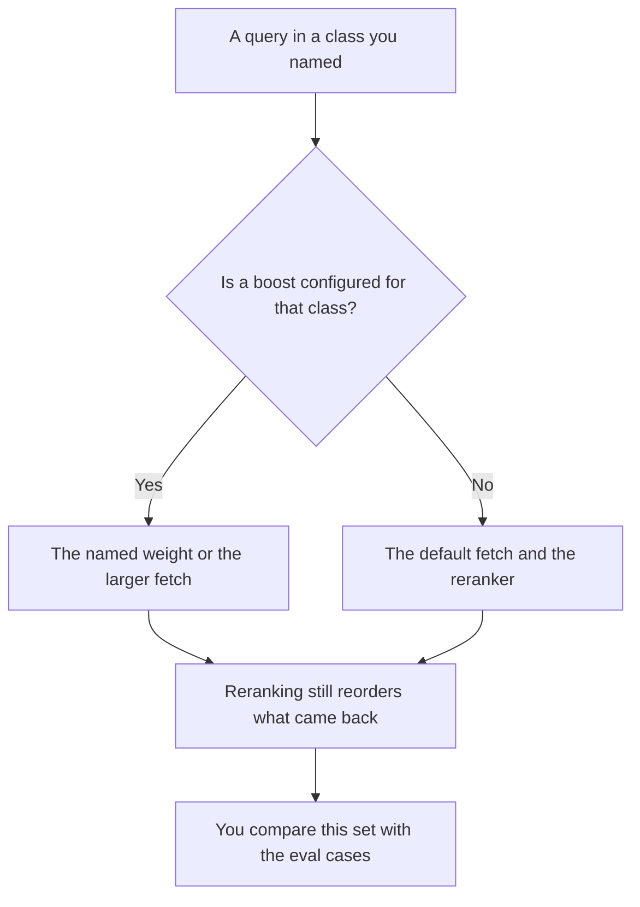

**An AI retrieval boost is a named change to retrieval for a query class a person configured: more passages, or a higher weight on a source, that you can point at and turn off.** It is not a claim that the answer got better. The second pass that reorders passages you already fetched is [what retrieval reranking is](/blog/what-is-retrieval-reranking-2026/). Whether a page is current is [what retrieval freshness is](/blog/what-is-retrieval-freshness-2026/). A boost that you cannot name is a hidden preference.

Fetching passages at all is [what RAG is](/blog/what-is-rag-explained-2026/). How you tell a good fetch from a bad one is [what retrieval evaluation is](/blog/what-is-retrieval-evaluation-2026/). The payload those passages join is [what AI prompt compilation is](/blog/what-is-ai-prompt-compilation-2026/).

Perplexity and Notion prices are from directory pages checked October 16, 2026. Claude's prices are from claude.com/pricing on October 24. ChatGPT's seat price is from the October 16 card. chatgpt.com/pricing returned HTTP 403 that day. Published October 24, 2026. We did not score answers. The directory does not list a separate "boost" SKU, so this page does not invent a fee for one.

## What you are allowed to boost

| Change | Write it down as | Turn it off when |
|---|---|---|
| A larger k for one query class | "Fetch 12, not 4, for policy questions" | The extra passages are noise on the eval set |
| A source weight | "Prefer the handbook collection by N" | The handbook is stale and freshness already failed |
| A metadata filter people call a boost | "Only this tenant's docs" | It is a filter, and the name should say so |
| A temporary boost for an incident | The incident id and the end date | The date arrives. A boost with no end date becomes the default |

A filter is not a boost. A filter drops documents. A boost changes rank or count among documents the query was allowed to see. Calling a tenant filter a boost hides an access-control rule inside a relevance story. Write the filter on its own line.

A model that says it "focused on the important source" has not documented a boost. If the weight is not in the config, the next person cannot turn it off, and you cannot explain why a passage appeared.

## Where you inspect the set

**Cited web results.** [Perplexity](/tools/perplexity/) Pro is $17 a month billed annually on the October 16 card. The page lists Model Council on Pro and Max. A citation you can open is the check. A boost inside a vendor's ranker is not something this card prices separately. The invoice is [Perplexity pricing explained](/blog/perplexity-pricing-explained-2026/).

**A wiki you own.** [Notion AI](/tools/notion-ai/) Business is $20 a seat a month if search runs across the workspace and connected apps. Plus at $10 is not the full AI tier on that card. You can see which page was retrieved only if the product shows it. The invoice is [Notion AI pricing explained](/blog/notion-ai-pricing-explained-2026/).

**A reading of the set you already fetched.** [Claude](/tools/claude/) Pro is $17 a month billed annually, $200 up front, or $20 monthly. Paste the passage ids before and after the boost. Ask what entered and what left. The review is [Claude review](/blog/claude-review-2026/).

**One comparison, from two lists.** [ChatGPT](/tools/chatgpt/) Plus is $20 a month on the October 16 card. Do not ask which list is "more relevant." Ask which ids differ.

A prompt that holds the line:

"Compare these two passage-id lists. Say which ids the boost added and which it dropped. Do not judge which list answers the question better. Do not add an id that is not in the paste."

## What not to delegate

Do not leave a launch-week boost on after the incident date. Do not raise k until the context window overflows and then call the overflow a retrieval win. The fit problem is [what token budgeting is](/blog/what-is-token-budgeting-2026/). Do not treat a higher weight as permission to skip freshness.

## FAQ

### How is a boost different from reranking?

Reranking reorders the candidates the first pass already returned. A boost can change that candidate set, or change a weight before the reranker runs. You can rerank with no boost. You can boost and still rerank. Log both, or you will not know which step moved the passage.

### How is a boost different from freshness?

Freshness asks whether the page is current enough to use. A boost can prefer a collection. It cannot make an old page current. If the fresh copy lost because of a weight, the weight is the bug.

### Do I need a special boost product?

You need a config line with an owner and an end date when the change is temporary. A search engine's internal rank is not your boost unless you can read the setting. This page does not price that setting.

### Who may turn a boost on?

The owner of the retrieval config. An eval movement is an input. It is not a signature. A single chat that "liked" the new passages is not an eval.

## Last verified

October 24, 2026 for Claude. October 16, 2026 for Perplexity, Notion, and ChatGPT. No retrieval-boost fee is recorded in the directory. Published October 24, 2026.

**Sources:** [Perplexity pricing](https://www.perplexity.ai/pro), [Notion pricing](https://www.notion.com/pricing), [Claude pricing](https://claude.com/pricing), [ChatGPT pricing](https://chatgpt.com/pricing/).

*Published by Andrew for [AI Tools Optimizer](https://aitoolsoptimizer.com).*

[Perplexity](/tools/perplexity/) is in the [research and search directory](/tools/category/research-search/). Directory pages may use affiliate links. A purchase through them may earn us a commission at no extra cost to you.
