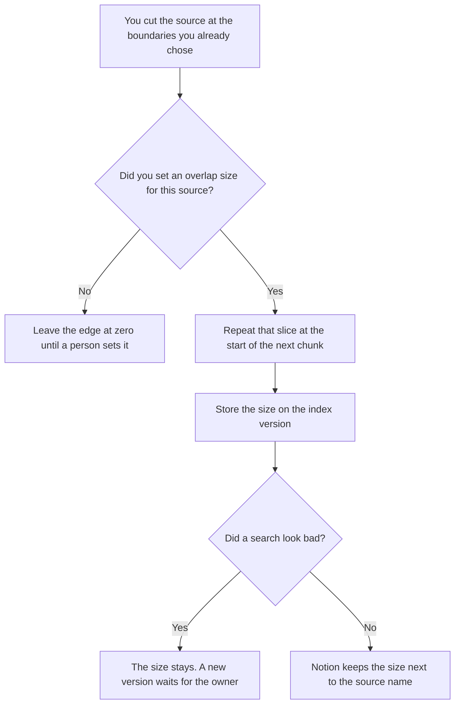

**AI retrieval chunk overlap is the repeated slice of a source that you keep at the edge of two neighboring chunks so a sentence is not cut in half.** Where you cut the document is [what vector chunking is](/blog/what-is-vector-chunking-2026/). This page is how much of the previous piece you repeat in the next one, and who is allowed to change that amount. Which filter binds which collection is [what an AI retrieval filter policy is](/blog/what-is-ai-retrieval-filter-policy-2026/). Overlap does not choose the collection.

The share of relevant passages you meant to get back is [what an AI retrieval recall target is](/blog/what-is-ai-retrieval-recall-target-2026/). Overlap can change what a case returns. It is not the target, and it is not the golden set.

Claude's prices are the October 24, 2026 read of claude.com/pricing recorded in [Claude pricing explained](/blog/claude-pricing-explained-2026/). Notion, Perplexity, and Cursor prices are from directory pages checked October 16, 2026. Perplexity's $17 annual Pro figure was reconfirmed in the October 24 pricing article. A refetch of the hub pricing URL timed out on October 24, so this page does not add a new Perplexity dollar. Published October 24, 2026. We did not measure recall. The directory does not list an overlap fee.

## What you write down before you repeat a slice

| Line | Who writes it | A blank means |
|---|---|---|
| Source | You | Overlap from one manual gets applied to a table |
| Overlap size | You, in characters, tokens, or a rule you use | Two indexes silently use different edges |
| What must not be split | You | A price row is cut so each chunk has half a number |
| Who may change the size | A person | A failed search grows the overlap in the same hour |
| Index version | You | A score from last month is compared with a new edge |

Overlap makes the index larger. The same sentence can appear in two chunks. That is the point when the sentence would have been cut, and it is a cost when you repeat a whole section by accident. Write the size. Do not describe it as "a little." If you cannot say whether the unit is characters or tokens, the size is not set.

A table, a code block, or a price row that you marked "do not split" stays whole. Overlap does not repair a cut through the middle of that block. Fix the cut. Then set the edge.

## Where the size is kept

**The rule for this source.** [Claude](/tools/claude/) Pro is $17 a month billed annually, $200 up front, or $20 monthly. The Project holds the unit and the size so a later index does not invent a new edge. The review is [Claude review](/blog/claude-review-2026/).

**The register.** [Notion AI](/tools/notion-ai/) Business is $20 a seat a month. One row per source, the overlap size, the unit, and the index version. The invoice is [Notion AI pricing explained](/blog/notion-ai-pricing-explained-2026/).

**A public page you still have to open, if the source is on the web.** [Perplexity](/tools/perplexity/) Pro is $17 a month billed annually on the October 24 record. You open the page. You do not treat a citation as the chunk boundary. The invoice is [Perplexity pricing explained](/blog/perplexity-pricing-explained-2026/).

**The diff, if the indexer lives in a repo.** [Cursor](/tools/cursor/) Plus is $8 a month, or $80 a year. You review the diff that changes the size. The ladder is [Cursor pricing explained](/blog/cursor-pricing-explained-2026/).

A prompt that holds the line:

"Draft the overlap row from the source name, the size, and the unit I pasted. If the size is missing, write Overlap not set. Do not pick a size. Do not change the chunk boundaries."

## What not to delegate

Do not ask the model for a "standard" overlap. Do not grow the overlap because one question failed. Do not repeat an entire section and call it an edge. The owner of the index sets the size, on a new version. Last month's retrieval score stays on the old size.

## FAQ

### How is this different from chunking?

Chunking is where you cut. Overlap is the slice you copy onto the next piece after the cut. You can chunk with zero overlap. You should not set an overlap and skip the decision about what must stay whole. A heading with no paragraph is a bad cut. Overlap does not add the missing paragraph.

### How is this different from a filter policy?

The filter policy says which rule binds which collection, tenant, and role. Overlap is inside one source in that collection. A larger overlap does not grant a role access to a collection. A filter does not choose the edge size.

### How is this different from a recall target?

The target is the share of relevant passages you said you needed. Overlap is a setting that can change which passages come back. Measure recall against a frozen set, on a named index version. Do not raise the overlap in the same hour to make the score move, and then compare it with last month.

### Who may change the overlap?

The person named on the row, in a new index version. A model suggestion is not a version. If the unit is missing, the size is not set, even if a number is sitting in a config file with no unit.

## Last verified

October 24, 2026 for Claude and for Perplexity's annual Pro figure, via the posts cited above. The hub pricing URL timed out that day. October 16, 2026 for Notion and Cursor. Published October 24, 2026.

**Sources:** [Claude pricing](https://claude.com/pricing), [Notion pricing](https://www.notion.com/pricing), [Perplexity pricing](https://www.perplexity.ai/hub/pricing), [Cursor pricing](https://cursor.com/help/account-and-billing/pricing).

*Published by Andrew for [AI Tools Optimizer](https://aitoolsoptimizer.com).*

[Perplexity](/tools/perplexity/) is in the [research directory](/tools/category/research-search/). Directory pages may use affiliate links. A purchase through them may earn us a commission at no extra cost to you.
