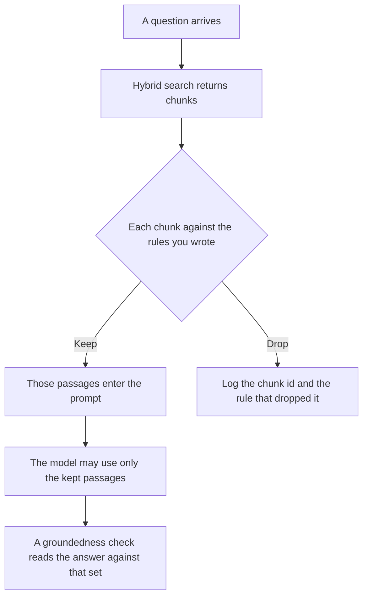

**An AI retrieval filter is a rule, written before the model answers, that keeps or drops each retrieved passage.** Search can return twenty chunks. The filter decides which of those chunks are allowed into this prompt. A passage that fails the rule does not get a second chance because it "looked useful."

How the two lists were merged is [what retrieval hybrid search is](/blog/what-is-retrieval-hybrid-search-2026/). Where the document was cut is [what vector chunking is](/blog/what-is-vector-chunking-2026/). Whether the finished sentence stays inside the passages you kept is [what an AI groundedness check is](/blog/what-is-ai-groundedness-check-2026/). Stripping a name before any of this runs is [what AI PII redaction is](/blog/what-is-ai-pii-redaction-2026/).

Prices are US list prices excluding tax from directory pages checked October 16, 2026. A live fetch of vendor pricing pages on October 24, 2026 returned HTTP 401, so this page stays on the directory record. Published October 24, 2026. The directory does not list a retrieval-filter fee. We did not measure relevance.

## What the filter is allowed to see

| Input | The filter may | The filter may not |
|---|---|---|
| A chunk id, a source, and the text | Keep or drop by a rule you wrote | Invent a source that was not retrieved |
| A metadata field you indexed | Require that field, such as a product line or a date | Guess the field when it is empty |
| A deny list of collections | Drop every chunk from a denied collection | Quietly keep one because the question seemed related |
| The passage itself | Drop a passage that still contains an identifier you said to strip | "Redact it later" and send the raw text anyway |

Hybrid search decides the candidate list. Chunking decides the boundaries. The filter is the gate between that list and the prompt. If you skip it, the model sees every neighbor the index returned, including the policy doc from another product and the draft that was never approved.

A filter that says "keep the top five" is a cutoff, and it is a weak one. Write the rule in words a second person can audit: this collection, this status, this date range, this tenant. A score the vendor printed is not that rule.

## Where the rule is written

**The spec.** [Claude](/tools/claude/) Pro is $20 a month, or $17 billed annually, when the filter rules are a short document a reviewer will read next to an example of a dropped chunk. The review is [Claude review](/blog/claude-review-2026/).

**The code.** [Cursor](/tools/cursor/) Plus is $8 a month, or $80 a year, when the filter is a function beside the retriever. You review the diff. A generated change that deletes the deny list is a defect. The ladder is [Cursor pricing explained](/blog/cursor-pricing-explained-2026/).

**A search product, which is not this gate.** [Perplexity](/tools/perplexity/) Pro is $17 a month billed annually. It retrieves and cites on its own index. It does not apply the collection rules on your private corpus unless you have built that separately. The invoice is [Perplexity pricing explained](/blog/perplexity-pricing-explained-2026/).

**A one-page version of the rules.** [ChatGPT](/tools/chatgpt/) Plus is $20 a month. Free can format one rule. Discard any rule it adds because every retrieval system "should also include the whole wiki."

A prompt that holds the line:

"Turn the collections, statuses, and date bounds I pasted into filter rules. Do not add a collection. If a field I required can be empty, write the drop behavior. Do not keep a chunk because it seems relevant."

## What not to delegate

Do not let the model choose which passages "matter." That choice is the filter, and it belongs in code or in a reviewed rule. Do not treat a groundedness failure as proof the filter is fine. The check can only see what you allowed in. Do not log the full passage if the passage still holds a customer identifier. Log the chunk id and the rule.

## FAQ

### How is a retrieval filter different from hybrid search?

Hybrid search builds the candidate list from two methods and merges them. The filter runs after that list exists. It can drop a high-scoring chunk that came from the wrong collection. Search rank does not override a deny rule.

### How is it different from a groundedness check?

The filter chooses the passages. The groundedness check reads the answer and asks whether the claims stay inside those passages. You can pass the filter and still fail the check, if the model adds a sentence the passages do not support.

### Should the filter also remove names?

Remove names before retrieval, or in a redaction step you can point at. A filter that sometimes redacts and sometimes does not will leak. The redaction article is the procedure. This article is the keep-or-drop rule.

### What do you log when a chunk is dropped?

The chunk id, the rule id, and the question id. The raw text is already in the index. Copying it into a prompt log is a second copy you now have to retain on purpose.

## Last verified

October 16, 2026 for Claude, Cursor, Perplexity, and ChatGPT. No retrieval-filter product fee is recorded in the directory. Published October 24, 2026.

**Sources:** [Claude pricing](https://claude.com/pricing), [Cursor pricing](https://cursor.com/help/account-and-billing/pricing), [Perplexity pricing](https://www.perplexity.ai/pro), [ChatGPT pricing](https://chatgpt.com/pricing/).

*Published by Andrew for [AI Tools Optimizer](https://aitoolsoptimizer.com).*

[Perplexity](/tools/perplexity/) is in the [research and search directory](/tools/category/research-search/). Directory pages may use affiliate links. A purchase through them may earn us a commission at no extra cost to you.
