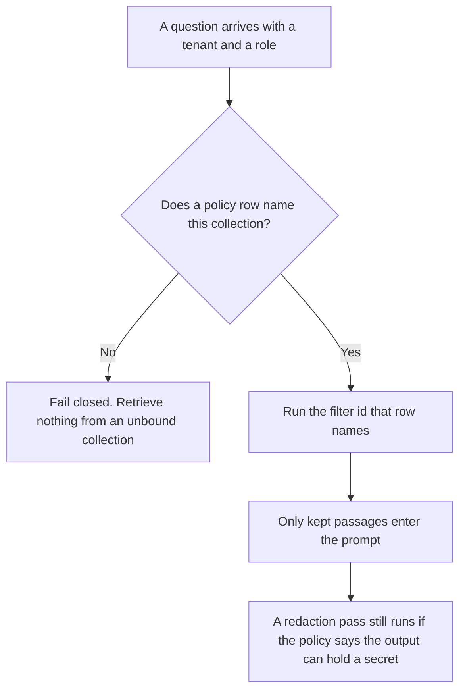

**An AI retrieval filter policy is the document that says which filter rule binds which collection, which tenant, and which role.** The rule that keeps or drops one passage is [what an AI retrieval filter is](/blog/what-is-ai-retrieval-filter-2026/). This page is who that rule applies to, and who may change it. A policy with no collection name is a wish. A filter with no policy is a rule that can be pointed at the wrong index.

The share of relevant passages you meant to retrieve is [what an AI retrieval recall target is](/blog/what-is-ai-retrieval-recall-target-2026/). Stripping a secret from an answer after retrieval is [what an AI output redaction pass is](/blog/what-is-ai-output-redaction-pass-2026/). Redaction is not a substitute for keeping the passage out.

Claude's prices are the October 24, 2026 read of claude.com/pricing recorded in [Claude pricing explained](/blog/claude-pricing-explained-2026/). Notion, Perplexity, and Cursor prices are from directory pages checked October 16, 2026. Perplexity's $17 annual Pro figure was reconfirmed in the October 24 pricing article from a help-center read that day. A refetch of the hub pricing URL timed out on October 24, so this page does not add a new Perplexity dollar. Published October 24, 2026. We did not measure recall. The directory does not list a filter-policy fee.

## What the policy has to name

| Line | Who writes it | A blank means |
|---|---|---|
| Collection | You | The filter can run on every index, including the draft one |
| Tenant or role | You | A customer's passages can enter another customer's prompt |
| The filter id | You, pointing at a rule you already wrote | The policy names a behavior nobody implemented |
| Fail closed or fail open | You | A missing metadata field is treated as allowed |
| Owner and review date | A person | The rule drifts and nobody notices |

Fail open means a missing field is treated as allowed. That choice has to be written. It is a poor default for a tenant boundary. If the row says fail closed, an empty tenant drops the passage and the log says why.

A recall target can fall because the policy dropped a relevant collection. That drop is the policy working, if the collection was out of scope. Do not lower the filter to chase the target. Change the policy in a new version if the collection should have been in scope, and say so.

## Where the policy is kept

**The draft.** [Claude](/tools/claude/) Pro is $17 a month billed annually, $200 up front, or $20 monthly. One Project holds the current policy text. The review is [Claude review](/blog/claude-review-2026/).

**The register.** [Notion AI](/tools/notion-ai/) Business is $20 a seat a month. One row per collection. The invoice is [Notion AI pricing explained](/blog/notion-ai-pricing-explained-2026/).

**A cited check of a vendor's own data-handling page, when the policy quotes it.** [Perplexity](/tools/perplexity/) Pro is $17 a month billed annually on the October 24 record. Open the citation. The ladder is [Perplexity pricing explained](/blog/perplexity-pricing-explained-2026/). Enterprise seats are a different article.

**The diff, if the policy is a file in a repo.** [Cursor](/tools/cursor/) Plus is $8 a month, or $80 a year. You review the diff that changes a tenant rule. The ladder is [Cursor pricing explained](/blog/cursor-pricing-explained-2026/).

A prompt that holds the line:

"Draft the filter policy row from the collection, the tenant, the filter id, and the fail-closed line I pasted. If the tenant is missing, write Tenant not set. Do not add a collection. Do not change fail closed to fail open."

## What not to delegate

Do not ask which documents are "safe enough" to retrieve. Do not paste a customer file into a chat so the policy "can see an example." Do not turn fail closed off because a demo returned nothing. The owner changes the row. The model does not.

## FAQ

### How is this different from a retrieval filter?

The filter keeps or drops a passage that search already returned. The policy says which filter runs for which collection, tenant, and role. You can have a strict filter and a policy that never points at it. You can have a policy that names a filter id nobody built. Both gaps are real. Fix the one the row shows.

### How is this different from a redaction pass?

Redaction removes text from an output that was already produced. The filter policy decides which passages may enter the prompt. A passage that should never be retrieved is a policy problem. A name that may be retrieved and must not be shown is a redaction problem. Do not skip the policy because redaction exists.

### How is this different from a recall target?

The target is a number you hope to hit on cases you froze. The policy can exclude a collection on purpose, and the recall math should use only the collections that are in scope. A missed target is not, by itself, a reason to widen the policy. Read the dropped collection before you edit the row.

### Who may change the policy?

The owner named on the row. A prompt engineer can propose a filter id. They do not bind a tenant by editing the prompt. If the review date is older than the index rebuild, say so on the row before you trust the filter.

## Last verified

October 24, 2026 for Claude, via the pricing article, and for Perplexity's annual Pro figure, via the pricing article. The hub pricing URL timed out on October 24. October 16, 2026 for Notion, Perplexity's directory card, and Cursor. Published October 24, 2026.

**Sources:** [Claude pricing](https://claude.com/pricing), [Notion pricing](https://www.notion.com/pricing), [Perplexity pricing](https://www.perplexity.ai/hub/pricing), [Cursor pricing](https://cursor.com/help/account-and-billing/pricing).

*Published by Andrew for [AI Tools Optimizer](https://aitoolsoptimizer.com).*

[Perplexity](/tools/perplexity/) is in the [research directory](/tools/category/research-search/). Directory pages may use affiliate links. A purchase through them may earn us a commission at no extra cost to you.
