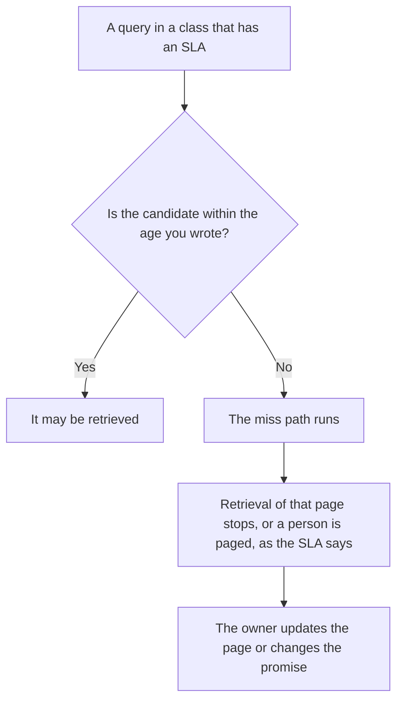

**An AI retrieval freshness SLA is a promise you wrote: for a named class of pages, the copy a system may retrieve will be no older than a limit you set, measured the way you wrote down, with a named action when the promise is missed.** The property of being current is [what retrieval freshness is](/blog/what-is-retrieval-freshness-2026/). Watching a service against a target is [what AI SLA monitoring is](/blog/what-is-ai-sla-monitoring-2026/). The target number without the customer promise is [what an AI SLO is](/blog/what-is-ai-slo-2026/). An SLA that has no miss path is a slogan.

Perplexity, Notion, and Zapier prices are from directory pages checked October 16, 2026. Claude's prices are from claude.com/pricing on October 24, 2026. Published October 24, 2026. We did not measure how fresh any index is. The directory does not price a freshness SLA as its own product.

## What you have to write down

| Line | A real SLA has | A slogan has |
|---|---|---|
| The class | "Published policies," not "important docs" | "Our knowledge is fresh" |
| The age | A number and a unit, from a clock you name | "Recent" |
| The measure | The review date on the page, or the crawl time | A feeling after one search |
| The miss | Who is told, and whether retrieval must stop | A hope that someone notices |

A boost that prefers a collection does not satisfy an age promise. The weight is [what an AI retrieval boost is](/blog/what-is-ai-retrieval-boost-2026/). If the fresh copy lost because of a weight, the weight is the bug, and the SLA is still missed. Fetching passages at all is [what RAG is](/blog/what-is-rag-explained-2026/). RAG does not set the age. You do.

## Where the promise is visible

**The page with the review date.** [Notion AI](/tools/notion-ai/) Business is $20 a seat a month if the wiki is the source. Plus at $10 is not the full AI tier on the October 16 card. The SLA names that review date. The invoice is [Notion AI pricing explained](/blog/notion-ai-pricing-explained-2026/).

**A public page you still open.** [Perplexity](/tools/perplexity/) Pro is $17 a month billed annually on that card. A citation is a link and a date you write down. It is not proof your internal SLA was met. The invoice is [Perplexity pricing explained](/blog/perplexity-pricing-explained-2026/).

**The miss note.** [Claude](/tools/claude/) Pro is $17 a month billed annually, $200 up front, or $20 monthly. Paste the page id, the review date, and the limit. Ask for the miss note. Do not ask whether the page is "probably fine." The review is [Claude review](/blog/claude-review-2026/).

**The reminder.** [Zapier](/tools/zapier/) Professional is $19.99 a month billed annually, 750 tasks, on the October 16 card. A task that pages the owner when a date passes is a clock. It is not a judgment that the text is still true. The invoice is [Zapier pricing explained](/blog/zapier-pricing-explained-2026/).

A prompt that holds the line:

"Write the freshness miss note from the page id, the review date, and the age limit I pasted. If any of those is missing, write Missing. Do not say the content is still accurate."

## What not to delegate

Do not let a model pick the age after a bad answer. Do not call a vendor's index "real-time" and skip the number. Do not keep serving a page the miss path said to stop.

## FAQ

### How is an SLA different from freshness?

Freshness is the question: is this page current enough to use? The SLA is the promise you will keep for a class, including what you do when you fail. You can measure freshness without promising it to anyone. Once you promise it, the miss path is part of the definition.

### How is it different from an SLO?

The SLO is the target you aim at inside the team. The SLA is the promise, with a consequence, that you are willing to state. Some teams set an SLO tighter than the SLA. Write both numbers if you do, and do not let a model average them.

### Does a daily crawl meet the SLA?

Only if the SLA says the crawl time is the clock, and the crawl actually succeeded for that page. A schedule is not a result. The miss path runs when the clock you named is past the limit.

### Who may waive the SLA for one page?

The owner named on the promise, with an end date. A chat that says the old page is "still directionally right" is not a waiver.

## Last verified

October 24, 2026 for Claude. October 16, 2026 for Perplexity, Notion, and Zapier. No retrieval-freshness SLA fee is recorded in the directory. Published October 24, 2026.

**Sources:** [Notion pricing](https://www.notion.com/pricing), [Perplexity pricing](https://www.perplexity.ai/pro), [Claude pricing](https://claude.com/pricing), [Zapier pricing](https://zapier.com/pricing).

*Published by Andrew for [AI Tools Optimizer](https://aitoolsoptimizer.com).*

[Perplexity](/tools/perplexity/) is in the [research and search directory](/tools/category/research-search/). Directory pages may use affiliate links. A purchase through them may earn us a commission at no extra cost to you.
