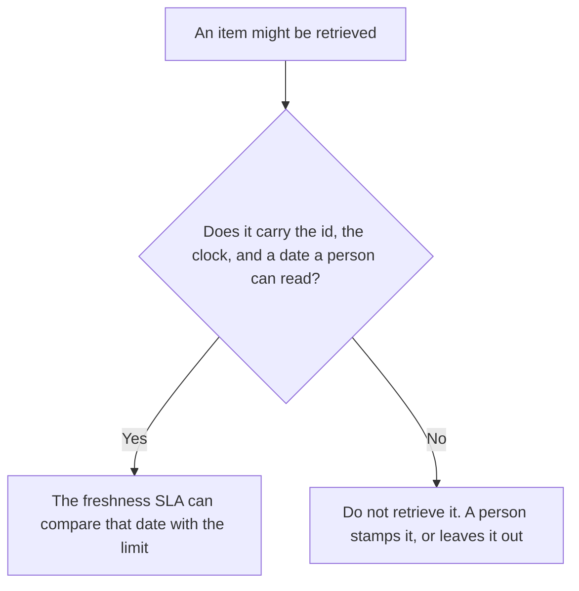

**An AI retrieval freshness stamp is the date, the clock you named, and the page id written on one item a system might retrieve.** The clock is the review date on the page, or the crawl time, whichever you said. The property of being current is [what retrieval freshness is](/blog/what-is-retrieval-freshness-2026/). The promise for a class of pages, with a miss path, is [what an AI retrieval freshness SLA is](/blog/what-is-ai-retrieval-freshness-sla-2026/). This page is the mark on the item. An SLA that has no stamp has nothing to compare with the age limit.

Fetching passages at all is [what RAG is](/blog/what-is-rag-explained-2026/). RAG does not date the page. You do, or the crawl you named does, and a person can see the stamp.

Perplexity, Notion, and Zapier prices are from directory pages checked October 16, 2026. Claude's prices are from claude.com/pricing on October 24, 2026. Published October 24, 2026. We did not measure how fresh any index is. The directory does not price a freshness stamp as its own product.

## What the stamp has to show

| Field | Who writes it | A blank means |
|---|---|---|
| Page or chunk id | You | Two copies can share a date that belongs to one of them |
| The clock | You: review date, or crawl time | "Recent" is not a stamp |
| The value | A date you can read | The SLA cannot tell a miss from a hit |
| Who set it | A person, or the job you named | A model fills in today's date |
| What a missing stamp does | You: do not retrieve | The item is treated as fresh |

A sentence in the answer that says "updated recently" is not a stamp. The stamp sits on the item before the question is asked. If the review date and the crawl time disagree, you do not average them. The SLA names which clock counts. The stamp records that clock's value. A boost that prefers a collection does not write a date. The weight is [what an AI retrieval boost is](/blog/what-is-ai-retrieval-boost-2026/).

## Where the stamp is visible

**The page with the review date.** [Notion AI](/tools/notion-ai/) Business is $20 a seat a month if the wiki is the source. Plus at $10 is not the full AI tier on the October 16 card. The stamp is that review date, next to the page id. The invoice is [Notion AI pricing explained](/blog/notion-ai-pricing-explained-2026/).

**A public page you still date yourself.** [Perplexity](/tools/perplexity/) Pro is $17 a month billed annually on that card. A citation is a link. The stamp is the date you write down for the clock you named. The invoice is [Perplexity pricing explained](/blog/perplexity-pricing-explained-2026/).

**The line that copies the stamp into a note.** [Claude](/tools/claude/) Pro is $17 a month billed annually, $200 up front, or $20 monthly. Paste the page id and the date. Ask for the stamp line. Do not ask whether the page is "probably current." The review is [Claude review](/blog/claude-review-2026/).

**The reminder when a date is missing.** [Zapier](/tools/zapier/) Professional is $19.99 a month billed annually, 750 tasks, on the October 16 card. A task that flags a page with no review date is a clock. It does not decide the text is true. The invoice is [Zapier pricing explained](/blog/zapier-pricing-explained-2026/).

A prompt that holds the line:

"Write the freshness stamp from the page id and the review date I pasted. If either is missing, write Stamp not set. Do not use today's date. Do not say the page is current."

## What not to delegate

Do not let a model stamp an undated page with the day of the chat. Do not treat a vendor's "real-time" label as a date. Do not retrieve an item whose stamp is blank because the rest of the class looks fresh.

## FAQ

### How is a stamp different from a freshness SLA?

The SLA is the promise: a class of pages will be no older than a limit, and a miss has a path. The stamp is the date on one item that the promise reads. You can stamp pages and promise nothing. You cannot meet a promise you cannot measure. Use the SLA page for the miss path. Use this page for the mark.

### How is a stamp different from freshness?

Freshness is the question of whether the item is current enough to use. The stamp is the evidence you stored: which clock, which date, which id. A feeling that a page "looks new" is not a stamp.

### Does a crawl write the stamp?

Only if you named crawl time as the clock, and that crawl recorded a time for that id. A schedule is not a stamp. A failed crawl leaves the old stamp or a blank, whichever your rule says. It does not invent a success time.

### Who may change a stamp?

The owner of the page, or the job you named, when the clock you chose actually moves. A chat answer that says the policy is "still fine" does not refresh the date.

## Last verified

October 24, 2026 for Claude. October 16, 2026 for Notion, Perplexity, and Zapier. No retrieval-freshness stamp fee is recorded in the directory. Published October 24, 2026.

**Sources:** [Notion pricing](https://www.notion.com/pricing), [Perplexity pricing](https://www.perplexity.ai/pro), [Claude pricing](https://claude.com/pricing), [Zapier pricing](https://zapier.com/pricing).

*Published by Andrew for [AI Tools Optimizer](https://aitoolsoptimizer.com).*

[Perplexity](/tools/perplexity/) is in the [research and search directory](/tools/category/research-search/). Directory pages may use affiliate links. A purchase through them may earn us a commission at no extra cost to you.
