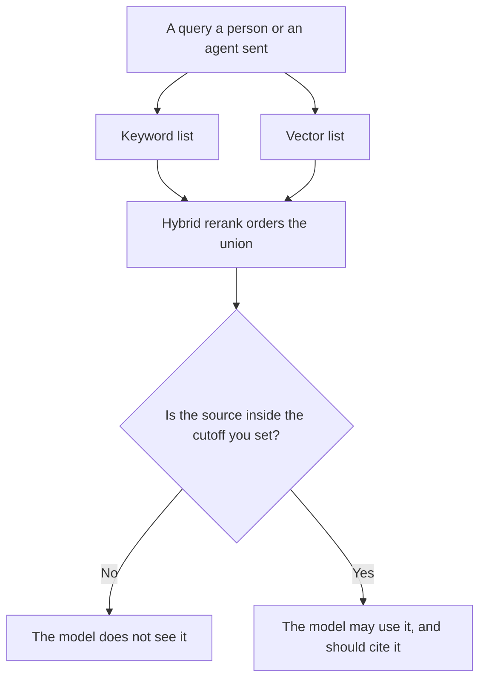

**AI retrieval hybrid rerank is a second pass that takes candidates from more than one search method, usually a keyword list and a vector list, and puts them in one order before the model writes.** The first pass finds. The rerank decides which of those finds the model is allowed to see, and in what order. It does not create a source that neither list contained. Lifting one source on purpose is [what an AI retrieval boost is](/blog/what-is-ai-retrieval-boost-2026/). How old a source may be is [what an AI retrieval freshness SLA is](/blog/what-is-ai-retrieval-freshness-sla-2026/).

Whether the answer then points at those sources is [what AI citation coverage is](/blog/what-is-ai-citation-coverage-2026/). A literature pass with a different job is [Perplexity vs Elicit for literature maps](/blog/perplexity-vs-elicit-for-literature-maps-2026/).

Perplexity's price is from the directory card checked October 16, 2026. perplexity.ai/pro returned HTTP 403 on October 24. Claude's prices are from claude.com/pricing on October 24. Elicit and ChatGPT prices are from the October 16 cards. chatgpt.com/pricing returned HTTP 403 that day. Published October 24, 2026. We did not measure ranking quality.

## What each pass is for

| Pass | What it uses | What it must not do |
|---|---|---|
| Keyword list | The words you indexed | Drop a document because it "felt less relevant" |
| Vector list | The embedding of the query | Invent a passage that was not in the index |
| Hybrid rerank | Both lists, and a ranker you named | Add a third document that was on neither list |
| The model | The top of the reranked list | Cite a source the rerank did not pass through |

If you only keep the vector list, you do not have a hybrid rerank. You have one retriever. Hybrid means both lists existed, and a ranker saw both. The cutoff is a number you set: how many passages, or what score, the model may read. A cutoff you never wrote is "whatever fit."

## Where the order shows up

**A cited answer.** [Perplexity](/tools/perplexity/) Pro is $17 a month billed annually on the October 16 card. You still open the citation. A rerank you cannot see is not something this product's public price page itemizes. The tearsheet that depends on those links is [Perplexity vs ChatGPT for competitive tearsheets](/blog/perplexity-vs-chatgpt-for-competitive-tearsheets-2026/).

**A paper list.** [Elicit](/tools/elicit/) is the research seat when the corpus is papers. The October 16 card is the price record. This explainer does not add a dollar the card did not print in the sentence you are reading. The comparison is the literature-map article above.

**The instruction that names the cutoff.** [Claude](/tools/claude/) Pro is $17 a month billed annually, $200 up front, or $20 monthly. Use a Project to hold the cutoff and the index rules. The review is [Claude review](/blog/claude-review-2026/).

**One query's expected sources.** [ChatGPT](/tools/chatgpt/) Plus is $20 a month on the October 16 card. Paste the two lists if you are checking an order by hand. The chat is not the index.

A prompt that holds the line:

"Order these two lists into one. Do not add a document that is on neither list. If I did not paste a cutoff, write Cutoff not set. Do not claim a passage is more true because it ranked higher."

## What not to delegate

Do not ask the model which embedding is "better." Do not treat the top row as the only true source. Do not skip the keyword list because the vector list looked fluent. The hybrid is the point. A single list can miss the exact name the user typed.

## FAQ

### How is this different from a retrieval boost?

A boost forces a source up, or in, because you wrote a rule. Hybrid rerank orders whatever both retrievers already returned. A boost can still apply after the rerank. It is a separate rule. It is not the rerank.

### How is this different from the model's own judgment?

The model sees the passages you passed in. The rerank decides that set. If the model "remembers" a paper that was not in the set, that sentence is not retrieval. Delete it or find the source and put it through the index.

### Does a higher rank mean the claim is right?

No. Rank is an order among candidates. Truth is whether the passage says the thing, and whether you trust that passage. Citation coverage counts links. It does not grade the ranker.

### Who sets the cutoff?

The person who owns the index. Write the number next to the index version. A chat that says "use the best five" has not set a cutoff you can rerun.

## Last verified

October 16, 2026 for Perplexity, Elicit, and ChatGPT. October 24, 2026 for Claude. No separate hybrid-rerank price is on those seat pages. Published October 24, 2026.

**Sources:** [Perplexity](https://www.perplexity.ai/), [Elicit](https://elicit.com/), [Claude pricing](https://claude.com/pricing), [ChatGPT pricing](https://chatgpt.com/pricing/).

*Published by Andrew for [AI Tools Optimizer](https://aitoolsoptimizer.com).*

[Perplexity](/tools/perplexity/) is in the [research and search directory](/tools/category/research-search/). Directory pages may use affiliate links. A purchase through them may earn us a commission at no extra cost to you.
