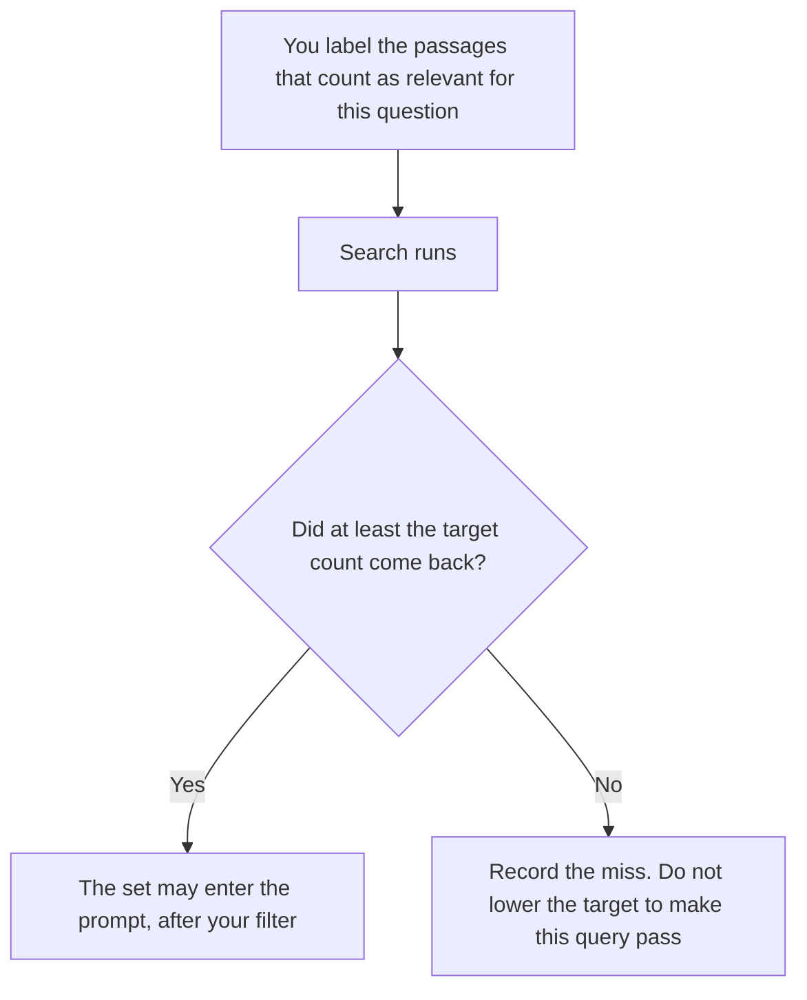

**An AI retrieval recall target is a count a person sets before search runs: of the passages already labeled relevant for this question, how many must come back before this retrieval is good enough to use.** The model does not pick the count. A high score the search engine prints is not the target. If you have not labeled any passages, you do not have a recall number. You have a hope.

The rule that drops a passage after it is retrieved is [what an AI retrieval filter is](/blog/what-is-ai-retrieval-filter-2026/). Whether the finished answer stays inside the passages you accepted is [what an AI grounding score is](/blog/what-is-ai-grounding-score-2026/). The pattern of fetching passages instead of pasting the corpus is [what RAG is](/blog/what-is-rag-explained-2026/). How fresh those passages must be is [what an AI retrieval freshness SLA is](/blog/what-is-ai-retrieval-freshness-sla-2026/).

Claude's prices are from claude.com/pricing on October 24, 2026. Perplexity's Enterprise Pro price is the directory card checked October 16, 2026. Notion and Cursor prices are from that same directory date. Published October 24, 2026. We did not measure recall. The directory does not list a recall-target fee.

## What you write down before the query

| Piece | Who sets it | A blank means |
|---|---|---|
| The question | You | There is nothing to retrieve for |
| The labeled relevant set | You, from passages you are allowed to store | Recall cannot be computed |
| The count that must return | You | Do not treat "the top few" as a target |
| What happens on a miss | Stop, or a named next step | Do not let the model answer from memory and call it retrieved |

Recall here is a fraction you can recompute: relevant passages returned, divided by relevant passages you labeled. This page does not print a vendor's recall percentage. If a product shows one, ask which labels it used. A target of "most of them" is not a count.

The filter still runs after a passing recall check. A relevant passage can be forbidden in this prompt because of a source, a date, or a permission. The target does not override that rule.

## Where the target is kept

**The definition.** [Claude](/tools/claude/) Pro is $17 a month billed annually, $200 up front, or $20 monthly. Keep the count and the miss path in a Project. The review is [Claude review](/blog/claude-review-2026/).

**A cited public source you will open, when the labels are on the web.** [Perplexity](/tools/perplexity/) Pro is $17 a month billed annually on the October 16 card. Enterprise Pro is $40 a user a month, or $400 a year, when the target is a company record. Open the citation. A citation is not a labeled relevant set. The ladder is [Perplexity pricing explained](/blog/perplexity-pricing-explained-2026/).

**The table of questions and counts.** [Notion AI](/tools/notion-ai/) Business is $20 a seat a month. One row per question. The invoice is [Notion AI pricing explained](/blog/notion-ai-pricing-explained-2026/).

**The check next to the index, if retrieval is code.** [Cursor](/tools/cursor/) Plus is $8 a month, or $80 a year. You review the diff. The test does not invent labels. The ladder is [Cursor pricing explained](/blog/cursor-pricing-explained-2026/).

A prompt that holds the line:

"Draft the recall-target row from the question, the labeled set size, the count, and the miss path I pasted. If the count is missing, write Target not set. Do not suggest a percentage. Do not mark the last query as passed."

## What not to delegate

Do not ask the model which passages were relevant and then use that list as the labels. That measures agreement with the model. Do not drop the target after a miss so the dashboard stays green. Do not paste a private corpus into a personal account to "label faster."

## FAQ

### How is this different from a retrieval filter?

The filter keeps or drops each passage that already came back. The recall target asks whether enough of the passages you labeled came back at all. You can hit the count and still filter every passage out. Both results should be visible. Neither one is a reason to answer from memory.

### How is this different from a grounding score?

Grounding looks at the answer against the sources you accepted. Recall looks at search against the labels you made before the answer existed. A grounded answer can sit on a retrieval set that missed three labeled passages. Say so. Do not average the two numbers.

### How is this different from a freshness SLA?

Freshness is how new the passage is allowed to be. Recall is whether the relevant ones returned. A fresh passage about the wrong product does not help the count. An old passage you labeled relevant still counts, unless the freshness rule removed it first. If it was removed, the miss path should say why.

### Who may lower the count?

The owner of the question, with a reason. A failed query is not a reason by itself. If the labels were wrong, fix the labels and leave a note. Do not edit the count in the same commit that hides the miss.

## Last verified

October 24, 2026 for Claude. October 16, 2026 for Perplexity, Notion, and Cursor. Published October 24, 2026.

**Sources:** [Claude pricing](https://claude.com/pricing), [Perplexity pricing](https://www.perplexity.ai/hub/pricing), [Notion pricing](https://www.notion.com/pricing), [Cursor pricing](https://cursor.com/help/account-and-billing/pricing).

*Published by Andrew for [AI Tools Optimizer](https://aitoolsoptimizer.com).*

[Perplexity](/tools/perplexity/) is in the [research directory](/tools/category/research-search/). Directory pages may use affiliate links. A purchase through them may earn us a commission at no extra cost to you.
