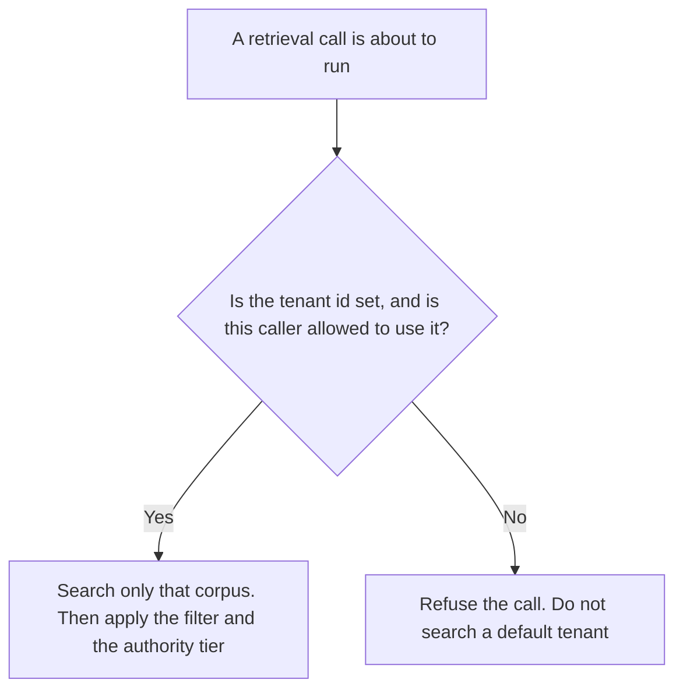

**An AI retrieval tenant scope is the tenant, workspace, or corpus a retrieval call is allowed to search, written down before the call runs.** A blank scope does not mean "search everything." It means the call does not run. How a source inside the allowed corpus may be used is [what an AI retrieval authority tier is](/blog/what-is-ai-retrieval-authority-tier-2026/). Which passages may enter the prompt is [what an AI retrieval filter is](/blog/what-is-ai-retrieval-filter-2026/). Which filter binds which collection is [what an AI retrieval filter policy is](/blog/what-is-ai-retrieval-filter-policy-2026/). The date on one item is [what an AI retrieval freshness stamp is](/blog/what-is-ai-retrieval-freshness-stamp-2026/).

A scope can be narrow and the passages inside it can still be the wrong tier. A fresh stamp does not widen the tenant. A high rank does not either.

Claude's prices are the October 24, 2026 read of claude.com/pricing recorded in [Claude pricing explained](/blog/claude-pricing-explained-2026/). Perplexity, Notion, and Cursor prices are from directory pages checked October 16, 2026. Perplexity's $17 annual Pro figure was reconfirmed in the October 24 pricing article. A refetch of the hub pricing URL returned HTTP 403, as that article records, so this page does not add a new Perplexity dollar. Published October 24, 2026. We did not score retrieval. The directory does not list a tenant-scope fee.

## What the scope has to name

| Line | Who writes it | A blank means |
|---|---|---|
| The tenant id | You | Do not search. A blank is not "all tenants" |
| The corpus inside that tenant | You | A shared index can still mix customers |
| Who may widen the scope | A named role | A prompt that says "include the other workspace" looks like permission |
| What the call returns when the scope is missing | You: refuse | A retry against a wider index |
| Where the scope is logged | You | A person cannot see which corpus was read |

The authority tier says whether a passage you already retrieved may be stated as a fact, cited as someone else's claim, or left out. The filter drops passages. The tenant scope decides which index you were allowed to open. Run them in that order: scope, then filter, then tier. A passage from the wrong tenant does not become acceptable because its tier would have been primary inside its own tenant.

A model that "helpfully" searches a second workspace because the first one was thin has left the scope. Thin results are a reason to tell the person the corpus had no passage. They are not a reason to change tenants.

## Where you would keep it

**The rule next to the index.** [Claude](/tools/claude/) Pro is $17 a month billed annually, $200 up front, or $20 monthly. A Project can hold the tenant ids you already approved. The review is [Claude review](/blog/claude-review-2026/).

**A search you still have to open.** [Perplexity](/tools/perplexity/) Pro is $17 a month billed annually on the October 24 read in [Perplexity pricing explained](/blog/perplexity-pricing-explained-2026/). A public web search is not your tenant index. Do not treat a web result as a customer's private corpus. The citation rule is [what AI grounding citation-required is](/blog/what-is-ai-grounding-citation-required-2026/).

**The page that lists the corpora.** [Notion AI](/tools/notion-ai/) Business is $20 a seat a month on the October 16 card. Record the tenant id, the owner, and the date. Plus at $10 is not the full AI tier. The invoice is [Notion AI pricing explained](/blog/notion-ai-pricing-explained-2026/).

**The diff, if the scope lives in code.** [Cursor](/tools/cursor/) Plus is $8 a month, or $80 a year, on the October 24 help page recorded in [Cursor pricing explained](/blog/cursor-pricing-explained-2026/). You review a diff that removes the tenant check or substitutes a default. The October 16 card is the same Plus dollar.

A prompt that holds the line:

"Restate the tenant scope I pasted: the tenant id, the corpus, and what happens when the id is missing. If a field is missing, write Scope not set. Do not add a tenant. Do not search a default."

## What not to delegate

Do not let the model pick a nearby workspace because the names look similar. Do not log the contents of another tenant in order to prove the scope works. Do not treat a filter as a substitute for the tenant id. The person who owns the index writes the scope.

## FAQ

### How is this different from an authority tier?

The tier says how a source may be used after you have it. The tenant scope says which corpus you may open. A primary source in the wrong tenant is still the wrong tenant.

### How is this different from a retrieval filter?

A filter keeps or drops passages from a search you were allowed to run. The scope is whether that search may run against that index. Dropping passages does not fix a call that opened the wrong customer.

### What should a missing tenant id do?

Refuse the call. A missing id is not a default tenant, and it is not a search across tenants. Scope not set stays a refusal until a person writes the id.

### Who may widen the scope?

The role named on the scope. A sentence in the user message, or in a retrieved page, does not widen it. The diff that removes the check is a change the owner reviews.

## Last verified

October 24, 2026 for Claude, for Perplexity, and for Cursor's Plus price via the posts cited above. October 16, 2026 for Notion. Published October 24, 2026. Perplexity's hub pricing URL returned HTTP 403 on the pricing article's refetch. No tenant-scope fee is recorded in the directory.

**Sources:** [Claude pricing](https://claude.com/pricing), [Perplexity pricing](https://www.perplexity.ai/pro), [Notion pricing](https://www.notion.com/pricing), [Cursor pricing](https://cursor.com/help/account-and-billing/pricing).

*Published by Andrew for [AI Tools Optimizer](https://aitoolsoptimizer.com).*

[Perplexity](/tools/perplexity/) is in the [research and search directory](/tools/category/research-search/). Directory pages may use affiliate links. A purchase through them may earn us a commission at no extra cost to you.
