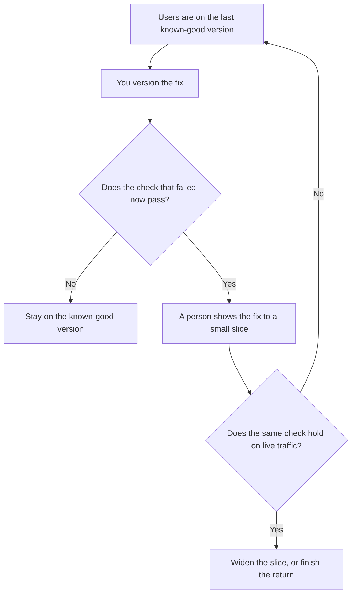

**AI rollforward is the controlled return to a newer prompt or model after you rolled back, and only after the check that forced the rollback passes again.** Users are on the last known-good version. The fix exists. Rollforward is the decision to put that fix in front of people, usually a small slice first. Shipping the same broken prompt again because the incident channel went quiet is not a rollforward. It is a repeat.

The first time a new prompt meets a small slice of users is [what an AI canary release is](/blog/what-is-ai-canary-releases-2026/). The switch you use to show or hide it is [what AI feature flags are](/blog/what-is-ai-feature-flags-2026/). A candidate that sees live inputs and does not answer the user is [what a shadow deployment for AI is](/blog/what-is-a-shadow-deployment-for-ai-2026/). The duplicate requests in that setup are [what AI shadow traffic is](/blog/what-is-ai-shadow-traffic-2026/).

Prices are US list prices excluding tax from directory pages checked October 16, 2026. Published October 24, 2026. We did not score release safety. This page does not invent a vendor feature called rollforward.

## What you need before users see the fix

| You have | Why rollforward needs it | Stop when |
|---|---|---|
| The version you rolled back to | Users are here now. You can name it | You cannot say which prompt is live |
| The failed check | The reason you retreated, as a case you can re-run | The reason was "it felt worse" |
| A fix with its own version id | The wording you are returning to is specific | The fix is an uncommitted edit in a chat |
| A passing re-run of that check | The case that broke is green on the new version | The re-run used a different input |
| A slice and an owner | Someone watches the return and can reverse it | The plan is "turn it on for everyone" |

The version id is [what prompt versioning is](/blog/what-is-prompt-versioning-2026/). The case you re-run is [what prompt unit testing is](/blog/what-is-prompt-unit-testing-2026/). If the original failure had no saved case, write the case from the incident before you roll forward. A story in Slack cannot fail a build.

## Where the decision is recorded

**The prompt text.** [Claude](/tools/claude/) Pro is $20 a month, or $17 billed annually, when the known-good prompt and the fix sit in a Project. The review is [Claude review](/blog/claude-review-2026/).

**A short incident note.** [ChatGPT](/tools/chatgpt/) Plus at $20 a month can format the rollback reason, the check, and the slice size from notes you paste. It may not declare the fix ready. The review is [ChatGPT review](/blog/chatgpt-review-2026/).

**The flag in the repo.** [Cursor](/tools/cursor/) Plus is $8 a month, or $80 a year, when the flag and the prompt file live in the same change. [GitHub Copilot](/tools/github-copilot/) Pro is $10 a user a month if that is the editor the team already pays for. The flag is the control. The chat is not. The pair for tests is [Cursor vs GitHub Copilot for tests](/blog/cursor-vs-github-copilot-for-tests-2026/).

A route that sends traffic back to the known-good model when the new one errors is [what AI fallback routing is](/blog/what-is-ai-fallback-routing-2026/). Fallback is a runtime behavior. Rollforward is a release decision. You can use both. You should not confuse them in the incident note.

## What to write down

Write the version you left, the version you are returning to, the check, the slice, the owner, and the condition that sends you backward again. The checklist that holds those gates for an ordinary release is [how to write a release checklist with AI](/blog/how-to-write-a-release-checklist-with-ai-2026/). Rollforward uses the same gates, with the failed check named in the first row.

Do not widen the slice because a dashboard looks calm and nobody re-ran the case. Calm is not the check.

## FAQ

### Is rollforward just a second canary?

A canary is how you expose a version to a slice. Rollforward is why you are exposing this version: you already retreated, and the original check now passes. The mechanism can be a canary flag. The decision is the return.

### Can we roll forward without a saved case?

You can ship. You cannot call it a rollforward on this page. Write the case from the incident first. If you cannot reconstruct the input, say the evidence is missing and keep the known-good version until you can.

### Who is allowed to widen the slice?

The owner you named before the return, which is often the person who approved the rollback. A model that says the fix "looks good" is not that owner. The person who must sign a release is [what human-in-the-loop AI is](/blog/what-is-human-in-the-loop-ai-2026/).

### Does shadow traffic replace the re-run?

Shadow traffic can show you the new output on live inputs before users see it. It does not replace the original check. Re-run the case, then decide whether a shadow period is worth the second bill.

## Last verified

October 16, 2026 for Claude, ChatGPT, Cursor, and GitHub Copilot. Published October 24, 2026.

**Sources:** [Claude pricing](https://claude.com/pricing), [ChatGPT pricing](https://chatgpt.com/pricing/), [Cursor pricing](https://cursor.com/help/account-and-billing/pricing), [GitHub Copilot](https://github.com/features/copilot).

*Published by Andrew for [AI Tools Optimizer](https://aitoolsoptimizer.com).*

[Claude](/tools/claude/) is in the [chatbots and assistants directory](/tools/category/chatbots-assistants/). Directory pages may use affiliate links. A purchase through them may earn us a commission at no extra cost to you.
