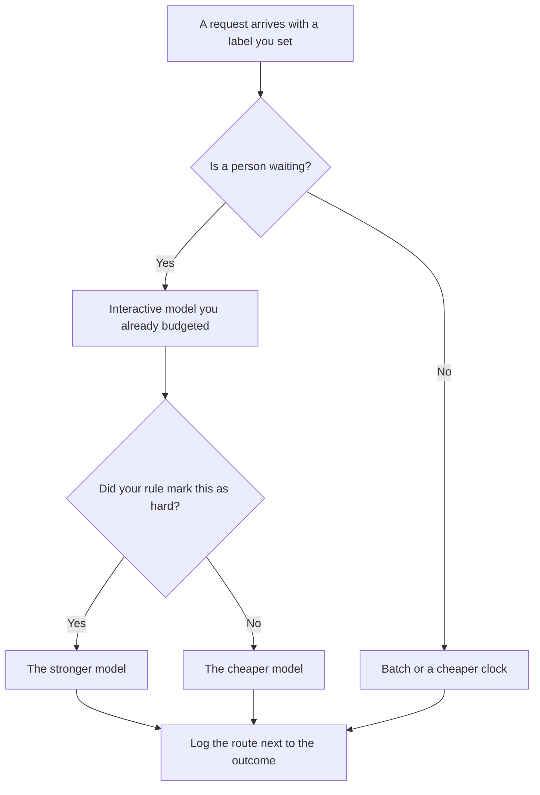

**AI routing is a rule that sends each request to a specific model, endpoint, or queue before the work starts.** A short classification can go to a cheap model. A hard draft can go to a stronger one. A pile that can wait can go to batch. One shared chat box that sends every sentence to the most expensive model is a routing decision too. It is just an expensive default.

The unit on the bill is still [what AI tokens are](/blog/what-are-ai-tokens-explained-2026/). The two clocks are [latency versus throughput](/blog/what-is-ai-latency-vs-throughput-2026/). A job that is allowed to finish later is [what batch inference is](/blog/what-is-ai-batch-inference-2026/).

Prices below are US list prices from directory pages checked October 16, 2026. Published October 24, 2026. This page does not publish a router fee, because the directory does not list one.

## What the rule is allowed to look at

| Signal you already have | A route that matches it | A bad use of that signal |
|---|---|---|
| The task type you labeled | Classify on a small model, draft on a large one | Guessing the task from vibes after the call returns |
| How long the user can wait | Interactive for a person, batch for a folder | Putting a support reply on the overnight queue |
| A published price | The model whose card you can afford at your volume | A "smart router" discount no vendor printed |
| A failure you measured | Send that slice back to the model that passed your eval | Switching models because a demo felt better |

A router that hides the model name makes the next incident harder. Write the route into the log. The habit of reading that log is [what AI observability is](/blog/what-is-ai-observability-2026/).

## Where a route actually lives

**Inside one product.** [Cursor](/tools/cursor/) can pick models for you with Cost, Balance, or Intelligence modes. The directory says Cursor Router is launching for Teams and Enterprise. It does not print a separate router price. New individual plans on The X Subscription start at Plus for $8 a month, or $80 a year. The invoice is [Cursor pricing explained](/blog/cursor-pricing-explained-2026/).

**As two seats you choose by hand.** [ChatGPT](/tools/chatgpt/) Plus is $20 a month. [Claude](/tools/claude/) Pro is $20 a month, or $17 billed annually. Using Plus for a quick reply and Claude for a long document is routing done by a person. That is allowed. It is not a product feature you can buy once and forget. The seat ladder is [ChatGPT Go vs Plus vs Pro](/blog/chatgpt-go-vs-plus-vs-pro-2026/).

**On an API, with a key.** [DeepSeek](/tools/deepseek/) Flash is $0.30 per million input tokens and $1.20 per million output tokens at peak, and half of that off-peak, on the directory card. Peak hours recorded there are 01:00–04:00 and 06:00–10:00 UTC on weekdays. A route that "uses the cheap model" and then runs inside peak hours pays peak. DeepSeek is a China-based company. Check the docs before you put customer data on that route. The review is [DeepSeek review](/blog/deepseek-review-2026/).

**In a workflow you can draw.** [Zapier](/tools/zapier/) can send one path to a model step and another path to a row in a sheet. Professional is $19.99 a month billed annually for 750 tasks. The path is still a rule you drew. The three-tool map is [Zapier vs Make vs n8n](/blog/zapier-vs-make-vs-n8n/). The split between a drawn path and an agent is [AI orchestration vs automation](/blog/what-is-ai-orchestration-vs-automation-2026/).

The call itself, seat versus key, is [what an API for AI tools is](/blog/what-is-an-api-for-ai-tools-2026/).

## What to measure before you add a second model

Run the same twenty tasks on both routes. Keep the failures next to the route name. That repeatable check is [what AI eval testing is](/blog/what-is-ai-eval-testing-2026/). The files that run it are [what an AI eval harness is](/blog/what-is-ai-eval-harness-2026/). A cheaper route that fails the refund slice is not a savings. It is a defect with a lower sticker.

Do not route customer-facing text to a model you have not read a sample from. Generate, then have a person send. That person is [what human-in-the-loop AI is](/blog/what-is-human-in-the-loop-ai-2026/).

## FAQ

### Is a model picker the same as routing?

A picker is a manual route. Routing, in this page's sense, is a rule that fires without a person choosing the model on every message. Both need a log. Only the rule needs a test that the label still means what you think.

### Does routing make answers better?

It can make the expensive model available for the hard slice, and it can stop you paying that rate for everything else. It does not raise the quality of a model. If both routes fail the same task, fix the prompt or the source. The definition of a hidden instruction is [what a system prompt is](/blog/what-is-a-system-prompt-2026/).

### Should every app have a router on day one?

Start with one model and a label for "this one was hard." Add a second route when you can show the cost and the failure rate of the first. A router with no log is a second place for bugs.

### Can I route by the user's plan?

You can send paying customers to a higher cap you already sell. You should not send them to a secret model and then describe every plan as identical. Say which plan gets which limit, in the pricing page they can read.

## Last verified

October 16, 2026 for ChatGPT, Claude, DeepSeek, Cursor, and Zapier prices named above. The directory does not list a standalone price for Cursor Router. Published October 24, 2026.

**Sources:** [DeepSeek API docs](https://api-docs.deepseek.com/), [Cursor pricing](https://cursor.com/help/account-and-billing/pricing), [ChatGPT pricing](https://chatgpt.com/pricing).

*Published by Andrew for [AI Tools Optimizer](https://aitoolsoptimizer.com).*

[DeepSeek](/tools/deepseek/) is in the [chatbots and assistants directory](/tools/category/chatbots-assistants/). Directory pages may use affiliate links. A purchase through them may earn us a commission at no extra cost to you.
