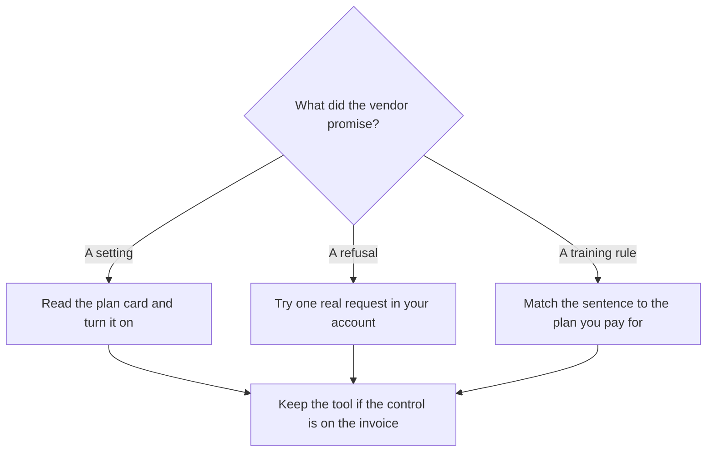

**AI alignment is the work of making a model's behavior match a stated intent: answer the task, refuse the tasks you named, and stay inside the data rules you signed.** "Safety" on a product page is a bundle of those behaviors plus the controls around them. A slogan that the model is "aligned" is a claim about intent. The part you can buy is a setting, a refusal, a retention rule, or an admin switch.

This page is for someone choosing a tool. It is a map of what a buyer can verify. The standing instructions a product applies before your prompt are [what a system prompt is](/blog/what-is-a-system-prompt-2026/). A confident wrong sentence has its own name: [what an AI hallucination is](/blog/what-is-ai-hallucination-2026/).

Prices are US list prices excluding tax from directory pages checked October 16, 2026, except Granola's plan cards, which were read on the pricing page on October 24, 2026. Published October 24, 2026.

## What you can check, and what you are taking on faith

| Claim you might hear | What you can actually inspect | What remains a research claim |
|---|---|---|
| "It refuses harmful requests" | Try the category you care about, in your account, this week | How the lab trained that refusal |
| "We do not train on your data" | The plan's opt-out or the enterprise contract, in writing | What a subprocessors' older training set contained |
| "Admins can turn training off for the team" | An admin control, such as Granola Enterprise's workspace-wide opt-out | A personal toggle on a free seat |
| "It cites sources" | Whether the link opens and matches the sentence | A quality score nobody published for your corpus |
| "Enterprise includes audit logs" | The plan that lists them, and a sample export | A logo on the marketing page |

Training versus the reply you get today is [what AI inference versus training is](/blog/what-is-ai-inference-vs-training-2026/). A model can refuse at inference time and still have been trained on a broad web corpus. Those are different sentences. Ask which one the contract covers.

## Controls that show up on real plan cards

| Control | Where it showed up | Price context |
|---|---|---|
| A personal opt-out of model training | [Granola](/tools/granola/) Basic, Business, and Enterprise | Basic is $0. Business is $14/user/month. Enterprise is $35/user/month, and the opt-out there is workspace-wide |
| Workspace admin, SSO, and audit | Granola Enterprise, and similar lines on other enterprise cards | The $35 Granola card lists SSO, SCIM, an audit API, and HIPAA-compliant workspaces |
| Business data excluded from training by default | [ChatGPT](/tools/chatgpt/) Business, as described on the directory page | Business is $20/user/month billed annually, with a two-user minimum, or $25 monthly |
| A full agent on your own wiki, with Notion's training statement | [Notion AI](/tools/notion-ai/) | Business is $20/seat/month. Notion says customer data is not used to train its AI subprocessors' models |
| A general assistant with a published plan ladder | [Claude](/tools/claude/) and [Gemini](/tools/gemini/) | Claude Pro is $20/month, or $17 billed annually. Google AI Plus is $4.99/month |

Granola's cards were read October 24, 2026. The other prices are from directory pages checked October 16, 2026. ChatGPT's ladder is [ChatGPT Go vs Plus vs Pro](/blog/chatgpt-go-vs-plus-vs-pro-2026/). Notion's seat is [Notion AI pricing explained](/blog/notion-ai-pricing-explained-2026/).

A free plan can be the right place to learn a product. It is a weak place to store the only copy of a customer conversation if the retention rule is "30 days" or "we may use chats to improve the model." Read the line that matches the plan you will actually pay for. Enterprise language on a homepage does not apply to a personal seat until the invoice says so.

## What alignment is for a team that ships text

**Name the behaviors you need, in plain language.** "Safe" is a marketing word. "Do not invent a refund amount," "do not send the email," and "do not train on this workspace" are behaviors. Put the first two in the instructions your team uses. Put the third in the contract.

**Test the refusal on a task you actually have.** A model that refuses a cartoonish request and then drafts a deceptive customer email has answered the demo. Your test is the email. Keep a short list of prompts your industry cares about, and rerun them when you change models.

**Separate a wrong answer from a harmful one.** A hallucinated date is a quality problem. A draft that tells a customer to ignore a safety notice is a harm problem. Both need a person. They need different reviews. The quality review is [how to fact-check AI writing](/blog/how-to-fact-check-ai-writing-2026/).

**Open-weight models move the control to you.** You can run a model whose weights are public, and you then own the data path and the refusal behavior you did not build. The definition is [what open-source AI is](/blog/what-is-open-source-ai-2026/). Publishing the weights is a distribution choice. It is a separate question from whether the behavior matches your policy.

## FAQ

### Is a model that refuses more questions "more aligned"?

It is more aligned with a policy that says refuse those questions. A refusal that blocks a legitimate work task is a product bug for you, even if a lab calls it caution. Write down the tasks that must succeed and the tasks that must stop.

### Does paying for Enterprise buy alignment?

It buys the controls on that plan: admin, retention, SSO, audit, and sometimes a training opt-out for the whole workspace. It does not buy a guarantee that every sentence is true. You still read the output.

### Should I trust a benchmark that says a model is safe?

Use it as a lab's report on the tests they ran. Your account, your data, and your prompts are a different test. Re-run the three tasks you cannot afford to get wrong.

### Who is responsible for the text we send?

The person who sends it. A vendor's alignment work changes how often a bad draft appears. It does not sign the email.

## Last verified

October 24, 2026 for Granola's plan cards and the controls listed on them. October 16, 2026 for ChatGPT, Claude, Gemini, and Notion prices. Published October 24, 2026.

**Sources:** [Granola pricing](https://www.granola.ai/pricing), [OpenAI ChatGPT pricing](https://openai.com/chatgpt/pricing/), [Notion AI](https://www.notion.com/product/ai).

*Published by Andrew for [AI Tools Optimizer](https://aitoolsoptimizer.com).*

[Claude](/tools/claude/) and [ChatGPT](/tools/chatgpt/) are in the [chatbots directory](/tools/category/chatbots-assistants/). Directory pages may use affiliate links. A purchase through them may earn us a commission at no extra cost to you.
