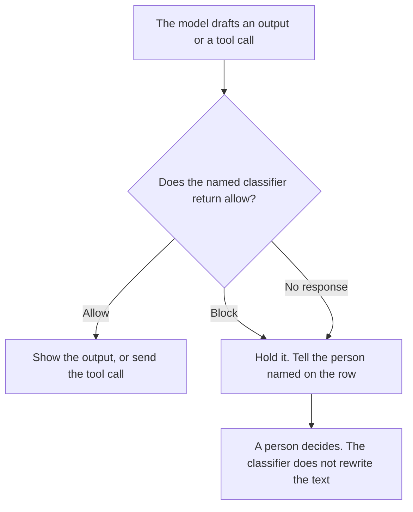

**An AI safety classifier gate is a named check that must return allow before an output is shown or a tool call is sent.** If the classifier returns block, or if it does not return at all, the output stays held. Stripping a secret from text that you will still show is [what an AI output redaction pass is](/blog/what-is-ai-output-redaction-pass-2026/). Whether the agent may call a tool at all is [what an AI tool permission gate is](/blog/what-is-ai-tool-permission-gate-2026/).

The note a person writes when an answer was wrong is [how to write a hallucination escalation note with AI](/blog/how-to-write-a-hallucination-escalation-note-with-ai-2026/). A classifier block is not that note. The note is for a person. The gate is for the next response.

Claude's prices are the October 24, 2026 read of claude.com/pricing recorded in [Claude pricing explained](/blog/claude-pricing-explained-2026/). ChatGPT's Plus price is the same-day plan-page figure recorded in [ChatGPT vs Claude for stakeholder updates](/blog/chatgpt-vs-claude-for-stakeholder-updates-2026/). Notion and Grammarly prices are from directory pages checked October 16, 2026. Published October 24, 2026. We did not measure classifier accuracy. The directory does not list a classifier-gate fee.

## What the gate has to name

| Piece | Who sets it | A blank means |
|---|---|---|
| Classifier id | You | Any model score can be treated as the gate |
| What it sees | The output, the tool arguments, or both, as you wrote | The check runs on a field you did not mean |
| Allow and block | The labels you accept | A new label is treated as allow |
| On block | Hold, and who is told | The user sees the text with a warning banner |
| On no response | Hold | A timeout becomes a pass |

Redaction can run after an allow, if the policy says a name must be removed and the rest may ship. Redaction is not an allow. A blocked output does not go to the redaction pass to be "cleaned up" and shown. Hold means hold.

A permission gate answers a different question: is this tool on the allowlist for this agent? A classifier gate answers whether this particular output or these particular arguments may proceed. A tool can be permitted and still be blocked for this call. A classifier allow does not put a new tool on the allowlist.

We did not publish a false-positive rate. If you have one, it belongs in your eval, on cases you froze. It does not belong as a adjective on this page.

## Where the rule is kept

**The definition.** [Claude](/tools/claude/) Pro is $17 a month billed annually, $200 up front, or $20 monthly. The Project holds the classifier id and the on-block action. The review is [Claude review](/blog/claude-review-2026/).

**One draft of the hold message a person will see.** [ChatGPT](/tools/chatgpt/) Plus is $20 a month on the October 24 plan page. The message says the output was held. It does not explain the classifier's private score as if it were a reason you verified. The ladder is [ChatGPT pricing explained](/blog/chatgpt-pricing-explained-2026/).

**The register.** [Notion AI](/tools/notion-ai/) Business is $20 a seat a month. One row per gate: classifier id, what it sees, owner, review date. The invoice is [Notion AI pricing explained](/blog/notion-ai-pricing-explained-2026/).

**A clarity pass on the hold message, after the words are stable.** [Grammarly](/tools/grammarly/) Pro is $12 a member a month billed annually, or $30 monthly. Reject a suggestion that says the content was "unsafe" if your row only says held. The invoice is [Grammarly pricing explained](/blog/grammarly-pricing-explained-2026/).

A prompt that holds the line:

"Draft the classifier-gate row from the classifier id, the field it sees, and the on-block action I pasted. If the classifier id is missing, write Classifier not set. Do not mark allow. Do not describe a score."

## What not to delegate

Do not ask the model to be its own gate and its own author in the same step. Do not treat a vendor's default filter as your classifier id until you have written the id down. Do not show a blocked output because a reviewer is offline. The on-block action is hold until a person is named. A timeout is a hold.

## FAQ

### How is this different from a redaction pass?

Redaction removes a class of text and can still show the rest. The classifier gate decides whether the output may be shown at all. You can redact after an allow. You do not redact a block in order to ship it. If the row says hold, the user does not see a cleaned version unless a person writes a new decision.

### How is this different from a tool permission gate?

Permission says this agent may call this tool. The classifier says this call, or this output, may proceed. An allowlist is not a content check. A content check is not an allowlist. A new tool needs a permission row. A risky argument on an allowed tool needs the classifier row, if you wrote one.

### How is this different from an escalation note?

The note is a record a person files after a bad answer, with an owner and a next step. The gate is automatic, and it acts before the user sees the output. A block can lead to a note. The note does not unblock the output. A person does.

### Who may turn the gate off?

The owner named on the row, in a change you can read later. A demo is not a reason to fail open. If the classifier is down, the written action is hold. Do not swap in a different model and call it the same classifier id.

## Last verified

October 24, 2026 for Claude and for ChatGPT's plan page, via the posts cited above. October 16, 2026 for Notion and Grammarly. Published October 24, 2026.

**Sources:** [Claude pricing](https://claude.com/pricing), [ChatGPT and Codex pricing](https://learn.chatgpt.com/docs/pricing), [Notion pricing](https://www.notion.com/pricing), [Grammarly pricing](https://www.grammarly.com/plans).

*Published by Andrew for [AI Tools Optimizer](https://aitoolsoptimizer.com).*

[Claude](/tools/claude/) is in the [chatbots and assistants directory](/tools/category/chatbots-assistants/). Directory pages may use affiliate links. A purchase through them may earn us a commission at no extra cost to you.
