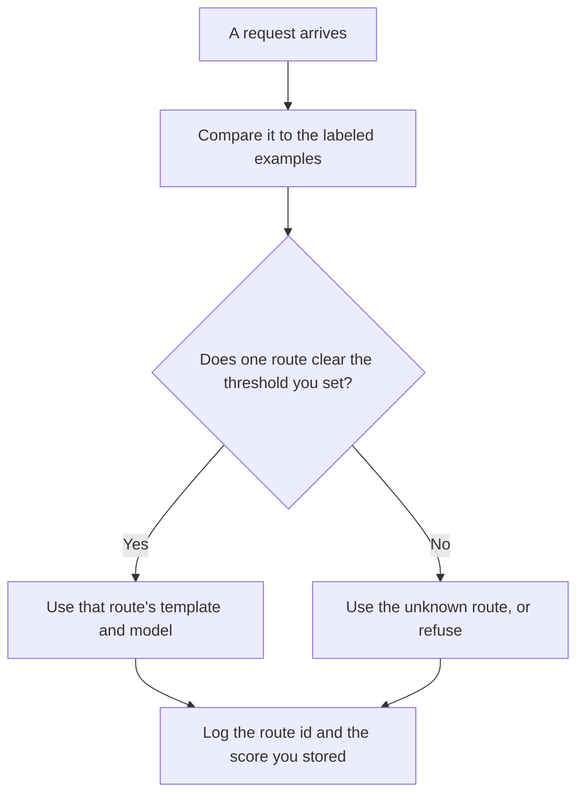

**An AI semantic router sends a request to a route by comparing its meaning to example phrases you already labeled, then uses the template and model that route names.** The comparison is usually an embedding. A keyword you can point at is a different router. If you can explain the match with a list, use the list.

The table that sends a labeled request to a template, when the label is a rule you can check, is [what an AI prompt router is](/blog/what-is-ai-prompt-router-2026/). The numbers the comparison uses are [what embeddings are](/blog/what-is-embeddings-in-ai-2026/). Mixing a keyword pass with a similarity pass is [what retrieval hybrid search is](/blog/what-is-retrieval-hybrid-search-2026/). Choosing the first model before any of this runs is [what AI routing is](/blog/what-is-ai-routing-2026/).

Prices are US list prices excluding tax from directory pages checked October 16, 2026. Published October 24, 2026. The directory does not list a semantic-router fee. We did not measure routing accuracy.

## What you write before the first request

| Piece | You write | A router that will misfile |
|---|---|---|
| Examples | A few phrases per route, that a person labeled | One vague sentence per route |
| Threshold | A similarity floor, or an unknown bucket when nothing clears it | "The closest route always wins" |
| Route | A template id and a model id | "The best model" |
| Ties | Which route wins, or unknown | Two templates in one turn |
| Review | A sample of mistakes you will read | A dashboard nobody opens |

The closest route is not always the right route. A billing question and a refund question will sit near each other. If your threshold is missing, every sentence gets a route, including the ones that should have been refused. The unknown bucket is part of the router.

## Where the examples live

**The example set.** [Claude](/tools/claude/) Pro is $20 a month, or $17 billed annually, when the phrases are long enough to review in a Project. The model may group phrases you already labeled. It may not invent a route. The review is [Claude review](/blog/claude-review-2026/).

**A short set.** [ChatGPT](/tools/chatgpt/) Plus is $20 a month when you have a dozen routes. The review is [ChatGPT review](/blog/chatgpt-review-2026/).

**The code that scores them.** [Cursor](/tools/cursor/) Plus is $8 a month, or $80 a year, when the router is a file. You review the threshold. A generated change that deletes the unknown route is a defect. The ladder is [Cursor pricing explained](/blog/cursor-pricing-explained-2026/).

**A cited lookup, which is not this router.** [Perplexity](/tools/perplexity/) Pro is $17 a month billed annually when the job is an answer with sources, not a dispatch inside your app. Do not call a search product a semantic router because it "understands" the question. The invoice is [Perplexity pricing explained](/blog/perplexity-pricing-explained-2026/).

A prompt that holds the line:

"Draft route cards from the route names and example phrases I pasted. Do not add a route. Do not delete the unknown route. If a route has no examples, write Examples missing and stop."

## What not to delegate

Do not let the router add routes from traffic you have not labeled. Do not hide the route id from the log. When an answer is wrong, you need the route that produced it. A change to the embedding model can move neighbors without a prompt edit. That shift is [what embedding drift is](/blog/what-is-embedding-drift-2026/).

## FAQ

### How is a semantic router different from a prompt router?

A prompt router matches a label you can check: a menu choice, a keyword list, a field on the ticket. A semantic router matches by meaning against examples. Use the prompt router when the label is already on the request. Use the semantic router when the user types a sentence and you have labeled examples. Many products need the rule first and the semantic match only for the leftover.

### What goes in the unknown route?

A refusal, a clarifying question, or a human queue. It should not be your most powerful model "just in case." Unknown is where mistakes and new intents show up. Read it.

### How many examples does a route need?

Enough that a person can see the boundary, and few enough that you will re-read them when you add a phrase. A route with one example will steal its neighbors. A route with a thousand unreviewed examples is a dump.

### Should I log the similarity score?

Yes, if you have one. You do not need to show it to the user. You need it when you decide whether the threshold is too low. A score without the route id is not a log.

## Last verified

October 16, 2026 for Claude, ChatGPT, Cursor, and Perplexity. No semantic-router fee is recorded in the directory. Published October 24, 2026.

**Sources:** [Claude pricing](https://claude.com/pricing), [ChatGPT pricing](https://chatgpt.com/pricing/), [Cursor pricing](https://cursor.com/help/account-and-billing/pricing), [Perplexity pricing](https://www.perplexity.ai/pro).

*Published by Andrew for [AI Tools Optimizer](https://aitoolsoptimizer.com).*

[Perplexity](/tools/perplexity/) is in the [research and search directory](/tools/category/research-search/). Directory pages may use affiliate links. A purchase through them may earn us a commission at no extra cost to you.
