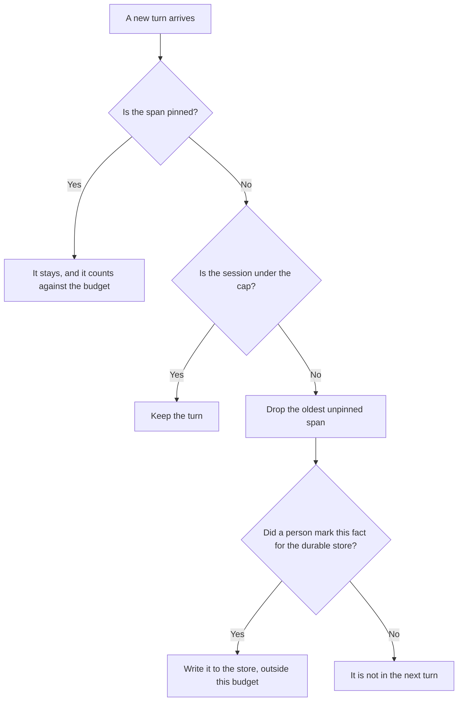

**An AI session memory budget is a cap, in tokens or in kept items, on what an agent may carry forward from earlier turns of this session.** When the cap is hit, something you already ranked as droppable leaves the window. Durable facts you meant to keep across sessions live in a store, which is [what an AI agent memory store is](/blog/what-is-ai-agent-memory-store-2026/). A span you refuse to drop even inside the window is [what AI context pinning is](/blog/what-is-ai-context-pinning-2026/).

How many tool calls the same session may make is [what an AI tool call budget is](/blog/what-is-ai-tool-call-budget-2026/). That budget counts calls. This one counts memory.

Claude's prices are from claude.com/pricing on October 24, 2026. ChatGPT, Cursor, and Notion prices are from directory pages checked October 16, 2026. chatgpt.com/pricing returned HTTP 403 on October 24. Published October 24, 2026. We did not measure how much a session remembers.

## What the budget counts

| You cap | A hit means | A hit does not mean |
|---|---|---|
| Tokens of prior turns kept in this session | Older unpinned turns drop, in the order you wrote | The durable store is erased |
| A count of kept notes | The lowest-ranked note leaves | A pinned instruction leaves |
| What may be stored at all | A secret you marked "do not keep" is not written into the next turn | The model forgot a fact that was pinned |
| The session, not the account | The next session starts under the same cap | Last month's project memory is this session |

A budget you never set is the model's window, and the window is not a policy. Write the number. Write what is pinned. Write what is forbidden to keep. A transcript of a customer call is not automatically allowed to ride into the next ten turns because it fit.

## Where the cap is written

**The project instructions.** [Claude](/tools/claude/) Pro is $17 a month billed annually, $200 up front, or $20 monthly. Put the cap and the pin list where the session starts. The review is [Claude review](/blog/claude-review-2026/).

**A short working session.** [ChatGPT](/tools/chatgpt/) Plus is $20 a month on the October 16 card. A saved chat is still a session. Do not paste a secret so the model "has context." The review is [ChatGPT review](/blog/chatgpt-review-2026/).

**The repo rule.** [Cursor](/tools/cursor/) Plus is $8 a month, or $80 a year. If the agent keeps a file's contents across turns, that file counts. The ladder is [Cursor pricing explained](/blog/cursor-pricing-explained-2026/).

**The note that outlives the session.** [Notion AI](/tools/notion-ai/) Business is $20 a seat a month. A fact the team must still know next week belongs on a page, which is the store, not the session budget. The invoice is [Notion AI pricing explained](/blog/notion-ai-pricing-explained-2026/).

A prompt that holds the line:

"List what this session may keep, using only the cap and the pin list I pasted. If the cap is missing, write Cap not set. Do not copy a secret into the kept list."

## What not to delegate

Do not ask the model what is safe to remember. Do not treat a large window as a budget. A window is a maximum the product allows. A budget is the smaller number you chose. Do not pin everything. A pin that covers the whole transcript has no budget left to manage.

## FAQ

### How is this different from a memory store?

The store is what you meant to keep after the session ends. The session budget is what this conversation may hold while it is open. A fact can be in the store and still be absent from the next turn, until something retrieves it. A fact in the session is not therefore in the store.

### How is this different from context pinning?

Pinning says this span does not drop. The budget says how much may stay, including pins. If the pins alone exceed the budget, the configuration is wrong. Shrink the pins or raise the budget on purpose. Do not drop a pin to make the numbers fit.

### How is this different from a tool-call budget?

Tool-call budget limits how many tools run. Session memory budget limits how much prior text stays. A session can have calls left and no room for another turn of notes, or the reverse.

### Who picks the number?

The owner of that agent or that workspace. Write it next to the pin list. A default you never read is not a decision, and it will keep the wrong thing the first time a secret is in the transcript.

## Last verified

October 24, 2026 for Claude. October 16, 2026 for ChatGPT, Cursor, and Notion. No session-memory line item is on those seat pages. Published October 24, 2026.

**Sources:** [Claude pricing](https://claude.com/pricing), [ChatGPT pricing](https://chatgpt.com/pricing/), [Cursor pricing](https://cursor.com/help/account-and-billing/pricing), [Notion pricing](https://www.notion.com/pricing).

*Published by Andrew for [AI Tools Optimizer](https://aitoolsoptimizer.com).*

[Claude](/tools/claude/) is in the [chatbots and assistants directory](/tools/category/chatbots-assistants/). Directory pages may use affiliate links. A purchase through them may earn us a commission at no extra cost to you.
